# IronMesh Architecture

C4 model of the IronMesh IoT security framework and fleet-management platform: system context,
containers, components for the PKI and the device agent, runtime sequences, data flows across trust
boundaries, deployment views and the design decisions behind them.

Normative sources, in order of precedence:

| Document                                                | Scope                                                                                        |
|---------------------------------------------------------|----------------------------------------------------------------------------------------------|
| [`docs/DESIGN_CONTRACT.md`](docs/DESIGN_CONTRACT.md)    | Identifiers, PKI hierarchy and certificate profiles, EST and attestation, MQTT, COSE envelope, firmware manifest, services and ports, tenancy, observability names, assurance levels |
| [`docs/API_CONTRACT.md`](docs/API_CONTRACT.md)          | REST and WebSocket interfaces of registry, OTA, anomaly, policy and PKI management; console proxy conventions; RBAC roles; Redpanda topics |
| [`THREAT_MODEL.md`](THREAT_MODEL.md)                    | STRIDE threats, mitigations and the code that implements them                                 |
| [`COMPLIANCE_MATRIX.md`](COMPLIANCE_MATRIX.md)          | Mapping of controls to ETSI EN 303 645, NIST IR 8259A, IEC 62443-4-2 and the EU CRA           |

Where this document and a contract disagree, the contract wins. Diagrams use Mermaid and render on
GitHub; identifiers in diagrams (`dev-...`, `im/v1/...`, port numbers) are the contract's.

## 1. System context (C4 level 1)

IronMesh sits between a fleet of MQTT devices, the people who operate them, and the external
systems that hold keys, identities and security events. Devices never talk to anything but the
broker, the EST endpoint and the firmware artifact store; operators never talk to anything but the
console.

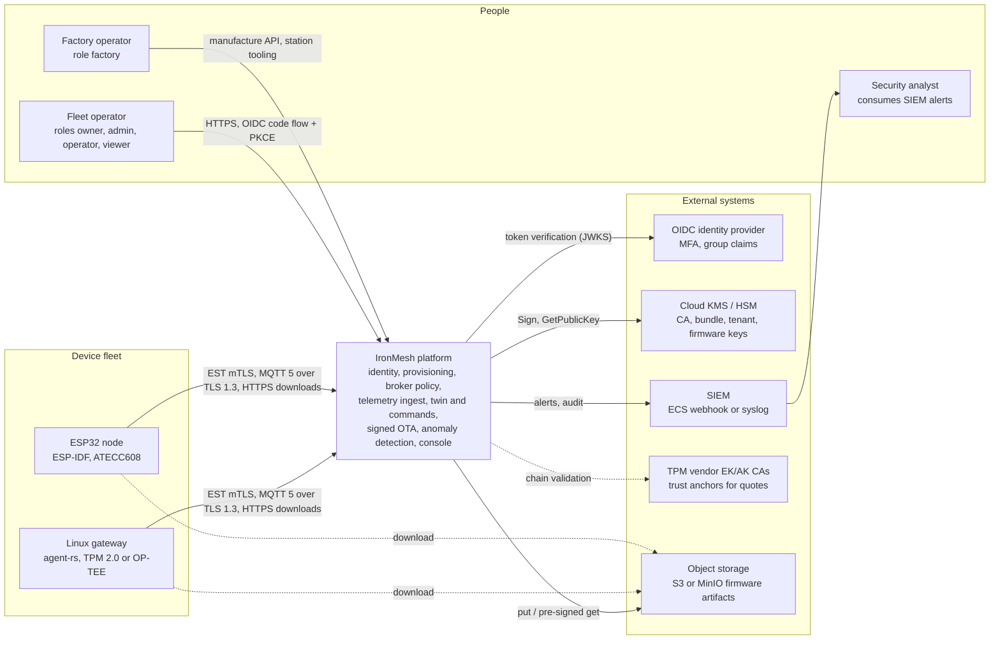

| Actor or system        | Relationship to IronMesh                                                                                                                                                 |
|------------------------|--------------------------------------------------------------------------------------------------------------------------------------------------------------------------|
| Fleet operator         | Uses the console to watch the fleet, manage groups, twins, commands, configuration, campaigns and alerts. Authenticated by the tenant's OIDC provider; authorised by RBAC roles `owner`, `admin`, `operator`, `viewer` (`docs/API_CONTRACT.md` section 0). |
| Factory operator       | Runs the manufacturing station: asks the registry to mint device ids, drives key generation in the secure element, obtains bootstrap certificates from the Factory CA, burns eFuses. Role `factory`. |
| Security analyst       | Receives alerts and audit events in the organisation's SIEM; may act in the console.                                                                                      |
| Linux gateway          | Runs `device/agent-rs` with a TPM 2.0 or OP-TEE identity; publishes telemetry, executes commands, applies A/B firmware updates.                                            |
| ESP32 node             | Runs `device/esp32` with an ATECC608 identity; same protocol surface as the gateway with constrained buffers.                                                              |
| OIDC identity provider | Issues the access tokens the console forwards; IronMesh verifies them against the JWKS and reads `tenant_id` and group claims.                                             |
| Cloud KMS / HSM        | Holds every long-lived private key: Device, Services and Factory CA keys, the PKI bundle key, per-tenant command keys and firmware signing keys. Keys never leave.          |
| SIEM                   | Receives `Alert` and `AuditEvent` records; the only outbound integration from the anomaly engine.                                                                           |
| TPM vendor CAs         | Trust anchors for the AK certificates inside TPM quotes (`services/pki/internal/attest/verify.go`, `Policy.AKRoots`).                                                     |
| Object storage         | Holds firmware images, manifests and delta patches; devices download through pre-signed URLs.                                                                              |

## 2. Containers (C4 level 2)

Every deployable unit from `docs/DESIGN_CONTRACT.md` section 7, with the console's proxy path made
explicit: the browser only ever reaches the console origin; Next.js route handlers under
`/api/proxy/<service>/...` forward each request server-side with the user's access token, and PKI
management calls are reached through the registry.

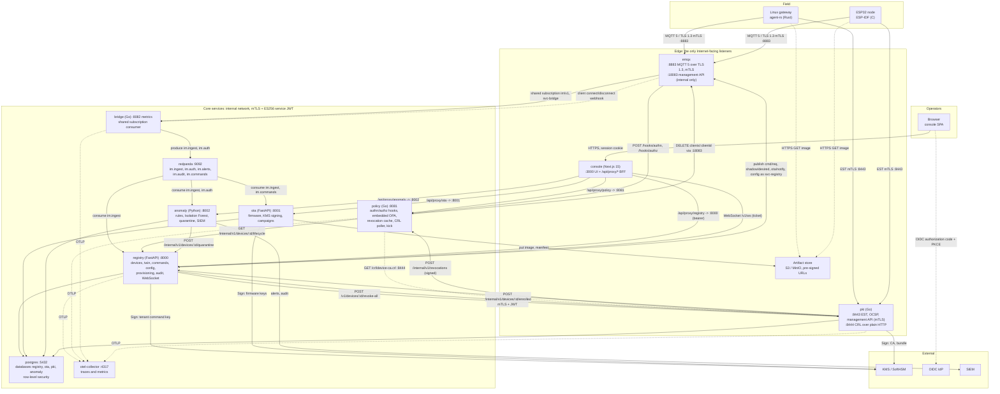

| Container        | Technology            | Ports and protocols                                                                 | Authenticates callers by                                                        | Owns                                                                                                   |
|------------------|-----------------------|-------------------------------------------------------------------------------------|---------------------------------------------------------------------------------|--------------------------------------------------------------------------------------------------------|
| `emqx`           | EMQX 5 (Erlang)       | 8883 MQTT 5 over TLS 1.3 only, ALPN `mqtt`, mTLS; 18083 HTTPS management (internal) | Client certificate chaining to Device CA or Services CA; `peer_cert_as_username = cn`; every CONNECT and every publish/subscribe delegated to `policy` | Sessions (7 d expiry, receive maximum 32), retained messages for `shadow/desired`, `ota/notify`, `config` |
| `pki`            | Go                    | 8443 HTTPS mTLS: `/.well-known/est/*`, `/ocsp`, `/v1/*` management; 8444 HTTP: `/crl/device-ca.crl` | Device bootstrap or operational certificate on EST; Services CA certificate + ES256 service JWT on management API | CA issuance (`internal/ca`), attestation verification (`internal/attest`), nonces, certificates and revocations (`internal/store`), CRL, OCSP, revocation push |
| `policy`         | Go                    | 8081 HTTPS (mTLS from EMQX and services): `/hooks/authn`, `/hooks/authz`, `/internal/v1/revocations`, `/v1/policy*`, `/v1/revocations` | mTLS Services CA; signed revocation events from PKI; OIDC bearer (roles) on `/v1/*` via the console proxy | Embedded Rego policy and its versions, revocation cache (persisted snapshot), lifecycle lookup cache, EMQX kick client |
| `bridge`         | Go                    | 8082 HTTP metrics only; MQTT client to 8883; Kafka client to 9092                   | Connects to EMQX with Services CA certificate CN `svc-bridge`; SASL/SCRAM + TLS to Redpanda | Nothing durable: forwards raw COSE bytes with broker metadata to `im.ingest` and EMQX client events to `im.auth` |
| `registry`       | Python 3.12, FastAPI  | 8000 HTTPS: `/v1/*`, `/v1/ws`, `/internal/v1/*`                                      | OIDC bearer or `imk_` API key on `/v1/*`; mTLS + service JWT on `/internal/v1/*` | Devices, lifecycle, groups, twin, commands, encrypted config, provisioning queue, fleet summary, audit, users and API keys; `registry` database |
| `ota`            | Python 3.12, FastAPI  | 8001 HTTPS: `/v1/firmware*`, `/v1/campaigns*`, `/v1/signing-keys`, `/internal/v1/*`  | As registry                                                                     | Firmware records, signed manifests, delta patches, campaigns and stages; `ota` database; artifact store objects |
| `anomaly`        | Python 3.12           | 8002 HTTPS: `/v1/alerts*`, `/v1/rules*`, `/v1/quarantine`, `/v1/settings`; Kafka consumer | As registry                                                                     | Rules, per-tenant Isolation Forest models, alerts, quarantine log, SIEM sink; `anomaly` database        |
| `console`        | Next.js 15, TypeScript| 3000 HTTPS (behind 443): pages, `/api/proxy/<service>/*`, OIDC callback             | OIDC session cookie (httpOnly, SameSite=Strict); forwards the bearer token server-side | No business data; generated API client checked against each service's `/openapi.json` in CI            |
| `redpanda`       | Redpanda              | 9092 Kafka protocol, TLS + SASL/SCRAM                                               | Per-service SASL principals and ACLs                                            | Topics `im.ingest`, `im.auth`, `im.alerts`, `im.audit`, `im.commands`                                   |
| `postgres`       | PostgreSQL 16         | 5432 TLS                                                                            | Per-service roles; application roles `NOBYPASSRLS`                              | Databases `registry`, `ota`, `pki`, `anomaly`                                                           |
| `otel-collector` | OpenTelemetry         | 4317 OTLP gRPC                                                                      | Cluster-internal only                                                           | Traces and metrics export to Prometheus and the tracing backend                                         |
| Artifact store   | S3 or MinIO           | HTTPS                                                                               | Pre-signed URLs issued by `ota`; bucket versioning and object lock              | `image.bin`, `manifest.cbor`, `manifest.sig`, delta patches                                             |
| KMS              | AWS KMS or SoftHSM    | Provider API or PKCS#11                                                             | Workload identity (IRSA) per service; key policies per key class               | All long-lived private keys                                                                             |

The `file` KMS backend (`services/pki/internal/kms/file/file.go`) exists for local development only;
it logs a warning on first use and the production profile refuses it (THREAT_MODEL T-74).

## 3. Components (C4 level 3)

### 3.1 PKI service (`services/pki`)

The PKI is a single Go binary with one HTTPS listener for EST, OCSP and the management API (8443,
mTLS) and one plain HTTP listener for the CRL (8444). Its packages are deliberately layered: `est`
speaks RFC 7030, `attest` verifies evidence, `ca` builds and signs certificates, `kms` is the only
code that touches private keys, and `store` is the only code that touches the database.

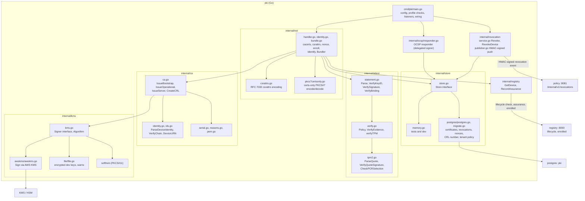

| Component                   | Responsibility                                                                                                                                              | Entry points                                                                                                  |
|-----------------------------|-------------------------------------------------------------------------------------------------------------------------------------------------------------|---------------------------------------------------------------------------------------------------------------|
| `cmd/pki/main.go`           | Load configuration, refuse unsafe profiles (file KMS in prod), build the CA set from KMS-backed signers, start listeners, wire the revocation publisher     | `main`, `requireProductionKMS`                                                                                 |
| `internal/est/handler.go`   | RFC 7030 operations plus the IronMesh nonce endpoint; `enroll(reenroll bool)` orchestrates the pipeline below; counts every outcome per operation           | `NewHandler`, `Register`, `cacerts`, `csrattrs`, `nonce`, `enroll`, `readCSR`, `policyFor`, `failAttestation`    |
| `internal/est/identity.go`  | Resolve the TLS client identity: chain to Factory CA or Device CA, EKU, revocation lookup, device id and tenant extraction                                  | `Identify`                                                                                                      |
| `internal/est/bundle.go`    | Build and sign the `X-IronMesh-Bundle` (tenant command public key, firmware signing keys, broker host and port, CA pins) with the bundle key; device-side verifier used by tests | `NewBundler`, `Build`, `BuildHeader`, `VerifyBundle`                                                   |
| `internal/est/csrattrs.go`, `pkcs7certsonly.go` | Wire encodings: `csrattrs` OID list, `application/pkcs7-mime; smime-type=certs-only` bodies                                             | `EncodeCSRAttrs`, `EncodeCertsOnly`, `DecodeCertsOnly`                                                         |
| `internal/attest/statement.go` | Decode the COSE_Sign1 attestation (`type=10`), check the `kid` against the TLS certificate serial, verify the ES256 signature with the TLS client key, bind `sha256(csr_der)` | `Parse`, `VerifyKeyID`, `VerifySignature`, `VerifyBinding`                                                  |
| `internal/attest/verify.go` | Apply the tenant attestation `Policy` (software keys allowed, PCR digest allowlist, AK roots, required PCRs) and return the assurance level                 | `VerifyEvidence`, `AssuranceFor`, `verifyTPM`                                                                  |
| `internal/attest/tpm2.go`   | Parse `TPMS_ATTEST` and `TPMT_SIGNATURE`, verify the quote signature with the AK, check PCR selection 0,2,4,7 and the nonce as qualifying data              | `ParseQuote`, `ParseSignature`, `VerifyQuoteSignature`, `CheckPCRSelection`, `PCRDigest`                        |
| `internal/ca/ca.go`         | Certificate profiles from the contract (subject, SAN URI, EKU, validity, CRL DP and AIA), signing through `kms.Signer`, CRL generation                    | `New`, `IssueBootstrap`, `IssueOperational`, `IssueServer`, `IssueOCSPSigner`, `CreateCRL`, `ValidateOperationalTTL` |
| `internal/ca/identity.go`, `ids.go` | Extract and validate device identity from a certificate (CN device id, OU tenant, SAN URN), verify chains with the right EKU                        | `ParseDeviceIdentity`, `VerifyChain`, `ValidateDeviceID`, `ValidateTenantID`, `DeviceURN`                      |
| `internal/ca/serial.go`     | 128-bit CSPRNG serials and their canonical hex form (also the COSE `kid`)                                                                                   | `NewSerial`, `FormatSerial`, `ParseSerial`                                                                      |
| `internal/kms`              | `Signer` abstraction over AWS KMS, SoftHSM (PKCS#11) and the development file backend; algorithms P-256, P-384, Ed25519                                    | `kms.Signer`, `awskms.Provider.Open`, `awskms.Signer.Sign`, `file.Provider.warn`                               |
| `internal/store`            | `Store` interface with in-memory and Postgres implementations: certificates, revocations, single-use nonces, CRL numbers, per-tenant attestation policy    | `PutCertificate`, `ListCertificatesByDevice`, `AddRevocation`, `PutNonce`, `ConsumeNonce`, `DeleteExpiredNonces`, `NextCRLNumber`, `GetTenantPolicy` |
| `internal/ocsp/responder.go`| RFC 6960 responder signed by a delegated OCSP signer certificate                                                                                            | `ServeHTTP`                                                                                                     |
| `internal/revocation`       | `Revoke` one serial or `RevokeDevice` (every valid serial of a device): store the revocation, trigger CRL regeneration and OCSP invalidation, publish the event; `HTTPPublisher` posts it to policy with a bearer token and an HMAC-SHA256 body signature, retrying until acknowledged | `Service.Revoke`, `Service.RevokeDevice`, `HTTPPublisher.Publish`, `Sign`, `VerifySignature`           |
| `internal/registry`         | Client for the registry's internal API: lifecycle lookup before issuance, assurance level and enrollment notification after issuance                        | `GetDevice`, `RecordAssurance`                                                                                  |
| `internal/ceremony`, `internal/shamir` | Offline and factory ceremonies as code: Root CA initialisation with Shamir-split key shares (M-of-N), root recovery, intermediate and bundle-key initialisation, bootstrap and server certificate issuance, plus clients for revoke, CRL fetch and OCSP checks | `InitRoot`, `RecoverRoot`, `InitIntermediate`, `InitBundleKey`, `IssueBootstrap`, `IssueServer`, `shamir.Split`, `shamir.Combine` |

Enrollment pipeline in `enroll` (the order is the security argument; each step fails closed and is
counted in `ironmesh_auth_failures_total`):

1. TLS layer: client certificate chains to the Factory CA (first enrollment) or to the Device CA for
   the same device id (re-enrollment), EKU `clientAuth` (`est.Identify` over `ca.VerifyChain` and
   `ca.ParseDeviceIdentity`).
2. Presenting certificate is not revoked (`store.GetRevocation`, inside `Identify`).
3. Lifecycle state from the registry is `manufactured`, `provisioned` or `active`.
4. `X-IronMesh-Attestation` parses (`attest.Parse`); `kid` equals the TLS certificate serial
   (`VerifyKeyID`); signature verifies with the TLS client public key (`VerifySignature`).
5. Nonce is consumed atomically and was issued to this certificate serial (`store.ConsumeNonce`).
6. `sha256(csr_der)` equals attestation claim 2 (`VerifyBinding`); CSR CN equals the device id and
   CSR OU equals the tenant from the certificate; CSR public key was never certified for this device.
7. Evidence satisfies the tenant policy (`VerifyEvidence`): `software` only when allowed; `tpm2`
   quote signature, AK chain to `Policy.AKRoots`, PCR selection and digest allowlist, nonce as
   qualifying data; `atecc608` and `optee` cross-checked against the manufacture record.
8. Issue the operational certificate (`ca.IssueOperational`), persist it (`store.PutCertificate`),
   revoke the superseded serial, notify the registry (`POST /internal/v1/devices/{id}/enrolled`).
9. Build and sign the bundle with the bundle key (`Bundler.BuildHeader`), return `certs-only` PKCS#7
   (`EncodeCertsOnly`) plus `X-IronMesh-Bundle`.

### 3.2 Device agent (`device/agent-rs`)

The Linux agent is a single Rust binary supervised by systemd. It is organised so that everything
that touches a private key sits behind the `Identity` trait, everything that parses untrusted bytes
sits in the `wire` crate (`#![forbid(unsafe_code)]`, fuzzed), and every network path is pinned.

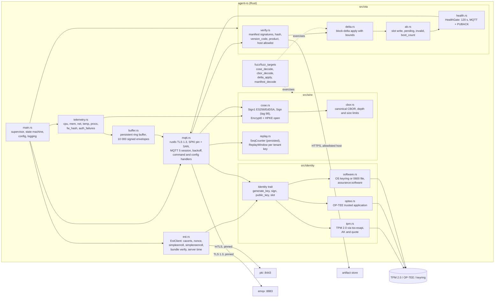

| Component                | Responsibility                                                                                                                                                   | Key symbols                                                                               |
|--------------------------|------------------------------------------------------------------------------------------------------------------------------------------------------------------|-------------------------------------------------------------------------------------------|
| `src/main.rs`, `src/agent.rs` | CLI entry and agent runtime: enrolment, MQTT session, uplink publishing, downlink verification, renewal and OTA health tasks                                  | `main`, `run_service`, `enroll_now`, `publish_uplink`, `verify_downlink`, `renewal_task`, `health_task` |
| `src/identity/*`         | One trait, three hardware backends plus software; keys are generated inside the backend and never serialised in clear; the software backend marks the identity so the certificate gets OU `assurance:software` | `identity_template`, `generate_operational_key` (TPM), `OpteeIdentity`, `derive_kek` (software) |
| `src/enroll.rs`, `src/est/*` | EST client over mTLS, pinned with `pki.est_pins` until a bundle exists: nonce, CSR, attestation COSE, enrol and re-enrol; bundle verification with the factory bundle key; renewal at 50% lifetime plus jitter, retry backoff 60 s to 6 h. The `Date` header is parsed but not yet used for time sync | `enroll`, `verify_bundle`, `renewal_time`, `retry_backoff`, `parse_http_date` |
| `src/tls.rs`, `src/mqtt/*` | rustls restricted to TLS 1.3, `PinnedVerifier` (Services CA SPKI + SAN host), ALPN `mqtt` offered; MQTT 5 client and codec; reconnect backoff base 1 s, cap 300 s, full jitter | `client_config`, `PinnedVerifier`, `verify_server_cert`, `Backoff`                          |
| `src/commands.rs`        | Command execution, `expires_at` enforcement (ack status 3), persisted idempotency cache (256 entries) that replays the stored ack                                  | `execute`, `IdempotencyCache`, `IDEMPOTENCY_CAPACITY`                                        |
| `src/wire/cbor.rs`       | Deterministic CBOR encoder and bounded decoder (depth <= 16, input <= 64 KiB)                                                                                     | `DEFAULT_MAX_DEPTH`, `DEFAULT_MAX_SIZE`                                                       |
| `src/wire/*` (COSE, envelope, HPKE, manifest) | COSE_Sign1 and COSE_Sign verify, envelopes verified before the payload is decoded, COSE_Encrypt0 config opened with HPKE DHKEM(P-256) through the identity backend, manifest signature policy (Ed25519 always, ML-DSA-65 when required) and image digest check | `decode`, `encrypt0_decode`, `unwrap_config`, `verify_manifest`, `accept_image_digest` |
| `src/seq.rs`             | Outbound `SeqCounter` whose high-water mark is reserved and persisted before use (flat 64-bit counter, no `boot_epoch`); inbound replay store per (tenant key, message type), persisted before a message is accepted | `SeqCounter`, `FileReplayStore`, `check_and_record`                                         |
| `src/ota/*`              | Staging checks (`product`, `version_code`, `min_version_code`, anti-rollback floor), HTTPS download without redirects and with an optional host allowlist, delta application, A/B slots, trial boot and rollback | `stage_update`, `parse_https_url`, `apply_delta_file`, `raise_anti_rollback`, `rollback`     |
| `src/wire/delta.rs`      | Block-delta applier (`COPY` and `LITERAL`) with base hash check and bounds checks                                                                                 | `DeltaApplier`                                                                               |
| `src/telemetry.rs`       | Contract telemetry body, including `fw_hash` and `auth_failures`; bounded `top_procs`                                                                              | `running_binary_hash`, `AuthFailureCounter`, `SystemTelemetry`                                |
| `src/buffer.rs`          | Persistent ring buffer of signed envelopes (default 10 000), files 0600 and not encrypted, replayed in `seq` order on reconnect                                   | `RingBuffer`, `push`                                                                         |
| `fuzz/fuzz_targets/*`    | cargo-fuzz targets for every parser that sees untrusted bytes                                                                                                    | `cose_sign1_decode`, `cose_sign_decode`, `cose_encrypt0_decode`, `cbor_decode`, `envelope_decode`, `manifest_decode`, `delta_apply`, `mqtt_decode`, `pkcs7_decode`, `bundle_decode` |

ESP32 firmware (`device/esp32`) implements the same protocol surface in C on ESP-IDF; the mapping is
one-to-one so the conformance suite can run the same scenarios against both targets:

| Agent component        | ESP32 equivalent                                   | Notes                                                                                           |
|------------------------|----------------------------------------------------|-------------------------------------------------------------------------------------------------|
| `identity/*`           | `components/im_platform_esp/identity_atecc.c`, `components/im_platform_esp/identity_nvs.c` | ATECC608 via `esp-cryptoauthlib` (P-256 only); `identity_nvs.c` is the software fallback in encrypted NVS |
| `est/*`                | `components/im_platform_esp/est_client.c`          | `esp_http_client` with the bootstrap client certificate; the server chain is validated against the factory CA or stored `cacerts`, not SPKI-pinned |
| `tls.rs`, `mqtt/*`     | `components/im_platform_esp/im_tls.c`, `components/im_platform_esp/mqtt_transport.c`, `components/im_core/im_mqtt.c` | mbedTLS TLS 1.3 only, SPKI pin, ALPN `mqtt` enforced; offline ring buffer of 2048 x 512 B in a 1 MiB partition on 8 MiB parts |
| `wire/*`               | `components/im_core/im_cbor.c`, `im_cose.c`, `im_envelope.c`, `im_hpke.c`, `im_manifest.c` | Reference C encoder and decoder validated against `device/common/vectors/`                       |
| `ota/*`                | `components/im_core/im_ota.c`, `components/im_platform_esp/ota_ab.c` | `esp_ota_ops` A/B with rollback, eFuse `secure_version` anti-rollback, same health gate; no artifact host allowlist |
| hardening (systemd)    | `components/im_platform_esp/hardening.c`, `sdkconfig.defaults.prod` | Verifies Secure Boot and release-mode Flash Encryption at boot; JTAG, ROM download mode and the console are disabled by configuration |
| `buffer.rs`, `seq.rs`  | `partitions.csv` `storage` partition, NVS          | Ring buffer and `seq` high-water mark live outside the A/B application slots, so a slot revert never rolls them back; the `storage` partition is deliberately not flash-encrypted |

## 4. PKI hierarchy

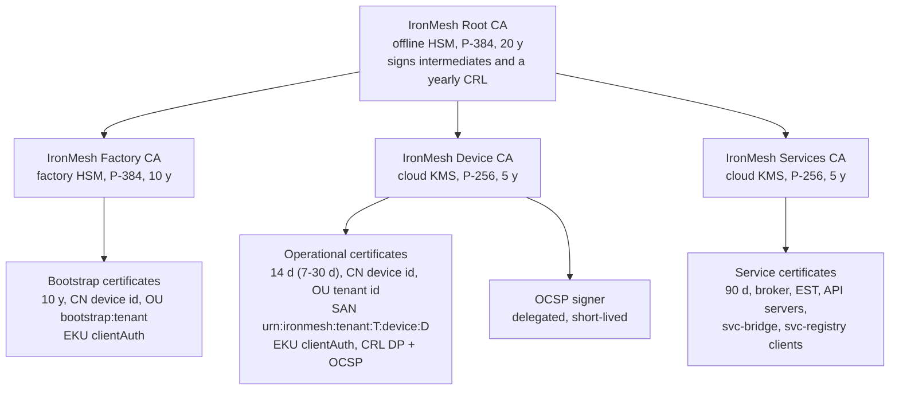

| Certificate class  | Issuer       | Key           | Validity         | Subject and extensions                                                                                                          | Revocation                                                                     |
|--------------------|--------------|---------------|------------------|---------------------------------------------------------------------------------------------------------------------------------|--------------------------------------------------------------------------------|
| Root CA            | self-signed  | P-384, offline HSM | 20 y        | `CN=IronMesh Root CA`, CA true, pathlen 1                                                                                       | Yearly CRL signed at a ceremony                                                 |
| Factory CA         | Root         | P-384, factory HSM | 10 y        | `CN=IronMesh Factory CA`, CA true, pathlen 0                                                                                    | Root CRL                                                                        |
| Device CA          | Root         | P-256, KMS    | 5 y              | `CN=IronMesh Device CA`, CA true, pathlen 0                                                                                     | Root CRL                                                                        |
| Services CA        | Root         | P-256, KMS    | 5 y              | `CN=IronMesh Services CA`, CA true, pathlen 0                                                                                   | Root CRL                                                                        |
| Bootstrap          | Factory CA   | P-256 in SE   | 10 y             | `CN=<device id>`, `OU=bootstrap:<tenant>`, `O=IronMesh`, SAN URN, KU digitalSignature, EKU clientAuth only                       | Decommission revokes it; EST also checks the manufacture record                 |
| Operational        | Device CA    | P-256 in SE   | 14 d (`IRONMESH_OPERATIONAL_CERT_TTL`, 7-30 d) | `CN=<device id>`, `OU=<tenant>` (+ `assurance:software` when applicable), SAN URN, KU digitalSignature, EKU clientAuth, CRL DP `https://pki.<domain>/crl/device-ca.crl`, AIA OCSP `https://pki.<domain>/ocsp`, 128-bit random serial | CRL (next update 24 h, published every 60 s or on change), OCSP, signed push to policy, EMQX kick |
| Service            | Services CA  | P-256, KMS or in-cluster | 90 d  | Server: SAN DNS of broker/EST/API hosts, EKU serverAuth; client: `CN=svc-bridge`, `CN=svc-registry`, EKU clientAuth              | Services CA CRL, policy cache                                                   |

Key custody and the operations each key performs:

| Key                          | Custody                                | Signs                                                                | Used by                               |
|------------------------------|----------------------------------------|----------------------------------------------------------------------|---------------------------------------|
| Root CA key                  | Offline HSM, M-of-N quorum             | Intermediate CA certificates, root CRL                               | Ceremony only                         |
| Factory CA key               | HSM at the factory                     | Bootstrap certificates                                               | Manufacturing station                 |
| Device CA key                | KMS (`ca_signing` policy)              | Operational certificates, device CRL, OCSP signer certificate        | `pki` only                            |
| Services CA key              | KMS (`ca_signing` policy)              | Service certificates                                                 | `pki` only                            |
| PKI bundle key               | KMS                                    | `X-IronMesh-Bundle` COSE_Sign1                                       | `pki` only; public key baked into firmware at the factory |
| Tenant command key (per tenant) | KMS, Ed25519                        | `ShadowDesired`, `Command`, `OtaNotify` COSE_Sign1 (`kid = tenant-cmd-<tenant>`) | `registry`, `ota`           |
| Firmware signing keys        | KMS, Ed25519 and ML-DSA-65 (`firmware_kek` policy) | Firmware manifests (COSE_Sign, tag 98)                      | `ota` release path only               |
| Service JWT keys             | Per-service Services CA key            | ES256 service-to-service JWTs (`aud=<service>`, 5 min)               | Every internal call                   |

## 5. Runtime views

Each sequence names the contract rule it implements. Participants are the containers of section 2;
`console` always reaches a service through its server-side proxy, which is elided after section 5.4.

### 5.1 Factory manufacture and bootstrap certificate

The registry mints the device id; the station never chooses it. The bootstrap serial is drawn by
the station from the Factory CA's serial space before the registry call so the manufacture record
is complete when the certificate is issued (`docs/API_CONTRACT.md` section 1.2, `POST /v1/devices`).

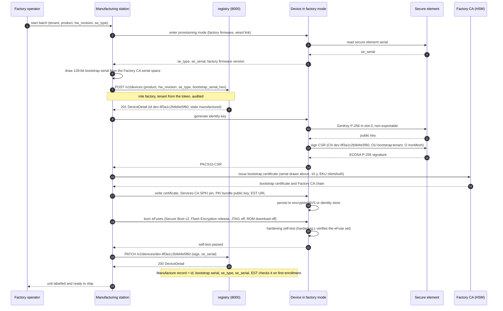

### 5.2 Zero-touch enrollment with attestation

`docs/DESIGN_CONTRACT.md` section 3 steps 1-6. The pipeline order inside the PKI is listed in
section 3.1 of this document; every failure returns RFC 9457 problem details and an audit event.

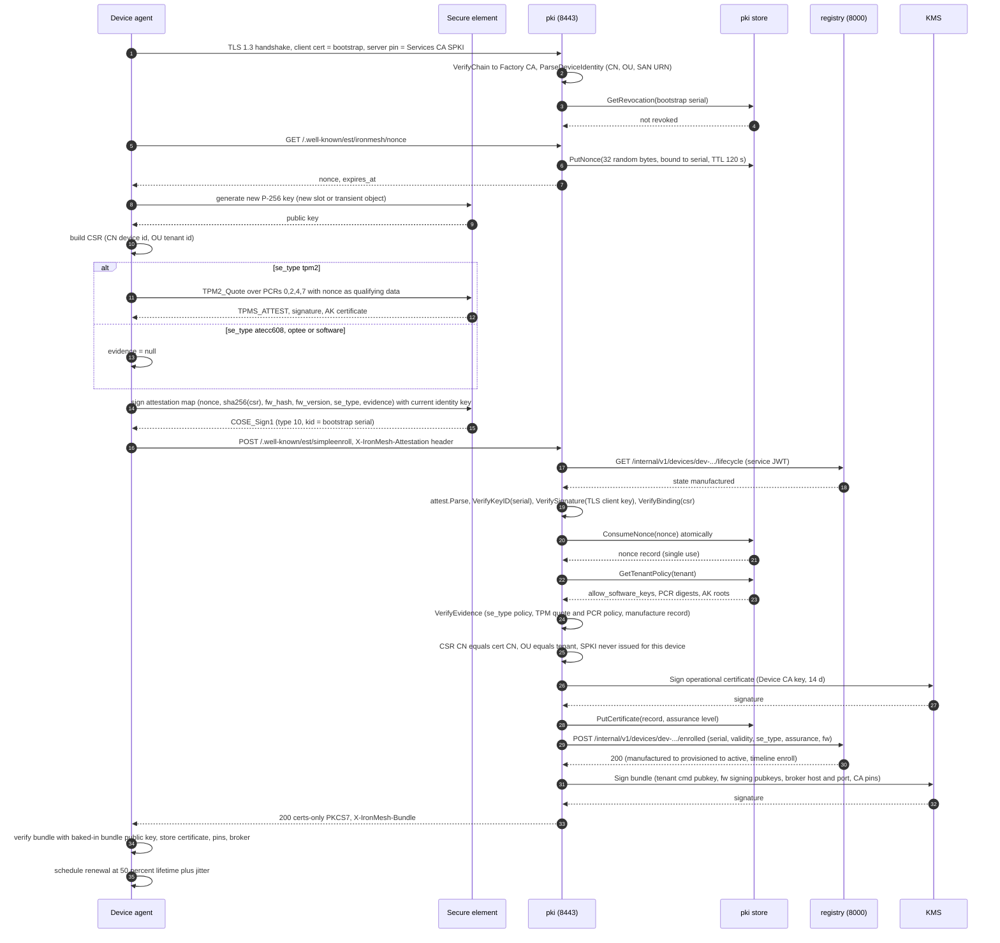

### 5.3 Certificate rotation (`simplereenroll`)

Renewal starts at `notBefore + 50% lifetime` with up to 10% jitter and retries with exponential
backoff (60 s base, 6 h cap) until expiry, after which the device falls back to bootstrap
enrollment. The superseded serial is revoked when the device's first CONNECT with the new serial
is observed or after a one hour grace, whichever comes first, so rotation never drops a live session
and a cloned identity is evicted within the hour (THREAT_MODEL T-13).

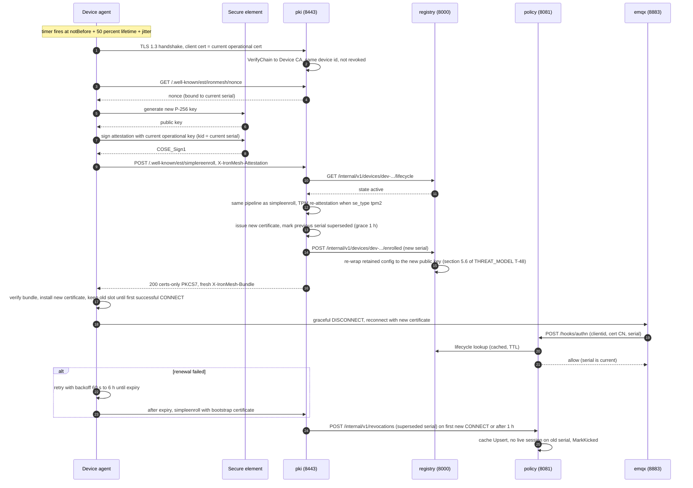

### 5.4 Revocation propagation (budget under 10 s)

`POST /v1/certificates/{serial}/revoke` to broker disconnect. The push path is authoritative; the
CRL poller in the policy service (`crlpoll.go`) reconciles every 60 s in case a push is lost, and
`ironmesh_revocation_latency_seconds` is alerted above 10 s.

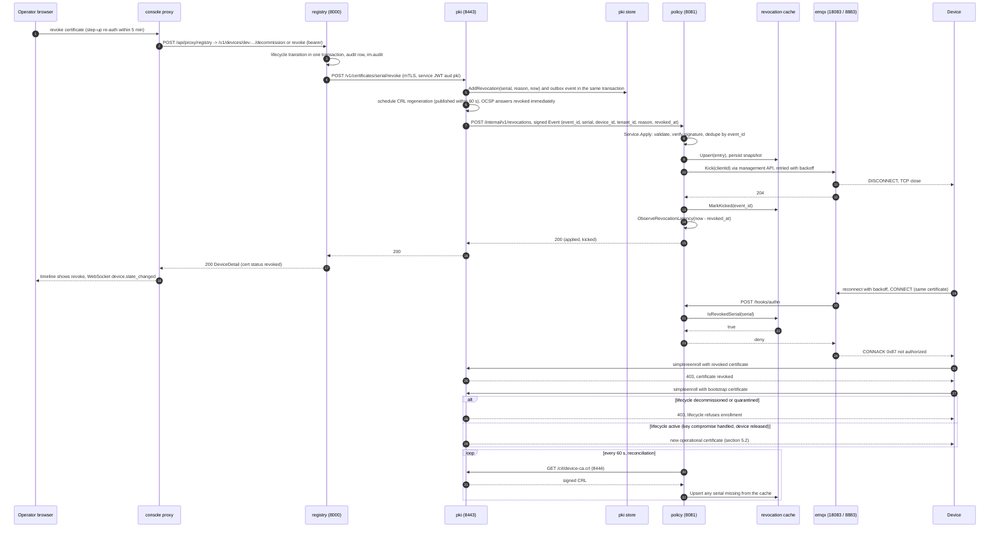

### 5.5 Telemetry ingest

Device to EMQX to bridge to Redpanda to registry and anomaly. The bridge never decodes payloads; it
forwards the raw COSE bytes with broker metadata, and each consumer verifies the signature and the
replay state itself (`docs/API_CONTRACT.md` section 6, topic `im.ingest`).

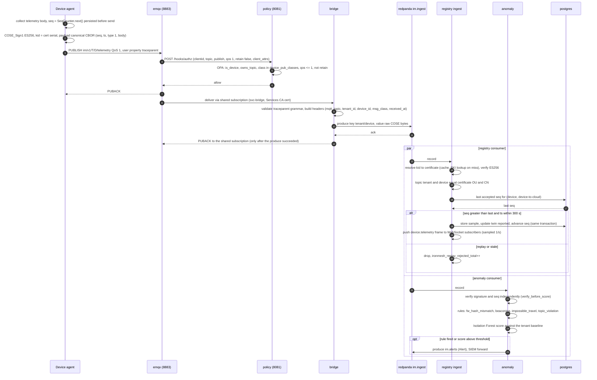

### 5.6 Command dispatch with acknowledgement and idempotency

`docs/API_CONTRACT.md` section 1.5. Commands are signed with the tenant key, carry a nonce, an
idempotency key and an expiry, and are never retained on the broker.

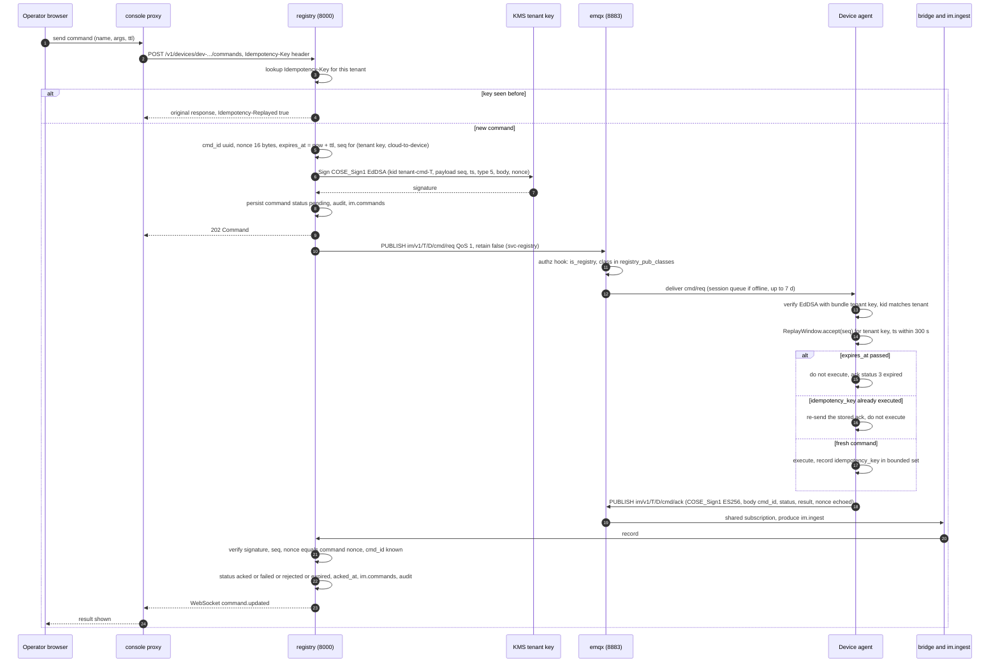

### 5.7 Staged OTA campaign

Default stages from `docs/API_CONTRACT.md` section 2: 1% (dwell 3600 s), 10% (dwell 3600 s), 100%,
each with `max_failure_rate` 0.05. A device applies the image A/B and must prove health within
120 s or the bootloader reverts. A halted campaign is rolled back by a child campaign that carries
the previous image re-signed with a higher `version_code`, so anti-rollback is never bypassed.

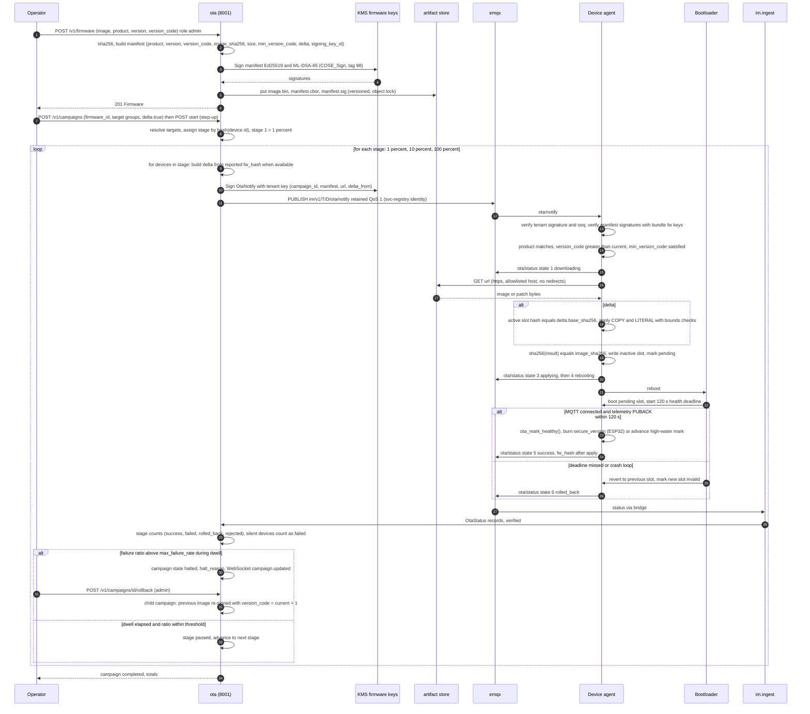

### 5.8 Anomaly detection to automatic quarantine

Rules are deterministic; the Isolation Forest only auto-quarantines when its score exceeds the hard
threshold and at least one rule corroborates (THREAT_MODEL T-68). A per-tenant circuit breaker caps
automatic quarantines at 5% of the fleet per hour (T-69). Quarantine revokes every certificate of the
device, denies it at CONNECT and kicks the live session (`docs/API_CONTRACT.md` section 1.2).

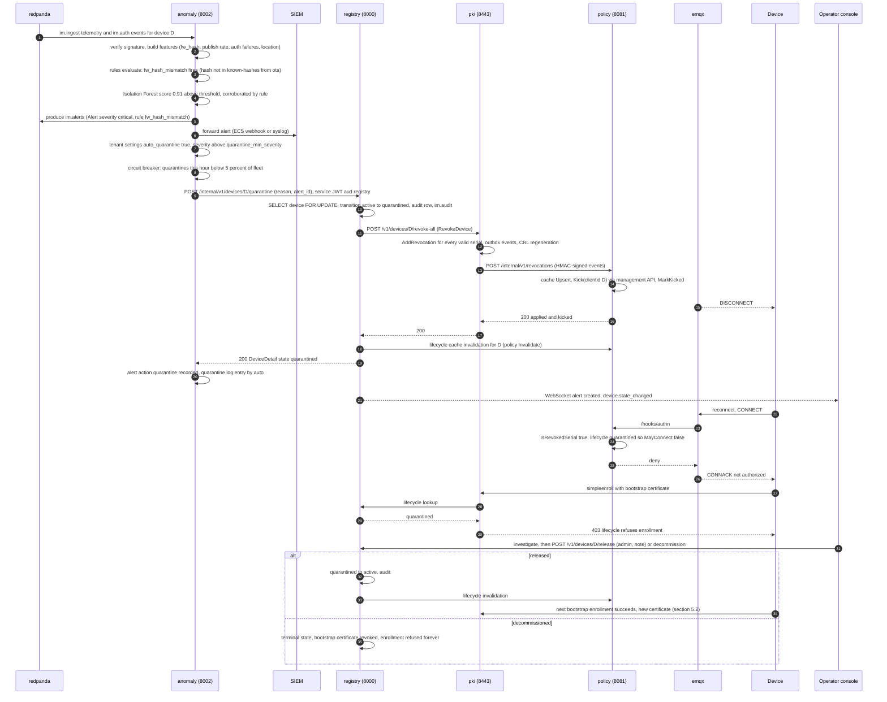

## 6. Data flows and trust boundaries

Boundary identifiers (TB-n) are those of `THREAT_MODEL.md` section 3. The rule that ties the table
together: identity is always the verified certificate (or the verified OIDC token for people), never
a string in a payload, a client id, or broker metadata.

| ID    | Flow                                                   | From -> to                                  | Boundary     | Transport protection                                   | Message protection                                                        | Classification                                   |
|-------|--------------------------------------------------------|---------------------------------------------|--------------|--------------------------------------------------------|---------------------------------------------------------------------------|--------------------------------------------------|
| DF-01 | Factory provisioning                                   | Station -> device                           | TB-3         | Wired link on the factory network, one-time mode        | Bootstrap certificate (public); key generated in the SE and never exported | Identity material                                |
| DF-02 | EST enrollment and rotation                            | Device -> pki 8443                          | TB-2, TB-4   | TLS 1.3 mTLS, Services CA SPKI pin, SAN match           | COSE_Sign1 attestation by the current identity key; nonce; CSR hash binding | Device identity, firmware hash and version       |
| DF-03 | Bundle                                                 | pki -> device (EST response header)          | TB-2         | Same TLS session as DF-02                               | COSE_Sign1 by the PKI bundle key, verified with the baked-in public key    | Trust configuration (public)                     |
| DF-04 | CONNECT authentication                                 | emqx -> policy `/hooks/authn`                | TB-5         | mTLS with Services CA certificates                       | EMQX forwards the verified certificate fields; policy derives `client_attrs`, checks client id = CN, revocation cache, lifecycle | Session identity                                 |
| DF-05 | Publish and subscribe authorization                    | emqx -> policy `/hooks/authz`                | TB-5         | mTLS                                                     | `client_attrs` from DF-04 plus topic, action, QoS, retain; OPA decision cached 60 s | Authorization decision                           |
| DF-06 | Telemetry, events, shadow reported, acks, OTA status   | Device -> emqx -> bridge                     | TB-2, TB-5   | TLS 1.3 mTLS; shared subscription under `svc-bridge`     | COSE_Sign1 ES256 (`kid` = serial), `seq`, `ts`; confidentiality rests on TLS only | Tenant-confidential operational data             |
| DF-07 | Ingest stream                                          | bridge -> redpanda -> registry, ota, anomaly | TB-6         | TLS + SASL/SCRAM, per-principal ACLs                     | Raw COSE bytes preserved; every consumer re-verifies signature and `seq`    | Tenant-confidential                              |
| DF-08 | Commands, desired shadow, OTA notify                   | registry or ota -> emqx -> device            | TB-2, TB-5   | TLS 1.3 mTLS; publisher identity `svc-registry`          | COSE_Sign1 EdDSA by the tenant key; `seq` per tenant key; nonce and `expires_at` on commands | Actuation                                        |
| DF-09 | Device configuration                                   | registry -> emqx (retained) -> device        | TB-2, TB-5   | TLS 1.3 mTLS                                             | COSE_Encrypt0: HPKE DHKEM(P-256) to the device certificate key wraps a fresh AES-256-GCM key; re-wrapped on rotation | Secrets (Wi-Fi credentials, tenant tokens)        |
| DF-10 | Firmware download                                      | Device -> artifact store                     | TB-2         | TLS, host allowlist, no redirects, no client certificate | COSE_Sign (Ed25519 + optional ML-DSA-65) manifest and `image_sha256` make integrity independent of the source | Firmware (integrity-critical, not secret)        |
| DF-11 | Revocation push                                        | pki -> policy `/internal/v1/revocations`     | TB-7         | In-cluster HTTP + bearer token (no mTLS)                 | HMAC-SHA256 over the body (`services/pki/internal/revocation/publisher.go:74 (Sign)`, verified by `services/policy/internal/revocation/service.go:283 (validSignature)`), `event_id` dedupe | Security state                                   |
| DF-12 | Lifecycle lookup                                       | policy -> registry `/internal/v1/devices/{id}/lifecycle` | TB-7 | mTLS + ES256 service JWT `aud=registry`                 | Response bound to the requested device id (`ErrInconsistent`), cached with TTL, invalidated on transitions | Security state                                   |
| DF-13 | Service REST calls                                     | registry <-> pki, anomaly -> registry, pki -> registry | TB-7 | mTLS + ES256 service JWT (`aud`, `iss`, 5 min, `jti`)   | JSON bodies validated against OpenAPI; RFC 9457 problems                   | Mixed                                            |
| DF-14 | Console to services                                    | Browser -> console proxy -> service          | TB-9         | HTTPS; httpOnly SameSite=Strict session cookie; proxy adds the bearer token server-side | Tenant from the token claim; RLS in Postgres; `X-IronMesh-Tenant` only for `platform_admin` | Tenant operational data                          |
| DF-15 | Live updates                                           | registry `/v1/ws` -> browser (via console)   | TB-9         | WSS with a 60 s single-use ticket                        | Notification frames only; no secrets; telemetry sampled 1/s/device         | Tenant operational data                          |
| DF-16 | Alerts and audit export                                | anomaly -> SIEM                              | TB-7 egress  | TLS to an allowlisted host; credentials from the secret store | `Alert` and `AuditEvent` JSON; also durable in `im.alerts`, `im.audit`      | Security events (device and tenant identifiers)  |
| DF-17 | Signing operations                                     | pki, registry, ota -> KMS                    | TB-10        | Provider API with workload identity (IRSA) or PKCS#11    | Only `Sign` and `GetPublicKey`; key policies per key class; every call logged | Key usage                                        |

Trust boundary notes:

* Devices trust exactly three things they did not receive over the network: the bootstrap
  certificate and key, the Services CA SPKI pin and the PKI bundle public key, all written at the
  factory. Every other trust input (broker host, tenant command key, firmware keys, pin rotations)
  arrives inside a bundle signed by that key.
* The broker is a policy enforcement point, not a trusted party. It cannot forge a message (no
  device or tenant key), cannot read configuration (HPKE) and cannot grant access on its own
  (fail-closed hooks).
* Redpanda and its consumers treat every record as untrusted until the signature and `seq` check
  pass; the bridge's headers are hints for routing and metrics only.
* Postgres row-level security is the last line of tenant isolation; the application sets
  `ironmesh.tenant_id` from the verified token on every transaction and connects with a role that
  cannot bypass the policy.
* Private keys exist in exactly two kinds of places: secure elements on devices and KMS/HSM in the
  cloud. No service process ever holds a CA, bundle, tenant or firmware private key in memory
  except the explicitly non-production `file` KMS backend.

## 7. Deployment view

| Concern              | Local compose (`deploy/docker`)                      | Kubernetes (`deploy/helm`, `deploy/k8s`)                                           | AWS reference (`deploy/terraform/aws`)                                                                 |
|----------------------|------------------------------------------------------|------------------------------------------------------------------------------------|--------------------------------------------------------------------------------------------------------|
| Purpose              | Developer loop, conformance suite in CI               | Any conformant cluster, staging                                                    | Production reference, two environments (`environments/staging.tfvars`, `prod.tfvars`)                   |
| Ingress for devices  | Host ports 8883 and 8443 directly into `emqx` and `pki` | `Service` type LoadBalancer with TCP passthrough; mTLS terminates in `emqx` and `pki` | Network Load Balancer, TCP passthrough on 8883 and 8443, Shield Standard; mTLS terminates in the pods |
| Ingress for operators| Host port 3000                                        | Ingress with TLS for the console only                                              | ALB with ACM certificate (`module "alb"`), WAF, console only                                           |
| Secrets              | `.env` (git-ignored) and dev certificates              | External Secrets Operator syncing from the cloud secret store                       | AWS Secrets Manager, IRSA roles per service (`module "iam"`)                                            |
| Key custody          | SoftHSM (PKCS#11) or the dev `file` backend            | SoftHSM sidecar for staging or cloud KMS                                           | AWS KMS keys per class with dedicated key policies: `admin`, `verify`, `ca_signing`, `root_ca`, `firmware_kek`, `data_generic`, `eks` (`modules/kms`) |
| Relational data      | Single `postgres` container, four databases            | Postgres operator or managed service                                               | Amazon RDS for PostgreSQL, `storage_encrypted`, private subnets (`modules/rds`)                         |
| Streaming            | `redpanda`                                            | Redpanda operator                                                                   | Kafka-compatible managed cluster (`module "msk"`), TLS + SCRAM                                          |
| Artifacts            | MinIO                                                  | MinIO or cloud object storage                                                      | S3 with versioning, object lock, SSE-KMS, access logging and cross-region replica (`modules/s3`)        |
| Compute              | Docker Compose services                                | Helm chart `deploy/helm/ironmesh`; `cosign verify` runs before each deploy (`scripts/ci/deploy_helm.sh`); image digests are not pinned and there is no admission policy yet (`THREAT_MODEL.md` T-67) | EKS with managed node groups, launch template with encrypted gp3 volumes, IRSA (`modules/eks`, `modules/eks-addons`) |
| Network policy       | Single host, no segmentation                           | `NetworkPolicy` per service: 18083 reachable only from policy, 5432 only from service pods, egress allowlists | Security groups plus the same NetworkPolicies                                                          |
| Observability        | `otel-collector`, Prometheus, Grafana (`observability/`) | kube-prometheus stack, OTLP to the collector                                       | CloudWatch Container Insights and OTLP (`module "observability"`)                                      |
| Identity provider    | Keycloak development realm                             | Tenant OIDC provider                                                                | Tenant OIDC provider                                                                                   |

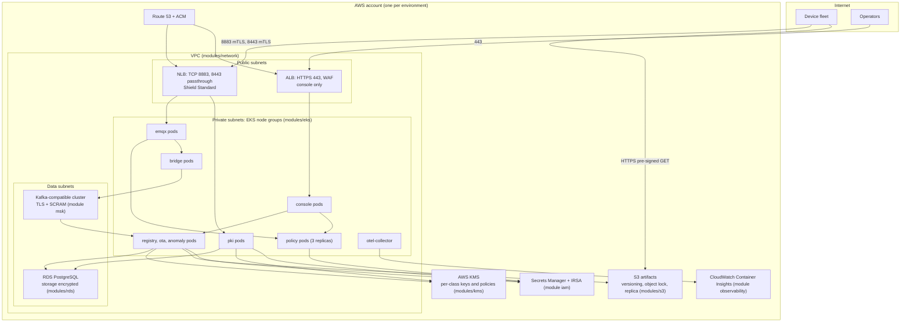

Profiles are selected with `IRONMESH_PROFILE` (`dev`, `staging`, `prod`). The `prod` profile refuses
the `file` KMS backend, requires `allow_software_keys=false` as the tenant default, enforces TLS 1.3
only on every listener, and fails start-up if any service certificate is not issued by the Services
CA (THREAT_MODEL T-74).

## 8. Key design decisions

| ID   | Decision                                                      | Alternatives considered                                                  | Rationale                                                                                                                                                                                                                                                                                                                                                                                                                                                                                                                                      |
|------|---------------------------------------------------------------|--------------------------------------------------------------------------|-----------------------------------------------------------------------------------------------------------------------------------------------------------------------------------------------------------------------------------------------------------------------------------------------------------------------------------------------------------------------------------------------------------------------------------------------------------------------------------------------------------------------------------------------|
| D-01 | EST (RFC 7030) for enrollment and rotation, extended with a nonce endpoint and an attestation header | ACME (including `device-attest-01`), SCEP, CMP, a proprietary API | ACME proves control of a DNS name or HTTP endpoint and models publicly trusted server certificates; devices have no DNS identity, sit behind NAT and must re-enrol under an existing credential. EST authenticates `simpleenroll` and `simplereenroll` with the TLS client certificate natively, returns certs-only PKCS#7, constrains CSR contents with `csrattrs`, and is small enough for ESP32. The attestation header and nonce endpoint are additive, so a plain RFC 7030 client still interoperates. SCEP relies on shared secrets and lacks crypto agility; CMP and ACME clients (JOSE, account keys) are heavy for a 4 MiB flash budget. |
| D-02 | COSE_Sign1 on every payload in addition to TLS                 | TLS only; JWS; MQTT 5 user-property signatures                            | TLS protects one hop. The broker, bridge, Redpanda and every consumer are further hops where origin and integrity would otherwise rest on metadata. COSE_Sign1 binds each message to the device certificate (`kid` = serial), gives non-repudiation and carries the replay counter independently of the broker, so the anomaly engine and registry can trust nothing they have not verified. CBOR (RFC 8949 deterministic encoding) keeps envelopes compact and parseable on constrained devices; JWS would double payload size. Cost is one ECDSA signature per message, which the secure element performs in tens of milliseconds. |
| D-03 | EMQX HTTP authn/authz hooks backed by an embedded OPA (Rego) policy | EMQX built-in file or database ACLs; a custom Erlang plugin; Mosquitto dynamic security | Built-in ACLs cannot express "topic segments must equal fields of the verified certificate" together with revocation and lifecycle checks. HTTP hooks let the policy service derive `client_attrs` from the certificate at CONNECT and evaluate a declarative, unit-tested, versioned Rego policy per publish or subscribe. Tenants can customise it under built-in invariants; decisions are cached briefly and EMQX is configured fail-closed. A custom plugin would couple IronMesh to the broker's release cycle. |
| D-04 | ECDSA P-256 for device identity; Ed25519 plus optional ML-DSA-65 for firmware | P-256 everywhere; Ed25519 everywhere; RSA; ML-DSA mandatory               | ATECC608 supports only P-256, and TPM 2.0, OP-TEE and TLS 1.3 client authentication support it universally, so device identity is `ES256`. Firmware verification runs in software with no secure-element constraint: Ed25519 verifies quickly with 64-byte signatures and avoids ECDSA nonce pitfalls in the signing service. Code signing is the trust relation that must outlive the fleet, so ML-DSA-65 (FIPS 204) adds post-quantum assurance; it is optional (`IRONMESH_PQ_REQUIRED`) because its 3.3 KB signatures cost flash on the smallest targets. COSE_Sign (tag 98) carries both signatures in one manifest. |
| D-05 | HPKE (RFC 9180) for device configuration                       | TLS only; pre-shared symmetric keys; ad hoc ECIES                        | Configuration is the one payload that must stay confidential from the broker, where it is retained. HPKE with DHKEM(P-256, HKDF-SHA256) encrypts to the device's existing certificate key, so no extra key provisioning is needed and the ATECC608 can perform the ECDH. Each message wraps a fresh AES-256-GCM key; the registry re-wraps on certificate rotation, so compromise of an old key never exposes current configuration. Pre-shared keys would need their own provisioning and rotation; ad hoc ECIES is non-standard and hard to audit. |
| D-06 | 14-day operational certificates with push revocation          | Long-lived device certificates with CRL/OCSP only; 24-hour certificates | Devices do not check CRLs and OCSP latency is minutes to hours. A 14-day lifetime bounds any compromise and keeps enrollment load to one request per device per week, while the signed push to policy and the EMQX kick give sub-10-second enforcement for the cases that matter. One-day certificates would make the PKI a hard availability dependency for the whole fleet. |
| D-07 | Shared-subscription bridge into a Kafka-compatible log         | Services subscribe to the broker directly; EMQX rule engine to database  | One audited subscriber identity (`svc-bridge`), back-pressure between broker and consumers, replayable history for the anomaly engine and conformance tests, and independent scaling of consumers. Because consumers re-verify signatures, the bridge needs no trust. |
| D-08 | Postgres row-level security for tenancy                        | Application-level filters; database per tenant                           | Isolation enforced where the data lives, with a one-line policy per table and a non-owner application role; cross-tenant tests are trivial to write. A database per tenant does not scale operationally; application filters fail open on the first forgotten `WHERE`. |
| D-09 | Rust agent for Linux, C reference firmware for ESP32            | C everywhere; Python agent                                                | Memory safety for the component that parses untrusted bytes on a general-purpose OS, with `#![forbid(unsafe_code)]` in the wire crate and continuous fuzzing. ESP-IDF requires C; the two implementations are cross-checked against shared test vectors. |
| D-10 | A/B slots with a connectivity-proving health gate and staged canary rollout | Single-slot update with recovery partition; operator-driven rollout | A/B allows atomic revert without a recovery image. The health gate requires a real mTLS session and a broker PUBACK, so an image that boots but cannot talk is reverted. Deterministic canary assignment, dwell times and `max_failure_rate` stop a bad image at 1% or 10% of the fleet without a human in the loop. |
| D-11 | Console as a backend-for-frontend proxy                        | Browser calls services directly with the OIDC token                      | Tokens never reach browser JavaScript, the CSP lists no service origins, every service call carries the user's bearer token from a single audited egress, and WebSocket access uses a short-lived ticket instead of a token in a URL. |
| D-12 | Deterministic rules plus an Isolation Forest, with gated auto-quarantine | Rules only; model only                                                   | Rules are explainable and cannot be trained away; the model catches patterns nobody wrote a rule for. Letting the model quarantine only with corroboration and a per-tenant circuit breaker bounds both false negatives and weaponised false positives. |

## 9. Cross-cutting concerns

| Concern        | Approach                                                                                                                                                                                                                                                      |
|----------------|---------------------------------------------------------------------------------------------------------------------------------------------------------------------------------------------------------------------------------------------------------------|
| Metrics        | Prometheus names with prefix `ironmesh_`: `ironmesh_connected_devices`, `ironmesh_auth_failures_total`, `ironmesh_cert_expiring_total{window}`, `ironmesh_ota_result_total{result}`, `ironmesh_anomaly_alerts_total{rule}`, `ironmesh_revocation_latency_seconds`, `ironmesh_replay_rejected_total`. Device id is never a label. |
| Logs           | JSON with `ts, level, service, trace_id, span_id, tenant_id, device_id, msg`; device-supplied strings are fields, never concatenated into `msg`.                                                                                                              |
| Traces         | W3C `traceparent` propagated end to end; devices place it in the MQTT 5 user property, the bridge validates its grammar and copies it into the Redpanda header, services continue the span.                                                                   |
| Configuration  | Environment variables prefixed `IRONMESH_`; `IRONMESH_PROFILE` selects guard rails; `IRONMESH_OPERATIONAL_CERT_TTL` bounded to 7-30 d; `IRONMESH_PQ_REQUIRED` on devices.                                                                                     |
| Secrets        | Never in images, charts or repository; delivered by the platform secret store; certificates issued by the Services CA at start-up where possible.                                                                                                              |
| Time           | Cloud services use provider NTP; devices take authenticated time from the EST response and sanity-check NTP against it; all freshness windows (`ts` +/-300 s, nonce 120 s, JWT 5 min, WebSocket ticket 60 s) assume that bound.                              |
| Testing        | Unit tests per package, the Rego test suite, shared wire vectors (`device/common/vectors/`), fuzz targets for every parser, and the conformance suite that drives both firmware targets through enrollment, revocation (< 10 s), replay, ACL and OTA scenarios. |
| Documentation  | `docs/DESIGN_CONTRACT.md` and `docs/API_CONTRACT.md` are normative; `THREAT_MODEL.md` references are checked by `scripts/resolve_threat_refs.py`; `COMPLIANCE_MATRIX.md` maps every control to a standard clause.                                             |
