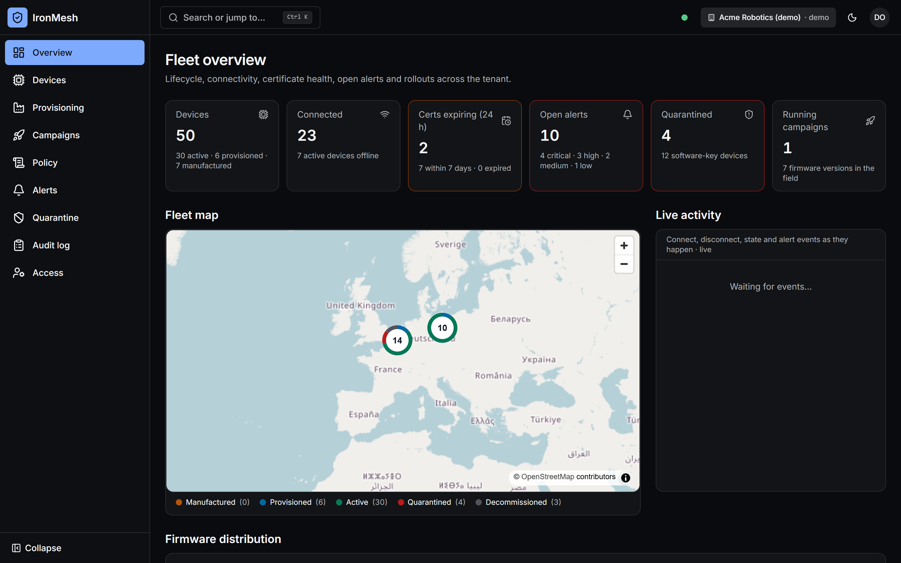
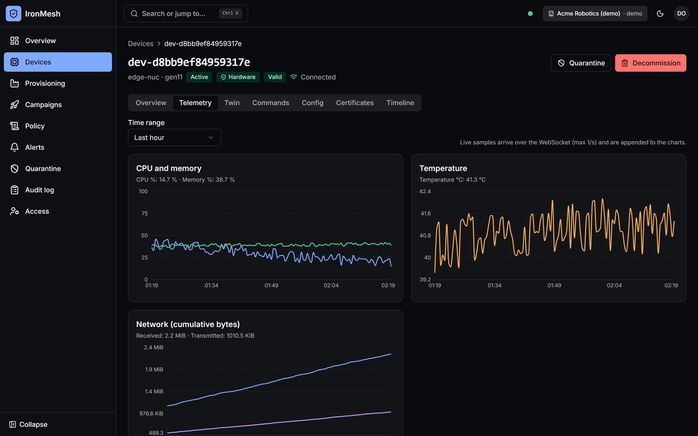
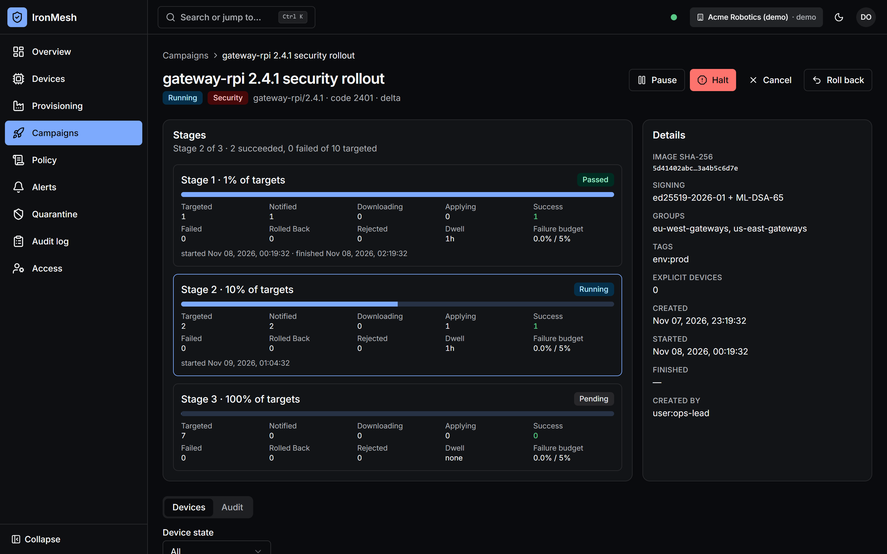
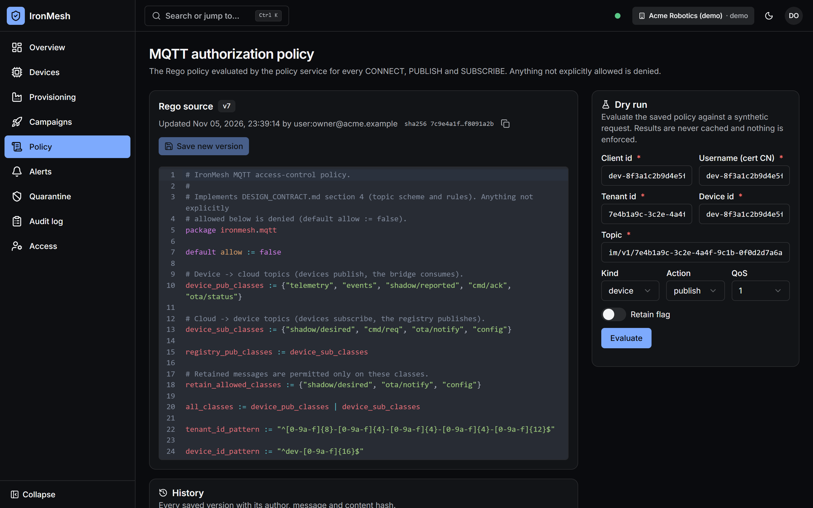
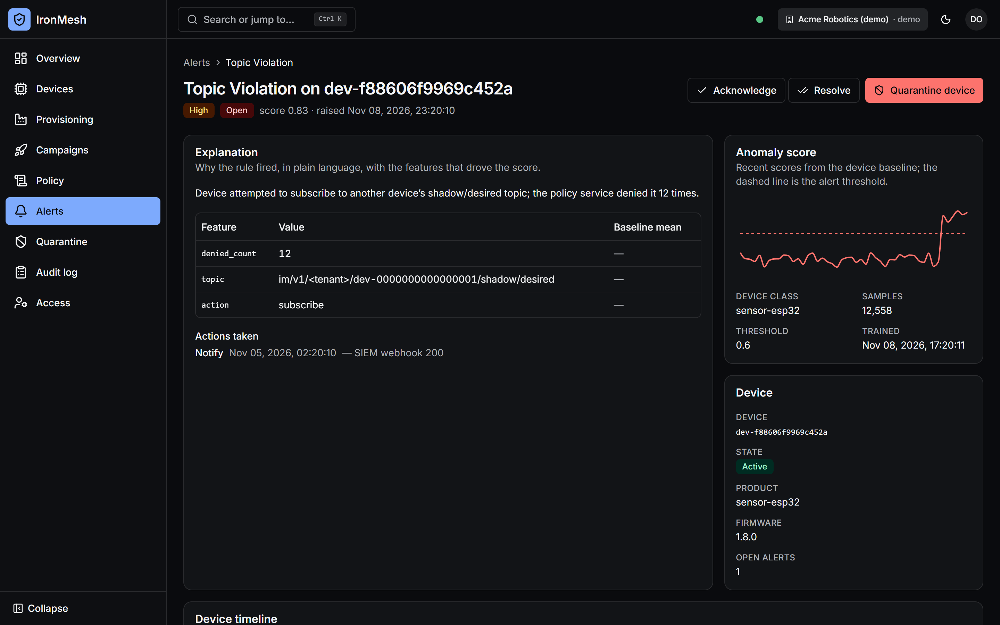
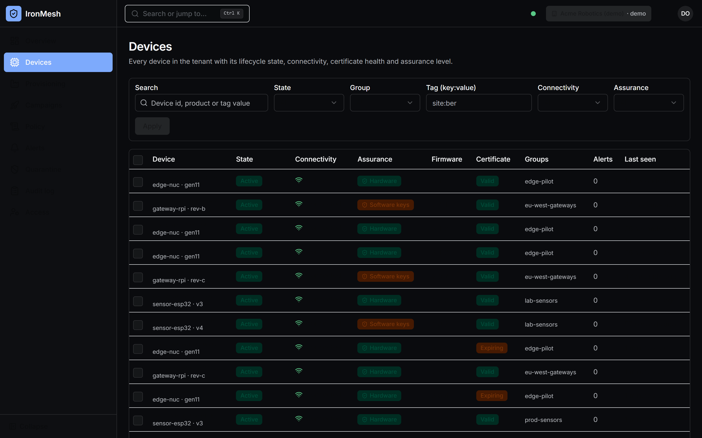
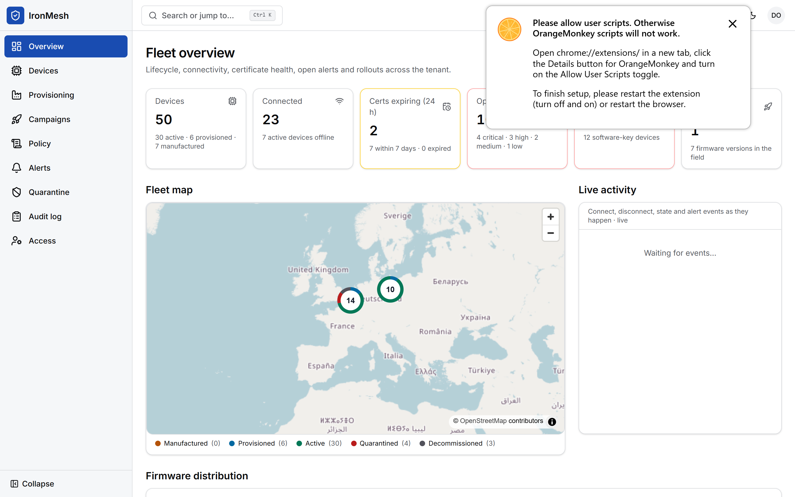
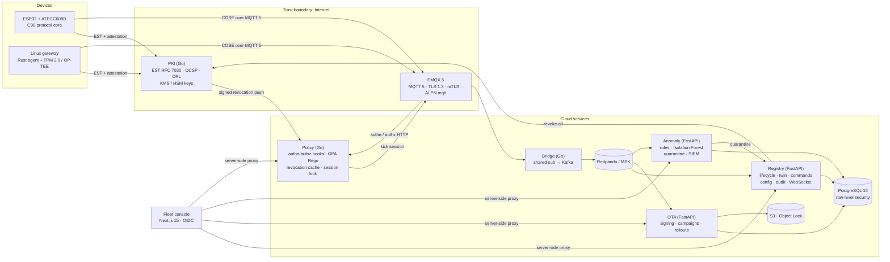
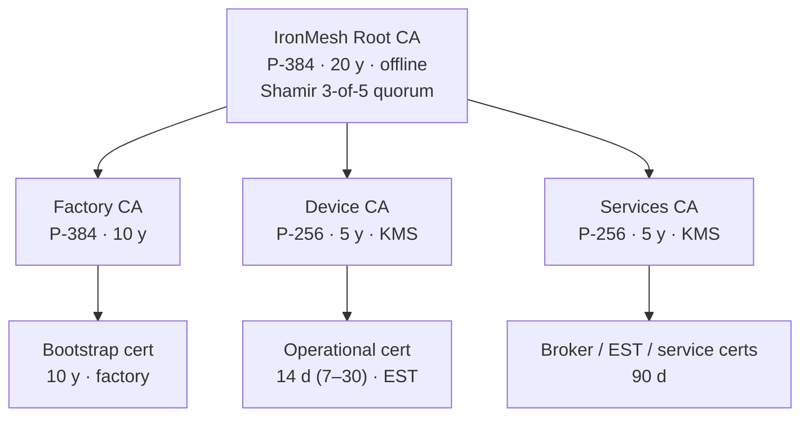
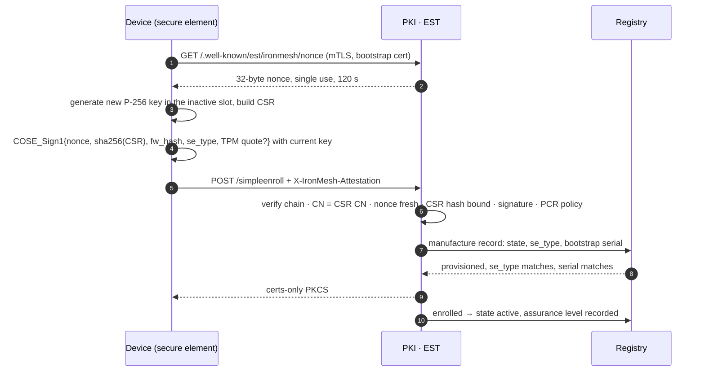

<div align="center">

# IronMesh

**Hardware-rooted security and fleet management for MQTT device fleets.**

Zero-touch provisioning · mutually authenticated TLS 1.3 · COSE-signed payloads · policy-as-code
authorization · signed A/B firmware updates with post-quantum signatures · runtime anomaly
detection with automatic quarantine · a full fleet console.




</div>

---

## Why IronMesh

Most IoT platforms trust whatever device id a client puts in its MQTT CONNECT. IronMesh trusts
nothing a device *says*, only what it can *prove*:

| Guarantee | How |
|---|---|
| **A device is who it claims to be** | The private key is generated inside an ATECC608B, TPM 2.0 or OP-TEE and never leaves it. Identity is the CN of a certificate the PKI issued only after verifying a hardware attestation over a fresh nonce. |
| **Stolen or cloned keys are short-lived** | Operational certificates live 7–30 days and rotate automatically at 50 % of lifetime. Revocation is pushed to the broker, which kicks the session in seconds. |
| **A compromised broker can't forge or replay data** | Every message is a COSE_Sign1 over canonical CBOR with a monotonic sequence number and a timestamp window, verified end to end by the receiver. |
| **A device can only touch its own topics** | Every CONNECT, PUBLISH and SUBSCRIBE is decided by an OPA/Rego policy keyed on the certificate identity. Cross-device and cross-tenant access is denied by default and proven by tests. |
| **Only signed firmware runs** | Manifests carry an Ed25519 signature plus an optional ML-DSA-65 (post-quantum) signature, anti-rollback version codes, A/B slots and a health gate that rolls back automatically. Rollouts go 1 % → 10 % → 100 % and halt themselves on failure. |
| **Misbehaving devices get isolated** | Streaming rules and a per-class Isolation Forest flag anomalies. Auto-quarantine revokes the certificate, drops the ACL and kicks the session, behind dry-run, severity and circuit-breaker gates. |
| **Tenants are isolated at the database** | Every service connects as a non-owner role under PostgreSQL `FORCE ROW LEVEL SECURITY`. Tests prove tenant A can't read or write tenant B's rows. |

---

## The console

<table>
<tr>
<td width="50%"><br><sub><b>Device detail</b>: certificate state, assurance level, live telemetry over WebSocket, twin, commands, encrypted config, timeline.</sub></td>
<td width="50%"><br><sub><b>Staged OTA rollout</b>: per-stage counts, failure budgets, halt / pause / roll back. Hybrid Ed25519 + ML-DSA-65 signed image.</sub></td>
</tr>
<tr>
<td><br><sub><b>Policy as code</b>: the live Rego ACL, versioned, with a dry-run evaluator that returns matched rules and a trace.</sub></td>
<td><br><sub><b>Alert center</b>: explanation, contributing features, anomaly score against the device's own baseline, one-click quarantine.</sub></td>
</tr>
<tr>
<td><br><sub><b>Fleet inventory</b>: server-side filters, software-key warning badges, bulk actions, cursor pagination.</sub></td>
<td><br><sub><b>Light and dark themes</b>, WCAG 2.2 AA targets, responsive down to 360 px, Ctrl/Cmd+K palette.</sub></td>
</tr>
</table>

---

## Architecture



Full C4 views, eight sequence diagrams and the trust-boundary model are in
[ARCHITECTURE.md](ARCHITECTURE.md). Every interface is pinned in
[docs/DESIGN_CONTRACT.md](docs/DESIGN_CONTRACT.md) (wire, PKI, topics) and
[docs/API_CONTRACT.md](docs/API_CONTRACT.md) (REST, WebSocket, Kafka).

---

## Technical deep dive

### 1. PKI and device identity



- **Keys never leave hardware.** ATECC608B slot 0 holds the factory bootstrap key. Slots 2 and 3
  alternate as operational keys, so every renewal is attested by the current key. The slot switch
  and the new certificate are committed in one atomic NVS write, so a power cut mid-renewal keeps
  the old pair. Linux gateways use a TPM 2.0 child key with an attestation key quoting PCRs
  0, 2, 4 and 7, or an OP-TEE trusted application.
- **Software keys are a flagged, lower-assurance tier.** Certificates carry
  `OU=assurance:software`, the console shows a warning badge, and production tenants can refuse
  them at enrollment.
- **The root ceremony is quorum-protected.** `pkictl init-root --quorum-shares 5
  --quorum-threshold 3` splits the root wrapping key with a GF(256) Shamir implementation in
  [services/pki/internal/shamir](services/pki/internal/shamir).
- **Online CA keys sit in AWS KMS** (ECDSA_SHA_256/384 `Sign`) or a PKCS#11 HSM. Ed25519 keys,
  which KMS can't hold, are Secrets Manager entries wrapped by a KMS key only one IAM role can use.

### 2. Zero-touch provisioning with attestation



Enrollment is refused for quarantined or decommissioned devices, for a reused CSR key, for an
`se_type` that differs from the manufacture record, and above per-device and per-IP rate limits.
On re-enrollment the previous serial is revoked after a one-hour grace period.

### 3. Transport: TLS 1.3, mutual auth, pinning

- **TLS 1.3 only**, ALPN `mqtt`, client certificate required (`verify_peer`,
  `fail_if_no_peer_cert`). A TLS 1.2-only server is rejected by both firmware targets.
- **Pinning.** Devices validate the chain *and* compare the Services CA SPKI SHA-256 against pins
  delivered in the signed bundle. A rogue broker with a publicly trusted certificate gets
  `tls_pin_mismatch` before any MQTT byte is sent.
- **Client id must equal the certificate CN.** The policy service's authn hook rejects any
  mismatch, and service identities are accepted only from in-cluster CIDRs.
- **MQTT 5 session resumption** (7-day session expiry). Reconnect backoff is exponential with full
  jitter, base 1 s and capped at 300 s, so a broker restart doesn't become a thundering herd.

### 4. Payload integrity that survives a broker compromise

Every message is `COSE_Sign1` (RFC 9052) over **canonical CBOR** (RFC 8949 §4.2.1), with byte-exact
implementations in Python, Rust and C validated against the same
[18 test-vector files](device/common/vectors).

```
payload = { 1: seq (uint64, strictly increasing), 2: ts (unix s), 3: type, 4: body, ?5: nonce(16) }
uplink   : ES256 (device key in the secure element),  kid = certificate serial
downlink : EdDSA (tenant command key),                kid = "tenant-cmd-<tenant uuid>"
```

- **Replay protection.** The receiver keeps the last accepted `seq` per *replay stream*: the device
  for uplink, `"<tenant kid>/<type>"` for downlink. Downlink streams are per type because the
  registry and the OTA service sign different message types with the same tenant key.
- **Freshness.** Messages must fall within ±300 s. Retained downlink types (desired state, OTA
  notice, config) only reject future timestamps, so a device that was offline for a week still
  applies its latest signed state. `seq` stops older versions from being replayed.
- **Confidential config.** Configuration is HPKE-wrapped (RFC 9180, DHKEM P-256) to the device's
  current certificate key inside `COSE_Encrypt0` with AES-256-GCM. The broker only ever retains
  ciphertext.

### 5. Authorization as code

The broker asks the policy service about every action, and the policy service evaluates an
embedded OPA/Rego policy against the **certificate identity**, never the payload:

```rego
allow if {
  input.kind == "device"
  input.action == "publish"
  owns_topic(input.topic)                 # im/v1/<own tenant>/<own device>/...
  topic_class(input.topic) in device_pub_classes
  input.qos <= 1
  not input.retain
}
```

- **Proven by tests.** 45 Rego tests plus a 60-case Go table cover cross-device publish,
  cross-tenant publish, wildcard and other-device subscriptions, retained telemetry, QoS 2 and
  `$SYS`.
- **Safe policy changes.** Owners can edit the policy from the console, but a new version is
  rejected with `422` unless it compiles **and** the built-in invariant tests still pass. It is
  then hot-swapped atomically and the decision cache is flushed.
- **Revocation fast path.** PKI revoke → HMAC-signed push to the policy service → revocation cache
  → EMQX `DELETE /api/v5/clients/{id}`. In the conformance suite, with the real policy binary, the
  broker drops the session within 14 ms (p95) of the revoke call. CRL polling every 5 s is the
  fallback.

### 6. Firmware updates

```
manifest = { product, version, version_code (anti-rollback), image_sha256, image_size,
             min_version_code, delta?{base_sha256, patch_sha256}, signing_key_id }
signature = COSE_Sign [ Ed25519 (required), ML-DSA-65 (optional, alg -49) ]
```

- **Device-side acceptance.** A device accepts an image only if every required signature verifies
  with a key from its signed bundle, the hash matches, `version_code` exceeds the current one
  (plus the eFuse secure version on ESP32) and the product matches.
- **A/B slots with a health gate.** The new image must reconnect and get a telemetry PUBACK within
  120 s, or the bootloader reverts it.
- **Delta updates.** A 4 KiB block delta format (`IMDELTA1`) is applied in streaming mode with
  bounded RAM, and the result is verified against the full image hash.
- **Staged rollouts.** Stages default to 1 % → 10 % → 100 %, with deterministic device selection
  per campaign. A stage halts automatically when its failure rate exceeds its budget, or on any
  rollback in the canary stage.
- **Rollback campaigns.** A rollback re-signs the previous image with a **higher** version code,
  because anti-rollback forbids going down.
- **Two-person rule.** A security release with a dwell under one hour needs a second operator's
  approval.

### 7. Runtime anomaly detection

| Rule | Signal |
|---|---|
| `auth_burst` | Sliding-window authentication failures per device and per source IP |
| `topic_violation` | Any authorization deny; repeated denies escalate to critical |
| `fw_hash_mismatch` | Reported firmware hash not in the signed catalogue for that product |
| `beaconing` | Low coefficient of variation in outbound burst timing plus an autocorrelation peak (robust MAD statistics) |
| `impossible_travel` | Haversine speed between consecutive fixes (GPS or offline GeoIP) above 900 km/h |
| `isolation_forest` | Per-product Isolation Forest combined with per-device robust z-scores; cold-start guarded |

- **Measured on a synthetic fleet of 203 devices**, with real P-256-signed envelopes through the
  full pipeline: exactly the 3 misbehaving devices were alerted, with no false positives among the
  200 normal ones. On its own, the Isolation Forest scored precision 1.00 and recall 0.96.
- **Poisoning resistance.** Training excludes quarantined devices and open-alert windows and caps
  each device's share of the training set.
- **Quarantine safety.** Auto-quarantine is gated per tenant and per rule (dry-run first). A
  circuit breaker stops after 10 quarantines per tenant per hour, so a bad rule can't take down a
  fleet. Every decision, taken or skipped, is audited.
- **SIEM export.** Alerts are exported as ECS 8.x JSON, as RFC 5424 syslog over TLS, or as an
  HMAC-signed webhook.

### 8. Tenant isolation and audit

- **Database isolation.** Every tenant table has `tenant_id` and
  `FORCE ROW LEVEL SECURITY USING (tenant_id = current_setting('ironmesh.tenant_id')::uuid)`.
  Services connect as non-owner roles and set the tenant per transaction. If it isn't set,
  queries fail closed.
- **Tamper-evident audit.** The audit log is append-only and hash-chained: each row stores
  `sha256(prev_hash ‖ canonical event)`, and `GET /v1/audit/verify` detects an edited row. The
  application role can't update or delete audit rows.
- **Internal calls.** Service-to-service calls use mTLS plus credentials bound to exactly one
  calling service, and each internal endpoint names the callers it accepts.

---

## Verified results

Every number below was produced by running the suites in this repository.

| Component | Language | Tests | Line coverage | Notes |
|---|---|---|---|---|
| Wire reference library | Python | 358 | 100 % | RFC 9180 A.3 vectors, Hypothesis property tests |
| PKI · EST · OCSP · CRL | Go | 124 test functions (241 with subtests) | 88–100 % per package, ≥ 90 % on core packages | Synthetic TPM quotes, full EST flows |
| Policy service | Go | 124 (173 subtests) | 95.0 % | 45 Rego invariant tests run inside `go test` |
| MQTT → Kafka bridge | Go | 40 | 95.1 % | In-process MQTT 5 broker and in-memory Kafka |
| Registry | Python | 134 | 97 % | 45 of them on real PostgreSQL 16 with RLS |
| OTA service | Python | 201 | 96.7 % | RLS, leader election, moto for S3/KMS |
| Anomaly service | Python | 140 | 98.4 % | 203-device scenario test |
| Linux agent | Rust | 106 | 91.8 % | End-to-end against in-test EST, broker and artifact store |
| ESP32 protocol core | C99 + Rust host tests | 62 | n/a | All 18 vector files byte-for-byte, MSVC `/W4 /WX` clean |
| Fleet console | TypeScript | 88 unit | n/a | Production build checked in a real browser; 9 Playwright + axe specs run in CI |

**Fuzzing.** 17 libFuzzer targets cover every device-side parser: CBOR, COSE Sign1/Sign/Encrypt0,
envelope, manifest, delta, MQTT, PKCS#7, EST bundle and DUT JSON, in both the Rust agent and the C
core.
- The C core's 7 targets ran about 12.7 million executions, and all 17 targets ran 60 s each, with
  **0 crashes** and 0 sanitizer reports.
- The corpora are committed under `device/*/fuzz/corpus`.
- Unit tests found one real ring-buffer ordering bug, which is fixed.

**Cross-implementation conformance.** Python, Rust and C produce byte-identical canonical CBOR,
Ed25519 COSE signatures, manifests, HPKE output and delta patches from the shared vectors, and
reject malformed input with the same error codes.

### Device conformance suite

One suite drives every firmware target through the same 27 cases over a device-under-test control
protocol. Access-control and revocation cases run against the **real policy service binary**. The
broker double consults it exactly as EMQX would, and revocation travels the production path: a
signed push to the policy service, then a session kick, then a refused reconnect. Full matrix:
[conformance/results/SUMMARY.md](conformance/results/SUMMARY.md).

| Target | Passed | Failed | Not applicable |
|---|---|---|---|
| Linux agent (Rust) | 27 / 27 | 0 | 0 |
| ESP32 protocol core (C, host build) | 26 / 26 | 0 | 1 (release-build test hook: compiled out by the prod profile) |
| Both targets against the **real PKI binary** | 15 and 14 | 0 | Downlink and OTA cases (harness doesn't load tenant keys into the real PKI) |

Covered cases include TLS 1.3 with ALPN, rejection of a rogue broker by pinning and of a TLS 1.2-only
broker, session resumption, bounded backoff, attested enrollment, refusal for quarantined devices,
manual and automatic certificate rotation, cross-device publish/subscribe denial, unsigned,
tampered, untrusted-key and downgraded firmware rejection, health-check rollback, delta updates,
replay, stale and forged command rejection, offline buffering, and encrypted config.

**Revocation reaction time** (C-REV-1, 20 runs per target, budget < 10 s):

| Target | Revoke → broker disconnect (p95) | Revoke → reconnect refused (p95, max) |
|---|---|---|
| Linux agent | 0.012 s | 0.017 s, 0.018 s |
| ESP32 core | 0.014 s | 0.957 s, 1.000 s (bounded by the device's first reconnect backoff) |

**Firmware tamper rejection**, measured on both targets:
- Unsigned images are rejected before download.
- A 1-byte-flipped image is rejected at verification with `image_hash`.
- An untrusted signing key and a downgrade are both rejected before download.
- An image that fails its health check is rolled back, after 15 s on Linux and 120 s on the ESP32.
- A delta patch of about 16.6 KB rebuilds a 53–70 KB image whose hash matches the full image.

### Scale: 10,000 devices

[loadtest/REPORT.md](loadtest/REPORT.md) runs 10,000 simulated devices on one laptop (i7-12700H). Each
device enrolls through EST with attestation, connects over pinned TLS 1.3 with mTLS, and publishes
COSE-signed telemetry every 10 s for a 10-minute sustained window. Every CONNECT, PUBLISH and
SUBSCRIBE is decided by the real policy service. The broker and the certificate server are the
conformance harness doubles.

| Metric | Result |
|---|---|
| Devices enrolled and connected | **10,000 / 10,000**, 0 errors, 0 TLS failures, 0 policy denies |
| Sustained telemetry accepted | **1,000.6 msg/s** (600,534 messages in 600 s) |
| Publish → PUBACK latency | p50 **0.7 ms**, p95 7.2 ms, p99 128.6 ms |
| Downlink command round trip | 500 / 500 acked, p50 2.0 ms, p99 30.3 ms |
| Uplinks verified end to end | 672,424, **0 replay rejections**, every device's last `seq` accounted for |
| Peak memory | 1.27 GiB total (fleet 687 MiB, harness 506 MiB, policy 117 MiB) |

- **Tail latency:** the p99 comes from the broker waiting on its connection pool to the policy service.
- **Not covered here:** the EMQX broker, Kafka and registry ingest. The nightly CI job load-tests them
  against the compose stack.

---

## Standards alignment

| Framework | Provisions | Satisfied | Partially | Integrator / N/A | Not satisfied |
|---|---|---|---|---|---|
| ETSI EN 303 645 v2.1.1 | 67 | 45 | 11 | 11 | **0** |
| NIST IR 8259A | 18 | 16 | 2 | 0 | **0** |
| IEC 62443-4-2 (selected CRs) | 42 | 30 | 10 | 2 | **0** |
| EU Cyber Resilience Act, Annex I | 22 | 17 | 5 | 0 | **0** |

Each row maps a clause to the control that satisfies it, with evidence at `file:line`, in
[COMPLIANCE_MATRIX.md](COMPLIANCE_MATRIX.md). "Partially" rows name the gap and sit in the gap
register; none is marked Satisfied without code that does it.

The STRIDE model in [THREAT_MODEL.md](THREAT_MODEL.md) covers 79 threats across device, network
and cloud. Every mitigation cites the enforcing code at `file:line`, and all 457 references are
checked by `scripts/resolve_threat_refs.py --strict` in CI. Threats that are only partially
mitigated say exactly what is missing. A few are explicitly **not mitigated**, each with residual
risk and compensating controls:
- secure-element side channels
- a factory insider holding the Factory CA
- compromise during the offline root ceremony
- volumetric DoS on the broker

---

## Repository map

| Path | What | Stack |
|---|---|---|
| [`services/pki`](services/pki) | Root / factory / device / services CAs, EST, OCSP, CRL, revocation push, quorum ceremony | Go |
| [`services/policy`](services/policy) | EMQX authn/authz hooks, Rego policy + invariants, revocation cache, session kick, policy API | Go, OPA |
| [`services/bridge`](services/bridge) | At-least-once MQTT 5 shared subscription → Kafka | Go |
| [`services/registry`](services/registry) | Lifecycle, twin, idempotent commands, HPKE config, verified ingest, audit, WebSocket | Python, FastAPI |
| [`services/ota`](services/ota) | Firmware signing (Ed25519 + ML-DSA-65), delta, staged rollouts, auto-halt | Python, FastAPI |
| [`services/anomaly`](services/anomaly) | Detection rules, Isolation Forest, quarantine, SIEM exporters | Python, scikit-learn |
| [`device/agent-rs`](device/agent-rs) | Linux agent + 500-device fleet simulator | Rust |
| [`device/esp32`](device/esp32) | ESP32 firmware: portable C core + ESP-IDF platform (ATECC608B, Secure Boot v2, flash encryption) | C, ESP-IDF |
| [`libs/python/ironmesh-wire`](libs/python/ironmesh-wire) | Reference CBOR / COSE / HPKE / delta + vector generator | Python |
| [`device/common`](device/common) | Byte-level wire and delta specs, shared test vectors | Markdown, JSON |
| [`conformance`](conformance) | One suite, every firmware target, driven over a DUT control protocol | Rust |
| [`console`](console) | Fleet console | Next.js 15, Tailwind, shadcn/ui |
| [`deploy`](deploy) | docker compose, Helm chart, Kustomize, Terraform for AWS | YAML, HCL |
| [`observability`](observability) | OTel collector, Prometheus rules, six Grafana dashboards | YAML, JSON |

---

## Quickstart

**See the console in two minutes (no backend, demo data):**

```bash
cd console && npm ci && npm run build:mock
```

```bash
AUTH_SECRET=dev-secret npm run start:mock
```

Open http://localhost:3100 and pick a role on the demo sign-in screen. Roles change what the UI
lets you do.

**Run the full stack** (PKI, EMQX, Redpanda, Postgres, all services, console, Grafana and 500
simulated devices that enroll, connect, receive a staged OTA, and one of which gets quarantined):

```bash
./scripts/demo/quickstart.sh
```

Windows: `scripts/demo/quickstart.ps1`. It needs only Docker with Compose v2. The script writes
`deploy/docker/.env` with random secrets, starts the stack, enrolls the 500-device fleet, uploads a
signed demo firmware, runs a 1 % → 10 % → 100 % campaign, waits until the anomaly engine quarantines
the misbehaving device, and prints the console URL (http://localhost:3000) with the demo sign-in.
Details are in [deploy/docker/README.md](deploy/docker/README.md); `make help` lists the developer
targets.

**Run the tests for a component:**

```bash
cd services/policy && go test ./... -race -cover
```

```bash
cd device/agent-rs && cargo test --features dut-control
```

```bash
cd services/registry && python -m pytest --cov=app
```

---

## Documentation

| Document | Contents |
|---|---|
| [ARCHITECTURE.md](ARCHITECTURE.md) | C4 views, sequence diagrams, PKI hierarchy, design decisions |
| [THREAT_MODEL.md](THREAT_MODEL.md) | STRIDE, 79 threats, trust boundaries, residual risk |
| [COMPLIANCE_MATRIX.md](COMPLIANCE_MATRIX.md) | ETSI EN 303 645, NIST IR 8259A, IEC 62443-4-2, EU CRA |
| [docs/DESIGN_CONTRACT.md](docs/DESIGN_CONTRACT.md) | Binding wire, PKI, topic and service contract |
| [device/common/WIRE_FORMAT.md](device/common/WIRE_FORMAT.md) | Byte-level CBOR / COSE / HPKE spec with CDDL |
| [RUNBOOK.md](RUNBOOK.md) | CA compromise, compromised device, halted rollout, restore |
| [HARDWARE_SETUP.md](HARDWARE_SETUP.md) | ESP32 + ATECC608B, Raspberry Pi + TPM, factory station, HIL runner |
| [SECURITY.md](SECURITY.md) | Disclosure policy, support period, crypto inventory |

---

## Honest limitations

- **Not compiled here: ESP-IDF code.** The ESP-IDF platform layer (ATECC608B, Secure Boot,
  flash encryption, esp-mqtt glue) is written against ESP-IDF v5.3 but was not compiled on the
  development machine. The portable C core it wraps is compiled and tested. CI builds the
  firmware, and the hardware-in-the-loop job runs it on a real board.
- **Not compiled here: TPM and OP-TEE backends.** These need Linux system libraries and are built
  in Linux CI.
- **Not run here: container-level checks.** Docker-based integration (EMQX, Redpanda, the compose
  stack), the Go race detector, Playwright and Lighthouse run in GitHub Actions. The local
  10,000-device load test uses the harness broker, not EMQX.
- **Smaller ESP32 offline buffer.** An ESP32 buffers about 2,048 telemetry records offline. Flash
  encryption is incompatible with the ring buffer's in-place acknowledgements, so the buffer
  partition holds signed, plaintext records.

---

<div align="center">

Built by **[lumidren](https://github.com/lumidren)** · Apache-2.0

</div>
