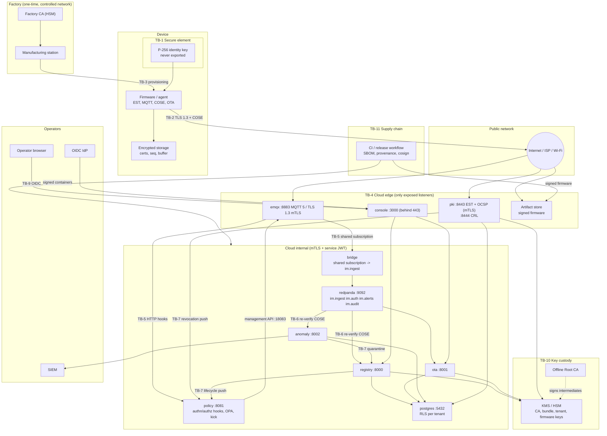

# IronMesh Threat Model

Phase 1 - STRIDE analysis of the IronMesh IoT security framework across device, network and cloud.

This document is subordinate to [`docs/DESIGN_CONTRACT.md`](docs/DESIGN_CONTRACT.md). Where the two
disagree, the contract wins and this document has a bug. Every mitigation below is either a contract
requirement or an implementation decision that satisfies one.

## 1. Scope and method

### 1.1 In scope

| Domain       | Elements                                                                                                                                    |
|--------------|---------------------------------------------------------------------------------------------------------------------------------------------|
| Device       | ESP32 firmware (`device/esp32/`), Linux agent (`device/agent-rs/`), secure elements (ATECC608, TPM 2.0, OP-TEE), software-key fallback       |
| Factory      | Manufacturing station, Factory CA, bootstrap certificate issuance, eFuse hardening                                                            |
| Network      | EST over mTLS (`/.well-known/est`), MQTT 5 over TLS 1.3 (8883), CRL/OCSP distribution, firmware artifact download                              |
| Cloud        | `emqx`, `pki`, `policy`, `bridge`, `registry`, `ota`, `anomaly`, `console`, `redpanda`, `postgres`, `otel-collector`, KMS/HSM                |
| Operators    | Console users (OIDC), tenant administrators, IronMesh platform operators                                                                      |
| Supply chain | Firmware and container build pipelines, dependency ecosystems (Cargo, Go modules, PyPI, npm, ESP-IDF components), signing infrastructure      |

Out of scope for Phase 1: physical security of the data centre, the back-office systems of tenants
that consume IronMesh APIs, and the internal correctness of third-party identity providers beyond the
OIDC contract.

### 1.2 Method

* STRIDE-per-element. Every trust boundary in section 3 is examined for Spoofing, Tampering,
  Repudiation, Information disclosure, Denial of service and Elevation of privilege.
* Each threat is rated for likelihood and impact (section 1.3) and mapped to the control that
  mitigates it and to the code location that implements the control.
* Threats that are deliberately not mitigated are recorded as **NOT MITIGATED** rows with the
  residual risk and compensating controls, so the decision is visible rather than implicit.

### 1.3 Rating scale

| Rating | Likelihood                                                                      | Impact                                                                                     |
|--------|---------------------------------------------------------------------------------|--------------------------------------------------------------------------------------------|
| H      | Expected to be attempted routinely against an Internet-exposed fleet             | Fleet-wide or tenant-wide compromise; CA or signing key loss; safety-relevant device misuse |
| M      | Requires a foothold, a specific vulnerability, or a motivated targeted attacker  | One tenant degraded, many devices affected, or sensitive data of one tenant exposed         |
| L      | Requires physical access, lab equipment, or an insider                           | Single device affected, or a nuisance that is detected and recovered automatically          |

### 1.4 Reference convention

The **Reference** column cites the implementing code as `path::symbol` in backticks, where `path` is
relative to the repository root and `symbol` is a function, type, Rego rule, config key or heading in
that file. `scripts/resolve_threat_refs.py` scans this file, `COMPLIANCE_MATRIX.md` and
`ARCHITECTURE.md`, checks that each path exists and that the symbol is present (and that every
backticked bare repository path exists), and in `--rewrite` mode replaces the reference with
`path:line (symbol)` so a reviewer can jump to the exact line. CI runs it with `--strict`, which fails the build on dangling references. References to
`docs/DESIGN_CONTRACT.md` use a heading or bold term from the contract as the symbol.

Every row either cites the code that implements its mitigation, or states **NOT MITIGATED** or
**Partially mitigated** followed by the gap. The register was reconciled against the implementation;
where the implementation differs from the original design intent, the row describes what the code
does, not what was planned.

## 2. Assets

| ID   | Asset                                                                        | Where it lives                                                                                | Goal    | Why it matters                                                                                            |
|------|------------------------------------------------------------------------------|-----------------------------------------------------------------------------------------------|---------|-----------------------------------------------------------------------------------------------------------|
| A-01 | Device identity private keys (bootstrap and operational, ECDSA P-256)         | ATECC608 slot, TPM 2.0 object, OP-TEE secure storage; encrypted NVS or OS keyring for `software` | C, I    | The device is its key. Every authorization decision derives from the certificate that wraps it            |
| A-02 | Bootstrap certificate (10 y, Factory CA)                                      | Device non-volatile storage                                                                   | I       | Long-lived re-entry credential; its binding to one physical device is what makes zero-touch safe          |
| A-03 | Operational certificate (14 d, Device CA)                                     | Device storage; `pki` database                                                                | I       | Carries device id and tenant id for MQTT authn/authz                                                      |
| A-04 | CA private keys: Root (offline), Factory, Device, Services                    | Offline HSM; factory HSM; cloud KMS (`awskms`) or SoftHSM                                     | C, I    | Loss of any online CA key allows minting arbitrary device or service identities                           |
| A-05 | PKI bundle signing key and the bundle public key baked into firmware          | KMS; firmware image                                                                           | C, I    | The bundle tells devices which broker, CA pins, tenant key and firmware keys to trust                     |
| A-06 | Tenant command signing keys (`tenant-cmd-<tenant>`, Ed25519)                  | KMS, one per tenant                                                                           | C, I    | Signs every command, desired shadow and OTA notification a device will act on                            |
| A-07 | Firmware signing keys (Ed25519 mandatory, ML-DSA-65 optional)                 | KMS                                                                                           | C, I    | Gate on all code that runs on devices                                                                     |
| A-08 | Firmware images, manifests and delta patches                                  | Artifact store (S3 or MinIO), `ota` database                                                  | I, A    | Integrity is enforced by signature; availability gates security patching                                  |
| A-09 | Telemetry, events, shadow reported state                                      | MQTT in flight, Redpanda `im.ingest`, `registry` and `anomaly` databases                       | I, C, A | Operational truth for the fleet; feeds anomaly detection and compliance evidence                          |
| A-10 | Commands, desired shadow, OTA notifications                                   | MQTT (retained for shadow/ota/config), `registry` and `ota` databases                          | I       | Actuation path to physical devices                                                                        |
| A-11 | Device configuration payloads (may embed Wi-Fi credentials, tenant API tokens) | HPKE-wrapped on the broker; plaintext only in `registry` memory and on the device              | C, I    | The only payload with confidentiality requirements beyond TLS                                             |
| A-12 | Tenant data partitions                                                        | Postgres databases `registry`, `ota`, `anomaly` under RLS                                      | C, I    | Multi-tenant platform; a cross-tenant read is a breach even without device impact                         |
| A-13 | Device lifecycle and revocation state                                         | `registry` (lifecycle), `pki` (revocations), `policy` in-memory caches                         | I, A    | Inputs to every CONNECT decision; stale or forged state grants or denies access                           |
| A-14 | Audit log                                                                     | `registry` append-only `audit_events` table, Redpanda `im.audit` (not forwarded to the SIEM)   | I, A    | Non-repudiation for operator and lifecycle actions                                                        |
| A-15 | Anomaly rules, Isolation Forest models, quarantine decisions                   | `anomaly` database and process memory                                                          | I       | Poisoned models silence detection or weaponise quarantine                                                 |
| A-16 | Service identities: Services CA certificates, `svc-bridge`, service JWT keys   | Kubernetes secrets or SPIFFE-style mounts; KMS                                                 | C, I    | `svc-bridge` can read every tenant's traffic; service JWTs authorise internal APIs                        |
| A-17 | Operator sessions and OIDC tokens                                             | Browser (httpOnly cookies via console BFF), console server memory                              | C, I    | Operators can revoke, quarantine, decommission and launch OTA campaigns                                   |
| A-18 | Replay state: per-device `seq`, EST nonces, command idempotency keys           | Postgres (`registry`, `pki`), device NVS or keyring                                            | I, A    | Replay protection is only as good as the persistence of the counters                                      |
| A-19 | Platform availability: broker, EST, ingest pipeline                            | Cloud                                                                                         | A       | Devices buffer offline but cannot be patched, commanded or quarantined while the platform is down         |
| A-20 | Build pipeline, SBOMs, provenance, release signing workflow                   | `.github/workflows/`, `sbom/`, KMS                                                             | I       | Single point from which every device and service inherits code                                            |

Goal column: C = confidentiality, I = integrity, A = availability.

## 3. Trust boundaries

| ID    | Boundary                                      | What crosses it                                                                                   | Primary control                                                                                                   |
|-------|-----------------------------------------------|---------------------------------------------------------------------------------------------------|-------------------------------------------------------------------------------------------------------------------|
| TB-1  | Secure element <-> firmware/application        | Signature requests and results only; the private key never crosses                               | Key generated inside the SE; non-exportable slot or object policy; software fallback marked `assurance:software`   |
| TB-2  | Device <-> Internet                            | EST (HTTPS mTLS), MQTT 5 over TLS 1.3, firmware downloads                                         | TLS 1.3 only to the broker and to EST, SPKI pinning on both paths (T-28, T-29), SAN host match, COSE_Sign1 on every payload, HPKE for config, artifact host allowlist (T-60) |
| TB-3  | Factory station <-> device                     | Key generation command, CSR, bootstrap cert, bundle public key, pins, EST URL; eFuse programming  | Physically controlled factory network; one-time provisioning mode closed by eFuses; registry reconciliation       |
| TB-4  | Internet <-> cloud edge                        | Only 8883 (EMQX), 8443/8444 (PKI), 443 (console and APIs), artifact store                         | mTLS on 8883/8443, no other listeners exposed, provider DDoS protection                                            |
| TB-5  | EMQX <-> policy and bridge                     | Authn/authz hook requests; shared-subscription stream of every tenant's publishes                 | Hook calls are plain HTTP with a shared hook token (an optional TLS 1.3 listener exists, not enabled by the charts); certificate serial and issuer checked at CONNECT (T-13); `svc-bridge` subscribe-only on the internal listener 8884, deny-by-default OPA, fail-closed hooks |
| TB-6  | Redpanda <-> consumers                         | Raw COSE envelopes with broker metadata                                                           | Consumers re-verify signatures and replay state; broker metadata is never trusted for identity                     |
| TB-7  | Service <-> service                            | Revocation and lifecycle pushes, quarantine calls, certificate lookups, signing requests          | Short-lived single-use ES256 service JWT (or a static bearer token toward registry and OTA) over in-cluster HTTP (mTLS only toward `pki`, T-50); HMAC on revocation pushes, durable outbox with fan-out to every policy replica (T-26); network policies, per-service DB roles |
| TB-8  | Tenant <-> tenant inside shared services       | Rows in shared tables; MQTT topics under `im/v1/<tenant>/`                                        | Postgres RLS keyed on `ironmesh.tenant_id`; OPA binds topics to certificate OU                                     |
| TB-9  | Operator <-> console and APIs                  | OIDC tokens, REST calls, campaign approvals                                                       | OIDC code flow with PKCE, SameSite=Strict BFF session cookies, nonce CSP, Origin checks, step-up re-authentication for destructive actions in the console (T-51), RBAC enforced server-side, audit |
| TB-10 | Services <-> KMS/HSM                           | Sign requests; keys never leave                                                                   | IAM-scoped KMS key policies, CloudTrail, `file` KMS refused in production; tenant and firmware keys are KMS-wrapped and used in process (T-44, T-64) |
| TB-11 | Source control and CI <-> deployed artifacts   | Firmware, containers, Helm charts, SBOMs                                                          | SLSA provenance, cosign signing, digest-pinned deploys and Kyverno admission verification in prod (T-67), dependency audits |

## 4. Attacker profiles

| ID   | Profile                                  | Access and resources                                                                              | Typical goals                                                                                        |
|------|------------------------------------------|---------------------------------------------------------------------------------------------------|------------------------------------------------------------------------------------------------------|
| AP-1 | Remote unauthenticated attacker           | Internet reachability to 8883/8443/443; scanners, protocol fuzzers, credential-stuffing kits       | Connect without a certificate, exhaust the broker or EST, find an input-validation bug                |
| AP-2 | On-path network attacker                  | Control of a Wi-Fi AP, ISP segment, DNS or BGP; can present forged certificates                    | Impersonate the broker or EST server, downgrade TLS, replay or reorder traffic                        |
| AP-3 | Physical possessor of a device            | Stolen or purchased unit; from a UART adapter to a side-channel lab                                | Extract the identity key or firmware, clone the device, reuse the bootstrap credential                |
| AP-4 | Compromised device                        | Legitimate certificate; attacker code runs on the device (exploit or malicious firmware)           | Spoof telemetry, probe topics, flood ingest, attempt lateral movement to other tenants or services    |
| AP-5 | Malicious tenant or tenant administrator  | Valid OIDC identity for one tenant; API access; can enrol their own devices                        | Read or write another tenant's data, escape topic ACLs, abuse shared services                         |
| AP-6 | Compromised operator or platform insider  | Stolen console session, or legitimate IronMesh operations access                                  | Revoke or quarantine at scale, push a rogue OTA campaign, read tenant data, erase audit trails        |
| AP-7 | Factory or contract-manufacturer insider  | Access to the manufacturing station and possibly the Factory CA                                   | Mint bootstrap certificates for rogue devices, exfiltrate keys before hardening                       |
| AP-8 | Supply-chain attacker                     | Compromised upstream dependency, CI runner, container registry or developer workstation           | Insert a backdoor into firmware or a service image that is then signed legitimately                   |
| AP-9 | Well-resourced adversary                  | Zero-days, side-channel and fault-injection equipment, patient targeting                          | Recover secure-element keys, compromise online CAs, or defeat secure boot on a target device          |

## 5. Threat register

Legend: S = Spoofing, T = Tampering, R = Repudiation, I = Information disclosure, D = Denial of
service, E = Elevation of privilege. L/I = likelihood / impact after considering the deployment
profile but before the listed mitigation. Attacker profiles (AP-n) and assets (A-nn) refer to
sections 2 and 4. Rows marked **NOT MITIGATED** are discussed again in section 6.

### 5.1 Device: hardware, firmware and local storage

| ID   | STRIDE | Threat | Affected component | L/I | Mitigation | Reference |
|------|--------|--------|--------------------|-----|------------|-----------|
| T-01 | S, I | Stolen device: attacker tries to extract the P-256 identity key from a hardware-rooted device (AP-3) | Secure element, agent identity module | M / H | The key is generated inside the secure element: `atcab_genkey` into an ATECC608 slot whose config and data zones are checked as locked at start-up, a TPM child object created with `fixedTPM`, `fixedParent` and `sensitiveDataOrigin` (only the TPM-wrapped blob touches disk), or the OP-TEE TA; firmware only ever receives signatures. A theft report moves the device to `decommissioned` (terminal in the transition table); after commit the registry calls PKI `revoke-all` (retried, with an outbox fallback), revocation kicks the live session (conformance `rev_1` asserts < 10 s), and EST refuses enrolment for every state other than `manufactured`, `provisioned` and `active`. The TPM and OP-TEE backends have no unit tests, and OP-TEE non-exportability rests on the TA, which is not in this repository. | `device/esp32/components/im_platform_esp/identity_atecc.c:159 (im_esp_keystore_genkey)` `device/esp32/components/im_platform_esp/identity_atecc.c:45 (check_config_zone)` `device/agent-rs/src/identity/tpm.rs:92 (identity_template)` `services/registry/app/lifecycle.py:27 (TRANSITIONS)` `services/registry/app/services/devices.py:492 (decommission)` `services/pki/internal/registry/registry.go:27 (EnrollmentAllowed)` `services/registry/tests/test_unit.py:90 (test_terminal_state)` `conformance/src/cases/rev.rs:108 (rev_1)` |
| T-02 | S, I | **NOT MITIGATED** - lab-grade side-channel (power or EM analysis) or fault-injection attack on the ATECC608 or TPM to recover the P-256 private key (AP-9) | Secure element | L / M | Not mitigated by IronMesh; depends on the secure-element vendor's countermeasures. Residual risk: one device identity per attacked unit, requiring physical possession and lab time. Compensating controls: operational certificates expire in 14 d and re-enrollment requires the current key; a re-enrolment supersedes the previous serial (revoked after a 1 h grace, serial-scoped); once a serial is revoked the policy authn hook refuses it at CONNECT (T-13); the `impossible_travel` and `auth_burst` rules flag a cloned identity; the device can be quarantined or decommissioned, which deny-lists the device id on every policy replica. | `docs/DESIGN_CONTRACT.md:241 (Assurance levels)` `services/pki/internal/est/handler.go:560 (supersedePrevious)` `services/anomaly/src/ironmesh_anomaly/rules/travel.py:38 (ImpossibleTravelRule)` `services/anomaly/src/ironmesh_anomaly/rules/auth_burst.py:39 (AuthBurstRule)` `services/policy/internal/hooks/authn.go:185 (decide)` |
| T-03 | S | Software-key device: malware or an attacker with filesystem access copies the key from encrypted NVS or the OS keyring (AP-3, AP-4) | `identity/software.rs`, `identity_nvs.c` | M / M | Software keys are a per-tenant opt-in (`AllowSoftwareKeys`, false unless the tenant policy sets it). The certificate carries OU `assurance:software`, the registry records the assurance level reported by the PKI, and `hardware_only` groups refuse software members (and cannot be switched to `hardware_only` while they have any). Linux stores the key AES-256-GCM-encrypted under a key derived with HKDF from a 0600 machine secret and refuses a group- or world-readable secret; ESP32 stores it in NVS, which is encrypted (`CONFIG_NVS_ENCRYPTION`, keys protected by flash encryption in the prod profile). | `services/pki/internal/attest/verify.go:59 (AllowSoftwareKeys)` `services/registry/app/services/devices.py:701 (record_assurance)` `services/registry/tests/test_devices.py:110 (test_default_group_and_software_hardware_only)` `device/agent-rs/src/identity/software.rs:103 (derive_kek)` `device/agent-rs/src/identity/software.rs:397 (world_readable_secret_refused)` `device/esp32/sdkconfig.defaults:34 (CONFIG_NVS_ENCRYPTION)` |
| T-04 | I, T | Flash readout or firmware extraction from a captured ESP32 (dump flash over SPI, read certificates and configuration, reverse engineer the image) (AP-3) | ESP32 flash, bootloader | M / M | **Partially mitigated** - gap: the `storage` partition that holds the ESP32 offline telemetry ring buffer is deliberately not flagged `encrypted` (the ring buffer acknowledges records by an in-place NOR bit-clear, which flash encryption's block-wise XTS would corrupt), so buffered telemetry is readable from a dumped flash. Implemented: the production `sdkconfig` enables Flash Encryption in release mode and Secure Boot v2 and disables ROM download mode; `nvs_keys` and `esp_secure_cert` are encrypted partitions and NVS (certificates, `seq`, EST pins) is encrypted with keys protected by flash encryption; CI fails a prod build whose config lacks these settings. Linux gateways: the agent encrypts its offline buffer and HMAC-seals its anti-rollback and time-floor records under keys derived from the machine secret (`atrest`); disk encryption of everything else is the integrator's (see `COMPLIANCE_MATRIX.md` 5.4-1). | `device/esp32/sdkconfig.defaults.prod:18 (CONFIG_SECURE_FLASH_ENC_ENABLED)` `device/esp32/sdkconfig.defaults.prod:26 (CONFIG_SECURE_DISABLE_ROM_DL_MODE)` `device/esp32/sdkconfig.defaults.prod:23 (CONFIG_NVS_SEC_KEY_PROTECT_USING_FLASH_ENC)` `device/esp32/partitions.csv:6 (nvs_keys)` `device/esp32/partitions.csv:17 (storage)` `device/esp32/tools/check_prod_config.py:86 (check)` `device/agent-rs/src/atrest.rs:60 (AtRestKey)` |
| T-05 | E | Debug interface abuse: JTAG or the UART console is used to halt the CPU, dump RAM or run code (AP-3) | ESP32 hardening, Linux agent host | M / H | **Partially mitigated** - gap: the boot-time self-check verifies only that Secure Boot and release-mode Flash Encryption are active (and reboots otherwise); it does not read the JTAG or ROM-download eFuses and does not gate enrolment. Implemented: Secure Boot v2 with `CONFIG_SECURE_BOOT_ALLOW_JTAG=n` disables JTAG via eFuse; the console and logs are compiled out (`CONFIG_ESP_CONSOLE_NONE`); ROM download mode is disabled. On Linux the agent runs as the unprivileged `ironmesh` user with `NoNewPrivileges`, an empty capability set and `ProtectSystem=strict`; physical ports are the integrator's responsibility. | `device/esp32/components/im_platform_esp/hardening.c:22 (im_esp_hardening_init)` `device/esp32/sdkconfig.defaults.prod:14 (CONFIG_SECURE_BOOT_ALLOW_JTAG)` `device/esp32/sdkconfig.defaults.prod:28 (CONFIG_ESP_CONSOLE_NONE)` `device/agent-rs/packaging/ironmesh-agent.service:28 (NoNewPrivileges)` `device/agent-rs/packaging/ironmesh-agent.service:53 (CapabilityBoundingSet)` |
| T-06 | T | Modified or malicious firmware booted on the device (flash rewrite, evil-maid) (AP-3, AP-8) | Boot chain | M / H | ESP32: Secure Boot v2 verifies bootloader and application signatures and the anti-rollback eFuse `secure_version` blocks older images. Linux: TPM measured boot; the quote must be signed by an AK that chains to the tenant's attestation CA, carry the EST nonce as qualifying data, cover the required SHA-256 PCRs and match a digest on the tenant allow list at every enrollment and rotation, so a modified boot chain cannot obtain an operational certificate. Telemetry carries `fw_hash` and the `fw_hash_mismatch` rule flags images not in the OTA catalogue. | `device/esp32/sdkconfig.defaults.prod:10 (CONFIG_SECURE_BOOT_V2_ENABLED)` `services/pki/internal/attest/verify.go:84 (verifyTPM)` `services/pki/internal/attest/tpm2.go:234 (CheckPCRSelection)` `services/pki/internal/est/handler_test.go:451 (TestTPMAttestation)` `services/anomaly/src/ironmesh_anomaly/rules/fw_hash.py:30 (FwHashMismatchRule)` |
| T-07 | S, T | Compromised device with a legitimate certificate publishes forged telemetry or events (AP-4) | Ingest, anomaly | M / M | Signatures cannot help: the message is genuinely from the device key, so detection is the control. `fw_hash` in every telemetry record is compared with the known-hash catalogue; TPM-backed devices are re-attested at every rotation; the `beaconing`, `topic_violation` and `auth_burst` rules and the per-tenant Isolation Forest raise alerts. Auto-quarantine (registry quarantine, which revokes and kicks) is available but off by default per tenant (minimum severity CRITICAL, circuit breaker), so most findings reach an operator as alerts. Telemetry bodies are schema-validated (types, field caps) by the shared wire library before storage. | `services/anomaly/src/ironmesh_anomaly/rules/fw_hash.py:30 (FwHashMismatchRule)` `services/anomaly/src/ironmesh_anomaly/quarantine.py:98 (QuarantinePolicy)` `services/anomaly/src/ironmesh_anomaly/clients.py:412 (HttpQuarantineClient)` `services/anomaly/tests/test_alerting_quarantine.py:161 (test_policy_gates_in_order)` `libs/python/ironmesh-wire/src/ironmesh_wire/envelope.py:100 (from_map)` |
| T-08 | T, D | Sequence counter loss or reset (NVS corruption, flash rollback, A/B slot revert, power loss mid-write) makes a device reuse a `seq`, so legitimate messages are dropped as replays or an old message becomes replayable (AP-3) | `seq.rs`, `im_agent.c`, NVS | M / L | **Partially mitigated** - gap: nothing detects or recovers from a lost high-water mark: if the persisted value is erased (NVS erase, deleted state file) the counter restarts low and the registry, which keys uplink replay state by device id, drops the device's messages as replays until the counter passes the stored value. This fails closed (availability, not replay). A `boot_epoch` is not part of the design: the wire format defines `seq` as a flat 64-bit counter per (sender kid, direction). Implemented: the high-water mark is reserved and persisted before any value in the block is used (Rust: block size `seq_block`, +1 on every open; ESP32: blocks of 16 in NVS), so a reboot or power loss can only move `seq` forward and an old message never becomes replayable. The store lives outside the A/B application slots. The server rejects non-increasing values with a compare-and-set in Postgres, counts them in `ironmesh_replay_rejected_total`, and `ReplayRejectedSpike` alerts on a sustained rate. | `device/agent-rs/src/seq.rs:129 (SeqCounter)` `device/agent-rs/src/seq.rs:323 (seq_never_reused_across_restart)` `device/esp32/components/im_core/im_agent.c:233 (next_seq)` `services/registry/app/repo/sql.py:671 (check_and_record_seq)` `observability/prometheus/rules/ironmesh.rules.yml:222 (ReplayRejectedSpike)` `conformance/src/cases/rpl.rs:144 (rpl_4)` `device/common/WIRE_FORMAT.md:206 (Payload)` |
| T-09 | T | Offline buffer tampering: an attacker with storage access edits or reorders buffered telemetry before it is replayed on reconnect (AP-3) | `buffer.rs`, ESP32 ring buffer | L / L | **Partially mitigated** - gaps: the ESP32 `storage` partition is not flash-encrypted (see T-04), so buffered telemetry is readable by whoever holds the flash; on Linux the buffer key derives from the 0600 machine secret, so root on the device can decrypt the buffer. Implemented: messages are COSE-signed when created and buffered as finished envelopes, so modification breaks the signature server-side, and `seq` ordering is enforced by the receiver. The Linux agent seals every buffered record with AES-256-GCM (key from the at-rest hierarchy, fresh nonce, the record's `seq` as associated data) and drops and counts a record whose tag does not verify instead of sending it. | `device/agent-rs/src/buffer.rs:85 (RingBuffer)` `device/agent-rs/src/buffer.rs:448 (records_are_encrypted_at_rest)` `device/agent-rs/src/buffer.rs:466 (tampered_records_are_dropped_and_counted)` `device/agent-rs/src/agent.rs:813 (publish_uplink)` `device/esp32/components/im_core/im_ringbuf.c:163 (im_rb_push)` `services/registry/app/services/ingest.py:149 (_process)` |
| T-10 | T | Device clock manipulation (NTP spoofing, RTC drift) to push `ts` outside the window, accept expired commands, or defeat certificate validity checks (AP-2) | Agent time source, EST client | M / L | **Partially mitigated** - gaps: the ESP32 uses unauthenticated SNTP and has no time floor; on Linux the floor moves the clock forward only, and only from EST responses, so between enrollments a clock pushed backwards (but not below the last authenticated EST time) still lets the device execute a command whose `expires_at` has passed (replay protection still limits each command to one execution); there is no other NTP sanity check. Implemented: the Linux agent applies the `Date` header of a mutually authenticated, pinned EST response as a forward-only time floor when its clock is unset or behind the newly issued certificate's `notBefore`, persists it HMAC-sealed (`time_floor.json`) and never uses a time below it after a restart; the receivers enforce a +/-300 s `ts` window, so a skewed device fails closed (its telemetry is rejected, not accepted with a wrong time); certificate validity is checked by the cloud services, which have trusted time. | `libs/python/ironmesh-wire/src/ironmesh_wire/envelope.py:42 (MAX_SKEW_DEFAULT)` `services/registry/tests/test_ingest.py:73 (test_replay_skew_signature_and_identity)` `device/agent-rs/src/seq.rs:97 (apply_time_hint)` `device/agent-rs/src/agent.rs:671 (persist_time_hint)` `device/agent-rs/tests/e2e.rs:160 (unset_clock_is_raised_to_the_authenticated_est_time)` `device/esp32/main/app_main.c:185 (wifi_start)` |
| T-11 | D | Rollback loop: a malicious or buggy image never calls `ota_mark_healthy()`, so the device reboots between slots indefinitely (AP-8) | `ota/boot.rs`, `ota_ab.c`, bootloader | L / M | After the 120 s health deadline the agent reverts to the previous slot, sets the new slot's state to `invalid` and reports `OtaStatus.state=6` (rolled_back); on a crash path the Linux boot control allows at most `max_boot_attempts` (3) trial boots before reverting. ESP32 calls `esp_ota_mark_app_invalid_rollback_and_reboot`. The rollout engine counts rolled-back devices toward the halt threshold. An invalid slot is never booted again without a new signed image, so the loop terminates. | `device/agent-rs/src/ota/boot.rs:146 (rollback)` `device/agent-rs/src/ota/boot.rs:341 (file_boot_control_trial_and_rollback)` `device/esp32/components/im_core/im_ota.c:369 (im_ota_tick)` `services/ota/src/ironmesh_ota/services/rollout.py:267 (check_halt)` `conformance/src/cases/ota.rs:247 (ota_6)` |
| T-12 | T, E | Memory-safety or parser bug in CBOR/COSE decoding triggered by a crafted retained message (device-side code execution) (AP-6 with broker access, AP-2) | `wire/cbor.rs`, `im_cbor.c`, `im_envelope.c` | M / H | The agent crate is `#![forbid(unsafe_code)]`; CBOR decoding is bounded (nesting depth <= 16, input <= 64 KiB) and ten parsers are fuzz targets (smoke run in CI, 10 min per target nightly). The ESP32 C decoder has the same depth bound, is cross-tested against `device/common/vectors/` (including negative vectors) and is compiled with the strong stack protector and light heap poisoning. Both implementations verify the signature before decoding the payload, so unauthenticated bytes never reach the body parser. | `device/agent-rs/src/lib.rs:5 (forbid)` `device/agent-rs/src/wire/cbor.rs:18 (DEFAULT_MAX_DEPTH)` `device/agent-rs/src/wire/envelope.rs:962 (decode)` `device/agent-rs/fuzz/fuzz_targets/cose_sign1_decode.rs:7 (fuzz_target!)` `device/esp32/components/im_core/im_envelope.c:366 (im_env_decode)` `device/esp32/sdkconfig.defaults.prod:43 (CONFIG_COMPILER_STACK_CHECK_MODE_STRONG)` `device/common/vectors/README.md:28 (Files)` `.github/workflows/nightly.yml:113 (fuzz-long)` |

### 5.2 Identity, PKI and enrollment

| ID   | STRIDE | Threat | Affected component | L/I | Mitigation | Reference |
|------|--------|--------|--------------------|-----|------------|-----------|
| T-13 | S | Cloned identity: attacker copies a bootstrap or operational credential (software-key device or extracted key) and runs a second device under the same id (AP-3, AP-4) | PKI, policy, anomaly | M / H | **Partially mitigated** - gap: the superseded certificate is revoked by an in-memory timer in the PKI (`PKI_SUPERSEDE_GRACE`, 1 h); a PKI restart inside the grace loses the timer, and the old serial then stays valid until it expires (at most 14 d) unless it is revoked otherwise. During the grace both serials are accepted (there is no "current serial only" rule). Deployment check: serial enforcement needs EMQX to render `${cert_pem}` in the authn body; if it does not, every CONNECT is denied (`no_cert_serial`), so the failure mode is closed. Implemented: hardware keys cannot be copied (T-01); EMQX sends `cert_pem` and `cert_serial` and the authn hook parses the certificate, requires the CN to match, the issuer to be the Device CA (Services CA for services) and the serial not to be revoked (PKI push or CRL), and denies a CONNECT that carries no serial (`POLICY_REQUIRE_CERT_SERIAL`, default on); a re-enrolment supersedes the previous certificate with a serial-scoped revocation, so the renewed device is not locked out; the hook rejects a client id that differs from the CN and denies deny-listed or non-connectable devices; the `auth_burst` and `impossible_travel` rules alert on the resulting pattern. | `services/policy/internal/hooks/authn.go:185 (decide)` `services/policy/internal/hooks/authn_serial_test.go:59 (TestRequireCertSerial)` `services/policy/internal/hooks/authn_serial_test.go:108 (TestTrustedIssuers)` `services/policy/internal/hooks/authn_serial_test.go:180 (TestRenewedDeviceNotLockedOut)` `services/policy/deploy/emqx/emqx.conf:140 (cert_pem)` `services/pki/internal/est/handler.go:560 (supersedePrevious)` `services/pki/internal/app/supersede_test.go:70 (TestRenewalSupersedesOnlyTheOldSerial)` `services/anomaly/src/ironmesh_anomaly/rules/auth_burst.py:39 (AuthBurstRule)` |
| T-14 | S | EST nonce reuse or attestation replay: a captured attestation COSE is replayed to enrol a second key (AP-2, AP-4) | `est/handler.go`, nonce store | M / H | The nonce is random with a 120 s TTL, bound to the device and tenant of the TLS client certificate that requested it, and consumed atomically (`DELETE ... RETURNING`) in Postgres so concurrent reuse loses. The attestation also binds `sha256(csr_der)`, so a replay cannot carry a different CSR. | `services/pki/internal/est/handler.go:244 (nonce)` `services/pki/internal/est/handler.go:56 (DefaultNonceTTL)` `services/pki/internal/store/postgres/postgres.go:398 (ConsumeNonce)` `services/pki/internal/attest/statement.go:241 (VerifyBinding)` `services/pki/internal/est/handler_test.go:340 (TestNonceLifecycle)` |
| T-15 | S, R | Attestation forgery: a software device claims `se_type=atecc608` or `tpm2`, or presents a quote from another TPM (AP-4, AP-5) | `attest/verify.go` | M / H | `tpm2`: the AK certificate must chain to the tenant's configured TPM attestation CA, `qualifyingData` must equal the nonce, the quote signature is verified with the AK, the quote must cover the required PCRs and its digest must be on the tenant allow list. `atecc608` and `optee`: the registry's manufacture record states the secure-element type, and a claimed `se_type` that does not match it is rejected. `software` is accepted only when the tenant allows it and is always marked in the certificate. The AK is not bound to the individual device's manufacture record. | `services/pki/internal/attest/verify.go:55 (VerifyEvidence)` `services/pki/internal/attest/verify.go:84 (verifyTPM)` `services/pki/internal/attest/tpm2.go:314 (VerifyQuoteSignature)` `services/pki/internal/est/handler.go:583 (checkSeTypeAgainstManufactureRecord)` `services/pki/internal/est/controls_test.go:53 (TestCheckSeTypeAgainstManufactureRecord)` |
| T-16 | T | CSR substitution or CN tampering in transit during `simpleenroll` (AP-2) | EST | L / H | mTLS prevents on-path modification; independently the server requires CSR CN == TLS certificate CN, CSR OU == certificate tenant, and `sha256(csr_der)` == attestation claim 2, which is signed by the TLS client key. | `services/pki/internal/est/handler.go:280 (enroll)` `services/pki/internal/attest/statement.go:241 (VerifyBinding)` `services/pki/internal/est/handler_test.go:246 (TestEnrollRejections)` |
| T-17 | S, E | Re-enrollment by a quarantined or decommissioned device using its still-valid 10 y bootstrap certificate (AP-3) | EST, registry lifecycle | M / H | EST fetches the lifecycle state from the registry before issuing: only `manufactured`, `provisioned` and `active` may enrol; `quarantined` is refused until released and `decommissioned` is terminal. The registry's `/enrolled` callback applies the same gate and writes a failure audit row. | `services/pki/internal/registry/registry.go:27 (EnrollmentAllowed)` `services/pki/internal/est/handler_test.go:379 (TestLifecycleAndTenantPolicy)` `services/registry/app/lifecycle.py:40 (ENROLLABLE)` `services/registry/app/services/devices.py:610 (enrolled)` `conformance/src/cases/enr.rs:109 (enr_2)` |
| T-18 | S | Bootstrap credential stolen in logistics: a device is intercepted between factory and installation and enrolled by the attacker (AP-3) | EST, registry | L / M | **Partially mitigated** - gap: the registry does not record an enrolment source and nothing checks a shipment window or expected region at first enrolment. Implemented: enrolment from `manufactured` still requires the hardware key and a bootstrap certificate whose serial matches the manufacture record, so the attacker needs the physical unit; the tenant can decommission it; `impossible_travel` can flag it once it reports location. Residual: an attacker who installs the stolen unit before the legitimate owner notices operates a device under the victim tenant until it is decommissioned. | `services/pki/internal/est/identity.go:67 (checkBootstrapSerialMatchesManufactureRecord)` `services/registry/app/services/devices.py:610 (enrolled)` `services/anomaly/src/ironmesh_anomaly/rules/travel.py:38 (ImpossibleTravelRule)` |
| T-19 | S, E | **NOT MITIGATED** - factory insider with Factory CA access mints bootstrap certificates for rogue hardware (AP-7) | Factory CA, registry | L / H | Not mitigated against an insider who controls both the Factory CA and the registry. Compensating controls: the device id is minted by the registry (`POST /v1/devices`, `admin` or `factory` role, which records `bootstrap_serial_hex` and `se_type`), and EST rejects a bootstrap certificate whose serial is not in that record, so a rogue certificate also needs a registry write, which is audited. The Factory CA can be revoked by the Root without affecting the Device CA. Not implemented: daily reconciliation of Factory CA issuance against production orders, batch manufacture records and secure-element serials. Residual: rogue devices operate until someone notices. | `services/pki/internal/est/identity.go:67 (checkBootstrapSerialMatchesManufactureRecord)` `services/pki/internal/est/controls_e2e_test.go:61 (TestManufactureRecordChecks)` `services/registry/app/services/devices.py:173 (create_device)` |
| T-20 | S, E | **NOT MITIGATED** - compromise of the offline Root CA ceremony (key generated or stored incorrectly, witness collusion) (AP-9, AP-7) | Root CA | L / H | Not mitigated by software. Compensating controls: `pkictl` ceremony tooling wraps the Root key under a KEK split 3-of-5 with Shamir secret sharing, and the AWS root key policy limits `Sign` to the ceremony role; the Root only signs intermediates and the CRL; devices trust the Services CA through pins in the signed bundle, whose key is independent of the Root. The written, witnessed ceremony procedure is still marked *planned* in the runbook, and pin replacement is single-step (see T-22). Residual: if the ceremony itself is corrupted every chain is suspect and the fleet must be re-rooted via OTA. | `services/pki/internal/ceremony/ceremony.go:63 (InitRoot)` `services/pki/internal/shamir/shamir.go:40 (Split)` `services/pki/internal/ceremony/ceremony_test.go:193 (TestQuorumCeremony)` `RUNBOOK.md:126 (Root CA ceremony)` `services/pki/internal/est/bundle.go:99 (BuildHeader)` |
| T-21 | S, E | Online CA or bundle key compromise through the KMS boundary (stolen service credentials, misconfigured IAM) (AP-6) | `kms/awskms/awskms.go`, SoftHSM backend | L / H | **Partially mitigated** - gaps: the KMS key-administrator statement includes `kms:PutKeyPolicy`, so an administrator can rewrite the `Sign` restriction; no alert compares issuance rate with the rotation baseline. Implemented: Device, Services and bundle keys are non-exportable KMS keys whose key policy allows `Sign` only to the `pki` and ceremony roles; KMS calls are logged by CloudTrail; the `file` backend is refused in production (`PKI_ENV=production`). Response is intermediate rotation from the Root. | `services/pki/internal/kms/awskms/awskms.go:129 (Sign)` `deploy/terraform/aws/modules/kms/main.tf:167 (ca_signing)` `services/pki/cmd/pki/main.go:46 (requireProductionKMS)` `services/pki/cmd/pki/main_test.go:48 (TestRunRefusesFileKMSInProduction)` |
| T-22 | T | Rogue or stale bundle: attacker substitutes a bundle to repoint devices at a hostile broker, add CA pins or swap firmware keys (AP-2, AP-6) | `X-IronMesh-Bundle`, device EST client | L / H | **Partially mitigated** - gaps: two-step pin rotation is not implemented (a valid bundle replaces `ca_pins` wholesale, checked only for being non-empty), and the ESP32 commits the newly issued identity before it verifies the bundle. Implemented: the bundle is a COSE_Sign1 by the PKI bundle key; devices verify it with the factory-provisioned bundle public key and accept it only from the `X-IronMesh-Bundle` header of an mTLS EST response, never from the broker. | `device/agent-rs/src/est/bundle.rs:66 (verify_bundle)` `device/agent-rs/src/est/bundle.rs:136 (sign_and_verify)` `device/esp32/components/im_core/im_agent.c:480 (im_agent_load_bundle)` `services/pki/internal/est/bundle.go:99 (BuildHeader)` |
| T-23 | S | Reused public key at re-enrollment: a CSR is submitted for a key that was already certified, defeating the new-key-per-enrollment rule (AP-4) | EST | L / M | The server rejects a CSR whose SubjectPublicKeyInfo matches any certificate previously issued to that device id. | `services/pki/internal/est/handler.go:596 (rejectReusedKey)` `services/pki/internal/store/postgres/postgres.go:164 (ListCertificatesByDevice)` `services/pki/internal/est/controls_e2e_test.go:94 (TestReusedKeyRejected)` |
| T-24 | S | Predictable or colliding certificate serials used to confuse `kid` lookups or forge revocation events (AP-5) | `ca/serial.go` | L / M | Serials are 128-bit values from the OS CSPRNG; the certificate store's primary key is the serial, so a collision fails the insert. | `services/pki/internal/ca/serial.go:16 (NewSerial)` `services/pki/internal/ca/serial.go:13 (SerialBytes)` `services/pki/internal/store/postgres/postgres.go:140 (PutCertificate)` |
| T-25 | D | EST enrolment flood or TLS handshake exhaustion against `pki` (AP-1, AP-4) | `pki` 8443 | M / M | **Partially mitigated** - gaps: the EST listener sits behind a TCP-passthrough NLB with no pre-handshake per-source rate limit (the WAF covers only the ALB), and a client may hold several nonces at once. Implemented: after the handshake, token-bucket limits per device (30/min, burst 10) and per source IP (1200/min, burst 300); expired nonces are purged; horizontal autoscaling. Devices back off exponentially (base 60 s, cap 6 h; full jitter on Linux, deterministic on ESP32). | `services/pki/internal/est/ratelimit.go:27 (DefaultDevicePerMinute)` `services/pki/internal/est/controls_e2e_test.go:120 (TestRateLimiting)` `services/pki/internal/store/postgres/postgres.go:415 (DeleteExpiredNonces)` `device/agent-rs/src/est/renewal.rs:43 (retry_backoff)` `device/esp32/components/im_core/im_agent.c:594 (schedule_renewal)` |
| T-26 | D, E | Revocation or lifecycle push lost between PKI or registry and policy (network partition, policy restart), so a revoked or quarantined device stays connected beyond the 10 s budget (AP-4 benefits) | `revocation/publisher.go`, `revocation/cache.go` | M / M | A revocation and its policy event are written to a durable outbox (`revocation_outbox`) in one transaction; a background dispatcher delivers each event until it is acknowledged (backoff doubling from 500 ms, capped at 30 s; rows leased with `FOR UPDATE SKIP LOCKED`, so a restarted or second PKI replica resumes delivery). With `PKI_POLICY_FANOUT=dns`, which the Helm chart sets against the policy headless Service, every event goes to every ready policy replica and is acknowledged only when each returned 2xx. The registry's own `revoke-all` call is retried from its action outbox. Policy verifies the HMAC, deduplicates by `event_id` (so redelivery is harmless) and kicks the live session (retried, with a 30 s requeue of unkicked entries). Because the authn hook checks the certificate serial at CONNECT (T-13), the CRL poll (every 5 s) is an independent second path for serial revocations, and the registry lifecycle check at CONNECT (cached 30 s) a third. `ironmesh_revocation_outbox_pending` exposes undelivered events and `RevocationLatencyHigh` alerts at p99 > 8 s; conformance `rev_1` measures revoke-to-disconnect < 10 s against one policy replica, and delivery to several replicas is covered by unit tests. | `services/pki/internal/revocation/outbox.go:67 (Dispatcher)` `services/pki/internal/store/postgres/migrations/0003_revocation_outbox.sql:13 (revocation_outbox)` `services/pki/internal/revocation/publisher.go:226 (fanOut)` `services/pki/internal/revocation/outbox_test.go:223 (TestOutboxRestartRecovery)` `services/pki/internal/revocation/outbox_test.go:325 (TestFanOutToEveryReplica)` `deploy/helm/ironmesh/values.yaml:432 (PKI_POLICY_URL)` `services/policy/internal/revocation/service_test.go:558 (TestFanOutRedeliveryIsIdempotent)` `services/policy/internal/revocation/crlpoll.go:152 (PollOnce)` `services/policy/internal/emqx/kick.go:100 (Kick)` `services/pki/internal/metrics/metrics.go:83 (RevocationOutboxPending)` `observability/prometheus/rules/ironmesh.rules.yml:118 (RevocationLatencyHigh)` `conformance/src/cases/rev.rs:108 (rev_1)` |
| T-27 | D | Stale revocation data makes the policy service decide incorrectly while the PKI is unreachable (AP-1 causing an outage) | `revocation/cache.go` | L / M | **Partially mitigated** - gap: policy has no degraded state; it records the last successful CRL fetch but stays ready, and only the `CrlStale` alert (CRL older than 600 s) pages operators. Implemented: policy keeps serving from its last-known cache so a PKI outage does not disconnect the fleet. Residual: a device revoked during a prolonged PKI-to-policy partition keeps access until the partition heals. | `services/policy/internal/revocation/cache.go:288 (IsRevokedSerial)` `services/policy/internal/revocation/crlpoll.go:145 (LastSuccess)` `observability/prometheus/rules/ironmesh.rules.yml:140 (CrlStale)` |

### 5.3 Transport and broker

| ID   | STRIDE | Threat | Affected component | L/I | Mitigation | Reference |
|------|--------|--------|--------------------|-----|------------|-----------|
| T-28 | S | Rogue broker: DNS hijack, BGP hijack or captive portal presents a forged broker certificate (AP-2) | Device MQTT client | M / H | Devices pin the SHA-256 of the Services CA SPKI distributed in the signed bundle, require the broker certificate SAN to match the configured host, and accept only TLS 1.3. A publicly trusted certificate for the right hostname is therefore not sufficient. Both firmware targets offer ALPN `mqtt`; EMQX 5.8 has no listener ALPN option and selects none, so the ESP32 rejects only a different negotiated protocol and the agent does not check it (not security-relevant given the pin). | `device/agent-rs/src/tls.rs:46 (PinnedVerifier)` `device/agent-rs/src/tls.rs:81 (verify_server_cert)` `device/agent-rs/tests/e2e.rs:184 (rogue_broker_and_tls12_broker_are_rejected)` `device/esp32/components/im_platform_esp/im_tls.c:106 (verify_cb)` `conformance/src/cases/tls.rs:114 (tls_2)` `docs/DESIGN_CONTRACT.md:103 (Pinning)` |
| T-29 | S, I | MITM on the EST path during first enrollment, before any bundle exists (AP-2) | Device EST client | M / H | The Linux agent pins the first EST connection with `pki.est_pins` from its provisioned configuration until a bundle exists. The ESP32 runs every EST request with `pin_required`: the server chain must contain a CA whose SPKI SHA-256 is pinned, using the signed bundle's `ca_pins` once enrolled and, before the first enrollment, the factory-provisioned PKI CA pin (NVS `est_pins`, falling back to the SPKI of the CA certificate in `esp_secure_cert`); with no pin at all it fails closed, and an EST `/cacerts` response can never introduce an unpinned anchor. The server requires the device's bootstrap certificate (mTLS), so an interceptor cannot complete a handshake toward the real server either. | `device/agent-rs/src/settings.rs:80 (est_pins)` `device/agent-rs/src/agent.rs:691 (enroll_now)` `device/agent-rs/tests/e2e.rs:58 (enrollment_pinned_connect_telemetry_resumption_and_rotation)` `device/esp32/components/im_core/im_util.c:63 (im_est_pins_select)` `device/esp32/components/im_core/im_agent.c:530 (im_agent_est_pins)` `device/esp32/components/im_platform_esp/im_tls.c:135 (pin_required)` `device/esp32/host/core-tests/tests/util.rs:306 (est_pins_bundle_first_then_factory_never_none)` |
| T-30 | T | TLS downgrade to 1.2 or a weak cipher suite (AP-2) | EMQX listener, EST listener, device TLS stacks | L / M | EMQX's device (8883) and internal (8884) listeners allow only `tlsv1.3` in every profile; the `pki` 8443 listener (EST, OCSP, management) negotiates TLS 1.3 only, and a test asserts that a TLS 1.2 client fails the handshake; the optional policy TLS listener is TLS 1.3 only; rustls in the agent is restricted to TLS 1.3; ESP-IDF mbedTLS is built with TLS 1.2 disabled; conformance `tls_3` asserts that the device refuses a TLS 1.2-only broker. Residual: the broker's refusal of a TLS 1.2 client rests on its configuration and is not covered by an automated test. | `services/policy/deploy/emqx/emqx.conf:53 (versions)` `deploy/helm/ironmesh/values.yaml:1205 (EMQX_LISTENERS__SSL__INTERNAL__SSL_OPTIONS__VERSIONS)` `services/pki/internal/server/server.go:101 (TLSConfig)` `services/pki/internal/server/server_test.go:19 (TestRunLifecycle)` `services/policy/internal/server/tls.go:14 (TLSConfig)` `device/agent-rs/src/tls.rs:188 (client_config)` `device/esp32/sdkconfig.defaults:12 (CONFIG_MBEDTLS_SSL_PROTO_TLS1_2)` `conformance/src/cases/tls.rs:119 (tls_3)` |
| T-31 | T | Replay of device-to-cloud messages captured on the wire or re-published through a compromised bridge (AP-2, AP-6) | Registry ingest, anomaly | M / M | Every envelope carries a strictly increasing persisted `seq` per (device, direction) and a `ts` within +/-300 s; the registry stores the last accepted `seq` per device in Postgres with a compare-and-set and drops anything at or below it, counting the drop in `ironmesh_replay_rejected_total`; the anomaly consumer re-verifies with its own (snapshotted) replay state. The `kid` must resolve to a certificate of that device that is neither revoked nor expired (there is no "current or immediately previous serial" rule, so a superseded certificate stays usable until its revocation, see T-13). | `services/registry/app/services/ingest.py:149 (_process)` `services/registry/app/repo/sql.py:671 (check_and_record_seq)` `services/registry/tests/test_ingest.py:336 (test_vector_replay_cases)` `services/anomaly/src/ironmesh_anomaly/ingest.py:123 (IngestDecoder)` `services/anomaly/tests/test_ingest.py:55 (test_replay_is_dropped_not_alerted)` |
| T-32 | T | Replay of cloud-to-device commands, desired shadow or OTA notifications, retained or captured (AP-2, AP-6) | Device wire layer | M / H | Devices persist the last accepted `seq` per stream (tenant key and message type) and accept a message only after the new value is durable, rejecting non-increasing values (fail closed on both implementations); commands carry an `idempotency_key` kept in an on-device cache (Linux: 256 entries, persisted; ESP32: 16 entries in RAM) and an `expires_at` enforced device-side (see T-10 for the clock caveat). | `device/agent-rs/src/seq.rs:296 (check_and_record)` `device/agent-rs/src/agent.rs:926 (verify_downlink)` `device/esp32/components/im_core/im_agent.c:193 (replay_persist)` `device/agent-rs/src/commands.rs:38 (IdempotencyCache)` `conformance/src/cases/rpl.rs:55 (rpl_1)` |
| T-33 | S | Telemetry spoofing across devices or tenants: a connected device publishes to another device's topic, or signs with a key the topic does not belong to (AP-4, AP-5) | OPA ACL, ingest verification | M / H | OPA allows a publish only when the topic's `<t>/<d>` segments equal the OU and CN of the connecting certificate, with exact segment matching. Independently, the registry ingest resolves the certificate by `kid`, verifies the signature, and requires the certificate's tenant and device to equal the topic's; broker metadata is never used for identity. | `services/policy/policy/rego/mqtt_acl.rego:104 (owns_topic)` `services/registry/app/services/ingest.py:149 (_process)` `services/registry/tests/test_ingest.py:130 (test_cert_state_and_device_state_rejections)` `conformance/src/cases/acl.rs:56 (acl_1)` |
| T-34 | E | Broker ACL bypass through wildcards, `$share`, `$SYS`, `+` inside device segments, MQTT 5 topic aliases, Unicode look-alikes, trailing slashes or empty segments (AP-4, AP-5) | OPA policy, EMQX | M / H | Deny-by-default Rego (`default allow := false`): `topic` is defined only when the string parses as `im/v1/<tenant>/<device>/<class>` with the tenant and device segments matching the contract regexes and `<class>` one of the contract classes, so wildcards, `$SYS`, extra or missing segments and unknown classes leave `topic` undefined and every allow rule fails. The tenant and device segments must equal the `client_attrs` the authn hook derived from the verified certificate, never anything the client sent; shared-subscription filters are accepted only for CN `svc-bridge`. EMQX resolves topic aliases before the authz hook runs, so the hook always sees the full topic. The Rego test suite contains the adversarial cases and runs in CI. Tenant owners may customise the policy through `PUT /v1/policy`, but the built-in invariant tests run on every update and a policy that fails one is refused. | `services/policy/policy/rego/mqtt_acl.rego:100 (has_wildcard)` `services/policy/policy/rego/mqtt_acl.rego:87 (topic)` `services/policy/policy/rego/mqtt_acl_test.rego:173 (test_device_claiming_service_cn_denied)` `services/policy/policy/rego/mqtt_acl_test.rego:110 (test_device_publish_wildcard_denied)` `.github/workflows/ci.yml:170 (rego)` |
| T-35 | S, D | Client id not equal to certificate CN: a device connects with another device's client id to take over its session or force a kick (AP-4) | Policy authn hook | M / M | The authn hook rejects any CONNECT whose `clientid` differs from the certificate CN (reason `clientid_mismatch`), and EMQX also uses the CN as username (`peer_cert_as_username = cn`), so session takeover requires the victim's key. | `services/policy/internal/hooks/authn.go:185 (decide)` `services/policy/internal/hooks/authn_test.go:250 (TestDecideDenials)` `services/policy/deploy/emqx/emqx.conf:89 (peer_cert_as_username)` |
| T-36 | E | Policy hook unavailable or slow and EMQX falls open (AP-1 causing an outage, AP-4 benefiting) | EMQX authn/authz configuration | M / H | **Partially mitigated** - gaps: policy reports ready as soon as it starts (`/readyz` checks only for shutdown, not for warm caches), and the Helm default is two policy replicas (three in `values-prod.yaml`). Implemented: the HTTP authenticator is the only chain element, the Kubernetes and Helm listener configs set `quick_deny_anonymous`, `authorization.no_match = deny` and `deny_action = disconnect`, so a hook timeout or 5xx denies the CONNECT or publish instead of allowing it; the authz result cache is 10 s because quarantine and revocation are enforced by kick, not by cache expiry. | `services/policy/deploy/emqx/emqx.conf:158 (no_match)` `services/policy/deploy/emqx/emqx.conf:159 (deny_action)` `deploy/k8s/base/emqx/configmap.yaml:24 (EMQX_LISTENERS__SSL__DEFAULT__ENABLE_AUTHN)` `services/policy/internal/server/server.go:60 (readyz)` `deploy/helm/ironmesh/values-prod.yaml:126 (policy)` |
| T-37 | I | Bridge credential theft: the `svc-bridge` Services CA certificate and key are exfiltrated and used to subscribe to `$share/bridge/im/v1/#` from outside (AP-6) | Bridge, EMQX, policy | L / H | **Partially mitigated** - gaps: the origin check accepts any RFC 1918 or loopback peer (`POLICY_SERVICE_CIDRS` is set to those ranges in the Helm and Kubernetes profiles), not just the pod CIDR; there is no session-count check; telemetry is signed, not encrypted, so the holder of a stolen bridge certificate reads tenant telemetry until the certificate is revoked. Implemented: cert-manager issues the key as a 90 d certificate renewed 30 d early; OPA allows `svc-bridge` to subscribe only, never publish; the authn hook requires O=IronMesh, OU=services, a private-range peer address and a certificate issued by the Services CA, and checks the serial at CONNECT, so revoking a stolen bridge certificate stops it at its next CONNECT and kicks a session admitted with that serial; service principals use the internal listener 8884, which trusts only the Services CA, has no NodePort or load balancer, and is admitted by NetworkPolicy only from the bridge and registry pods. | `services/policy/policy/rego/mqtt_acl.rego:48 (bridge_filters)` `services/policy/internal/hooks/authn.go:338 (checkServicePrincipalOrigin)` `services/policy/internal/hooks/authn.go:312 (DefaultServiceCIDRs)` `services/policy/internal/hooks/authn_serial_test.go:151 (TestRevokedServiceCertificateAtConnect)` `deploy/helm/ironmesh/values.yaml:1200 (EMQX_LISTENERS__SSL__INTERNAL__BIND)` `deploy/k8s/base/networkpolicies/networkpolicies.yaml:244 (name: emqx)` `deploy/k8s/base/pki-dev/service-certs.yaml:120 (bridge-tls)` `deploy/helm/ironmesh/values.yaml:224 (renewBefore)` |
| T-38 | T | Bridge-to-Redpanda poisoning: fabricated records are produced directly into `im.ingest` (AP-6, AP-4 after lateral movement) | Redpanda, consumers | L / M | **Partially mitigated** - gaps: the compose and Kubernetes Redpanda listeners authenticate with SCRAM but carry no TLS, so records cross the pod network in clear; the bridge's Kafka security still defaults to `none` (with a warning) when a profile does not set it; the OTA service declares `OTA_KAFKA_SASL_*` but its Kafka clients do not use them yet, so its Kafka traffic fails against an authenticated cluster (closed, not bypassed). Implemented: records carry the original COSE bytes and every consumer re-verifies signature, certificate state and replay before use, so a record without a valid device signature is rejected (and raised as a security event by anomaly); compose and the Kubernetes base enforce SASL/SCRAM-SHA-512 with per-service users, topic ACLs and `<svc>-*` consumer-group ACLs (`redpanda-init`); the bridge supports TLS with SCRAM or MSK IAM; on AWS MSK `allow.everyone.if.no.acl.found=false` and IAM gives the bridge write access to its topics only and the consumers read-only access. | `services/bridge/internal/bridge/producer.go:97 (Produce)` `services/bridge/internal/bridge/kafkasec.go:37 (NewSASLMechanism)` `deploy/k8s/base/redpanda/init-job.yaml:53 (superusers)` `services/ota/src/ironmesh_ota/settings.py:142 (kafka_sasl_mechanism)` `deploy/terraform/aws/modules/iam/main.tf:230 (bridge_kafka)` `deploy/terraform/aws/modules/msk/main.tf:119 (allow.everyone.if.no.acl.found)` `services/anomaly/tests/test_ingest.py:66 (test_forged_signature_is_a_security_event)` |
| T-39 | D | **NOT MITIGATED** - volumetric or protocol-level denial of service against the broker (SYN flood, TLS handshake flood, connection churn from a botnet) (AP-1) | EMQX 8883 edge | M / M | Not mitigated at the application layer. Compensating controls: AWS Shield Standard (automatic on AWS load balancers; Shield Advanced is not enabled) and a WAFv2 rate-based rule on the ALB (the MQTT NLB is TCP passthrough and has no WAF); EMQX `max_connections`, a per-listener connection rate (500/s by default, 2000/s in prod) and per-client message and byte rates (T-40); device reconnect backoff with full jitter (base 1 s, cap 300 s) that stops the legitimate fleet from amplifying an outage. Linux devices buffer up to 10 000 messages offline (ESP32: 2048 slots of 512 B), so telemetry is delayed rather than lost. Residual: a sufficiently large attack delays telemetry, commands and OTA until it is absorbed upstream. | `deploy/terraform/aws/modules/alb/main.tf:249 (aws_wafv2_web_acl)` `services/policy/deploy/emqx/emqx.conf:38 (max_connections)` `deploy/helm/ironmesh/values-prod.yaml:276 (EMQX_LISTENERS__SSL__DEFAULT__MAX_CONN_RATE)` `device/agent-rs/src/mqtt/client.rs:493 (Backoff)` `device/esp32/components/im_core/im_agent.c:836 (schedule_backoff)` |
| T-40 | D | Telemetry flood from a compromised subset of the fleet exhausts the broker, bridge or Redpanda (AP-4) | EMQX, bridge, Redpanda | M / M | **Partially mitigated** - gaps: per-client limits bound each device, not a compromised subset in aggregate; Redpanda has no producer quotas; there is no publish-rate anomaly rule; EMQX exports no counter for clients paused by `messages_rate`/`bytes_rate`, so `BrokerClientQuotaExceeded` sees only inflight and receive-maximum drops. Implemented: the device listener limits every client to 10 messages/s and 64 KB/s (`messages_rate`, `bytes_rate`, in compose, the Kubernetes base and Helm; service principals use the separate internal listener) with `mqtt.max_inflight` 32; the bridge applies backpressure (a semaphore bounds in-flight messages to `BRIDGE_MAX_INFLIGHT`, also used as the MQTT receive maximum, and QoS 1 acks are sent only after a successful produce); `BrokerClientQuotaExceeded` alerts on sustained quota drops; the `beaconing` rule flags abnormal publish patterns. | `deploy/helm/ironmesh/values.yaml:1184 (EMQX_LISTENERS__SSL__DEFAULT__MESSAGES_RATE)` `observability/prometheus/rules/ironmesh.rules.yml:249 (BrokerClientQuotaExceeded)` `services/bridge/internal/bridge/consumer.go:82 (MaxInflight)` `services/bridge/internal/bridge/consumer_test.go:175 (TestConsumerBoundsInflight)` `services/anomaly/src/ironmesh_anomaly/rules/beaconing.py:71 (BeaconingRule)` |
| T-41 | T | Trace context injection: a device sets the MQTT 5 user property `traceparent` to hostile content to pollute traces or exploit the collector (AP-4) | Bridge, otel-collector | L / L | **Partially mitigated** - gap: the Baggage propagator copies device-supplied `baggage` user properties into Kafka headers unfiltered. Implemented: `traceparent` is parsed by the OpenTelemetry W3C TraceContext propagator, which discards malformed values and starts a fresh trace; the raw value is never logged. | `services/bridge/internal/bridge/forwarder.go:83 (Forward)` `services/bridge/internal/bridge/forwarder.go:29 (HeaderTraceParent)` `services/bridge/internal/bridge/forwarder_test.go:91 (TestForwardPropagatesTraceContextThroughSDK)` |

### 5.4 Cloud platform: registry, tenancy, commands, configuration, console

| ID   | STRIDE | Threat | Affected component | L/I | Mitigation | Reference |
|------|--------|--------|--------------------|-----|------------|-----------|
| T-42 | I, E | Tenant isolation breach through the API: a tenant user requests another tenant's device, twin or campaign by id (IDOR) (AP-5) | Registry, OTA, anomaly APIs and databases | M / H | Every tenant table has `tenant_id uuid NOT NULL` and a forced RLS policy on `current_setting('ironmesh.tenant_id')`; services connect as a non-owner `NOBYPASSRLS` role and set the tenant with `set_config(..., true)` from the verified token claim at the start of every transaction; the `X-IronMesh-Tenant` override is honoured only for `platform_admin` and is audited. A missing setting raises an error in the registry; in OTA and anomaly it yields no rows. Cross-tenant tests in each service assert that reads return nothing and writes fail. | `services/registry/migrations/versions/0001_initial.py:432 (CREATE POLICY tenant_isolation)` `services/registry/app/repo/sql.py:919 (tenant)` `services/registry/tests/test_postgres_rls.py:109 (test_rls_isolates_tenants)` `services/ota/tests/test_postgres.py:396 (test_rls_blocks_cross_tenant_access_at_sql_level)` `services/anomaly/tests/test_postgres.py:156 (test_row_level_security_isolates_tenants)` `services/registry/tests/test_auth_rbac.py:155 (test_platform_admin_tenant_override)` |
| T-43 | E | RLS bypass: the application role owns tables or has `BYPASSRLS`, the policy is not forced, or a query injects `SET ironmesh.tenant_id` (AP-5 via SQL injection, AP-6) | Postgres roles, migrations | L / H | **Partially mitigated** - gap: the "every table has RLS" tests check hard-coded table lists, not the catalogue, so a new table added without a policy is not caught automatically (OTA's `pki_key_sync` deliberately has none). Implemented: the application roles (`registry_app`, `ota_app`, `anomaly_app` and, since migration 0002, `pki_app`) are created `NOBYPASSRLS` and own nothing; every tenant table has `FORCE ROW LEVEL SECURITY`; the PKI runs as `pki_app` and migrates with a separate owner DSN; the tenant is set with a parameterised `set_config` call and queries use bound parameters; an unset tenant fails closed in the registry. | `services/registry/migrations/versions/0001_initial.py:353 (FORCE ROW LEVEL SECURITY)` `services/registry/migrations/versions/0001_initial.py:421 (CREATE ROLE registry_app)` `services/registry/tests/test_postgres_rls.py:87 (test_policies_forced_on_every_tenant_table)` `services/registry/tests/test_postgres_rls.py:149 (test_unset_tenant_fails_closed)` `services/ota/tests/test_postgres.py:358 (test_migration_enables_forced_rls)` `services/pki/internal/store/postgres/migrations/0002_force_rls_app_role.sql:36 (FORCE ROW LEVEL SECURITY)` |
| T-44 | S, E | Tenant command signing key compromise: whoever can sign as `tenant-cmd-<tenant>` controls every device of that tenant (commands, desired shadow, OTA notify) (AP-6) | KMS, registry commands API, OTA | L / H | **Partially mitigated** - gap: the tenant Ed25519 key is not a non-exportable KMS key; KMS only wraps its seed, which the registry unwraps, caches and signs with in process, so a compromise of the registry process yields every tenant's key. Implemented: one key per tenant; the registry is the only holder (OTA asks the registry to sign OtaNotify downlinks and holds no tenant key) and pushes each tenant's public key to the PKI tenant-policy API, which only `svc-registry` may write, through a retried outbox; signing happens only on authorised, audited API paths; command TTL is limited to 30..86400 s so a leaked signature has a bounded life; a rotated key reaches devices through the bundle at their next rotation (<= 14 d). | `services/registry/app/crypto.py:55 (TenantKeyring)` `services/registry/app/integrations/kms.py:73 (AwsKmsKeyWrapper)` `services/registry/app/services/commands.py:78 (_sign)` `services/registry/app/models.py:273 (SendCommandInput)` `services/pki/internal/est/bundle.go:99 (BuildHeader)` `services/registry/app/services/tenant_policy.py:35 (push)` `services/pki/internal/mgmt/tenant.go:223 (putCommandKey)` |
| T-45 | T | Duplicate command execution: a command is delivered twice (QoS 1 redelivery, operator retry) and executes twice (AP-2, operator error) | Device command handler, registry | M / M | Operators supply an `Idempotency-Key` on `POST /v1/devices/{id}/commands`; the registry returns the existing command on a repeat (409 if the body differs). Devices keep recent `idempotency_key` values and answer a repeat with the stored ack instead of re-executing (Linux: 256 persisted entries with the full ack; ESP32: 16 entries in RAM with the status only, lost on reboot). | `services/registry/app/repo/sql.py:526 (get_command_by_key)` `services/registry/tests/test_twin_commands_config.py:141 (test_commands_idempotency_and_ack)` `device/agent-rs/src/commands.rs:38 (IdempotencyCache)` `device/agent-rs/src/commands.rs:207 (idempotency_persists_and_evicts)` `device/esp32/components/im_core/im_json.c:29 (im_cmd_cache_lookup)` |
| T-46 | T | Late execution: a command queued while the device was offline executes after it is no longer appropriate (AP-2 delaying delivery) | Device command handler | M / M | `cmd/req` is never retained; the broker queues for at most the session expiry (7 d), but the device enforces `expires_at` and acks `status=3` (expired) without executing; the registry sweeper marks expired commands. The device-side check depends on the device clock (T-10). | `device/agent-rs/src/commands.rs:139 (execute)` `device/agent-rs/src/commands.rs:183 (execution_rules)` `services/registry/app/services/commands.py:287 (sweep)` `services/registry/tests/test_twin_commands_config.py:200 (test_command_pagination_states_and_sweeper)` |
| T-47 | I | Configuration disclosure: anyone with broker access (bridge certificate, EMQX operator, retained-message dump) reads device configuration containing secrets (AP-6) | Config path, EMQX retained store | M / H | Config is `COSE_Encrypt0`: the registry wraps a fresh content key with HPKE (DHKEM P-256, HKDF-SHA256, AES-128-GCM) to the device's current certificate public key, then encrypts the CBOR; only the device holding the private key can open it (the ECDH runs inside the secure element or TPM where one is present). Plaintext never leaves registry memory and is never retained on the broker. | `services/registry/app/services/config.py:56 (_wrap)` `libs/python/ironmesh-wire/src/ironmesh_wire/hpke.py:245 (wrap_config)` `device/agent-rs/src/wire/hpke.rs:329 (unwrap_config)` `device/esp32/components/im_core/im_hpke.c:255 (im_config_unwrap)` `services/registry/tests/test_twin_commands_config.py:275 (test_config_encrypted_hpke)` `conformance/src/cases/cfg.rs:15 (cfg_1)` |
| T-48 | I | Configuration decryptable with a superseded or compromised device key: an old retained config stays readable after the key that wrapped it leaked (AP-3) | Config path | L / M | **Partially mitigated** - gaps: the retained config is not re-wrapped or cleared when a certificate is revoked without a new enrollment (quarantine, decommission, `revoke-all` after a key compromise), so it stays decryptable with the leaked key until the device re-enrolls or an operator publishes a new config; a copy captured before a re-wrap stays decryptable with the old key (inherent to wrapping to a device key). Implemented: each `PUT /v1/devices/{id}/config` wraps to the then-current certificate key and replaces the retained message; when the PKI reports an enrollment or renewal (`/enrolled`), the registry queues a durable `publish_config` action (cause `rewrap_on_enroll`) that re-wraps the stored config to the new certificate key and replaces the retained message, so a superseded key cannot decrypt what the broker retains after the next renewal. | `services/registry/app/services/devices.py:610 (enrolled)` `services/registry/app/services/config.py:131 (republish)` `services/registry/app/services/config.py:63 (put_config)` `services/registry/tests/test_twin_commands_config.py:363 (test_retained_config_rewrapped_to_new_key_on_renewal)` |
| T-49 | E | Lifecycle state race: concurrent transitions (quarantine while enrolling, release while decommissioning) leave a device in an inconsistent or privileged state (AP-5 timing) | `services/registry/app/lifecycle.py`, `services/registry/app/services/devices.py` | L / M | Transitions load the device row `FOR UPDATE` in one transaction, validate against the transition table (`decommissioned` terminal), write the audit row in the same transaction and flush WebSocket and bus events only after commit. | `services/registry/app/lifecycle.py:59 (check_transition)` `services/registry/app/lifecycle.py:27 (TRANSITIONS)` `services/registry/app/services/devices.py:248 (transition)` `services/registry/app/context.py:119 (flush)` `services/registry/tests/test_unit.py:81 (test_transition_table)` |
| T-50 | S | Service-to-service token forgery or replay: an attacker with network access to internal APIs replays a captured JWT or mints one (AP-6, AP-4 after lateral movement) | Internal APIs | L / H | **Partially mitigated** - gaps: calls to `policy`, `registry`, `ota`, `anomaly` and the EMQX management API cross the pod network as plain HTTP in the Helm and Kubernetes profiles (only calls to `pki` use mTLS; the policy TLS 1.3 listener exists but the charts do not enable it), so a pod-network observer sees bearer tokens; the registry and OTA still accept static per-caller bearer tokens on `/internal/*` (the PKI, policy, anomaly and OTA entries of `REGISTRY_INTERNAL_TOKENS`, `OTA_INTERNAL_TOKEN`), which have no expiry or replay protection; policy checks `iss` only when configured; `jti` caches are per instance, so a captured JWT can still be used once against each other replica within its lifetime. Implemented: every ES256 service-JWT receiver (PKI and policy management APIs, registry and OTA `/internal/*`) requires `iat`, `exp` and `jti`, caps `exp - iat` at 300 s and accepts each `jti` once per instance (bounded cache, remembered until `exp` + 30 s); PKI and policy bind the token `sub` to the Services CA client certificate when one is presented; senders mint a fresh token per request (60 s, random `jti`); the registry also checks `aud`, `iss` against an allow list of keys and a per-endpoint caller allow list; network policies restrict which service may reach which port. | `services/registry/app/auth.py:376 (ServiceJwtVerifier)` `services/registry/app/auth.py:342 (JtiReplayCache)` `services/registry/app/auth.py:440 (ServiceTokenMinter)` `services/registry/tests/test_unit.py:357 (test_service_jwt_single_use)` `services/ota/src/ironmesh_ota/auth.py:236 (authenticate_service)` `services/pki/internal/mgmt/auth.go:105 (Identify)` `services/pki/internal/mgmt/jwt.go:80 (MaxTokenLifetime)` `services/policy/internal/auth/replay.go:15 (ReplayCache)` `services/policy/internal/auth/hardening_test.go:185 (TestGuardBindsTokenSubjectToServiceCertificate)` `deploy/helm/ironmesh/values.yaml:753 (REGISTRY_POLICY_URL)` `deploy/k8s/base/networkpolicies/networkpolicies.yaml:369 (name: policy)` |
| T-51 | S, E | Console session hijack: XSS, token theft from browser storage, CSRF or session fixation lets an attacker act as an operator (AP-1, AP-6) | Console (Next.js), OIDC | M / H | The CSP is built per request in middleware with a fresh nonce: `script-src 'self' 'nonce-...' 'strict-dynamic'` (no `'unsafe-inline'` for scripts; `'unsafe-eval'` only in development) and `frame-ancestors 'none'`. Mutating requests to the console's own API routes are refused unless `Origin` (or, failing that, `Referer`) is the console's origin. The session cookie is httpOnly and SameSite=Strict, and `__Host-`-prefixed and Secure over HTTPS. Quarantine, release, decommission, config writes, policy saves, API-key and role changes, tenant security settings and campaign start, halt and rollback require a sign-in no older than 300 s (re-authentication with `prompt=login`), enforced in the proxy. OIDC authorization code flow with PKCE and `state`; tokens stay server-side and the browser holds only the session cookie; API keys (`imk_`) are stored as SHA-256 hashes; WebSocket sessions use a 60 s single-use ticket from `POST /v1/ws/ticket`. Residual: `style-src` keeps `'unsafe-inline'` (UI libraries set style attributes), and step-up is enforced by the console proxy, so a caller holding a raw access token or API key reaches the services without it (T-65). | `console/src/lib/security/csp.ts:71 (buildCsp)` `console/src/middleware.ts:16 (contentSecurityPolicy)` `console/src/lib/security/origin.ts:90 (checkSameOrigin)` `console/src/lib/security/session-cookie.ts:39 (sessionCookieSettings)` `console/src/lib/security/step-up.ts:165 (stepUpAction)` `console/src/lib/security/step-up.ts:197 (isAuthFresh)` `console/src/auth.ts:148 (authConfig)` `services/registry/app/ws.py:37 (TicketStore)` `services/registry/app/auth.py:166 (hash_api_key)` |
| T-52 | E | Role escalation in the console or APIs: a tenant `operator` or `viewer` performs admin-only actions (upload firmware, roll back a campaign, decommission, change user roles) (AP-5) | Registry, OTA RBAC | M / H | Roles come from OIDC claims or the API key record and are enforced server-side: every registry `/v1` route depends on `require(permission)` from the permission table and every `/internal` route on a caller allow list; OTA routes depend on `Viewer`, `Operator` or `Admin`. The console's `proxyAllows` only blocks viewer mutations and is never the enforcement point. Authorization tests are hand-written role matrices; nothing enumerates the app's routes, so a new unguarded route would not fail a test. | `services/registry/app/api/deps.py:169 (require)` `services/registry/app/auth.py:60 (PERMISSIONS)` `services/ota/src/ironmesh_ota/auth.py:279 (require_role)` `services/registry/tests/test_auth_rbac.py:78 (test_rbac_matrix)` `services/ota/tests/test_rbac_tenancy.py:90 (test_rbac_matrix)` |
| T-53 | R | Audit log tampering: an insider edits or deletes audit rows to hide an action (AP-6) | `repo/sql.py`, Postgres | L / H | **Partially mitigated** - gap: audit records are not forwarded to the SIEM (the SIEM sink sends alerts only), so the only copy outside Postgres is Redpanda `im.audit` under its retention. Implemented: `UPDATE`, `DELETE` and `TRUNCATE` are revoked on `audit_events` and a trigger blocks them even for the owner; rows form a per-tenant SHA-256 hash chain with the head in `audit_heads`, verifiable through the API; events are published to `im.audit`, and OTA and anomaly audit events are folded into the registry chain. | `services/registry/app/repo/base.py:221 (chain_hash)` `services/registry/app/repo/sql.py:702 (append_audit)` `services/registry/migrations/versions/0001_initial.py:312 (audit_events_immutable)` `services/registry/app/services/admin.py:265 (verify_audit)` `services/registry/tests/test_postgres_rls.py:198 (test_tampering_with_db_rows_is_detected)` `services/registry/tests/test_audit.py:59 (test_audit_chain_verifies)` |
| T-54 | T, R | Log injection: device-controlled strings (`top_procs`, `fw_version`, command `error`) contain newlines, ANSI escapes or fake JSON to forge log lines, mislead SIEM parsing or exploit log viewers (AP-4) | All services' logging, SIEM | M / L | **Partially mitigated** - gap: individual `top_procs` entries have no length cap and C0/C1 control characters are not stripped anywhere. Implemented: services emit structured JSON logs in which device-supplied values are fields, never concatenated into `msg`; the wire library caps names and `fw_version` at 64 characters and `top_procs` at 10 entries; the SIEM sink emits ECS / RFC 5424 structured fields. | `libs/python/ironmesh-wire/src/ironmesh_wire/envelope.py:50 (MAX_TOP_PROCS)` `libs/python/ironmesh-wire/src/ironmesh_wire/envelope.py:51 (MAX_NAME_LEN)` `services/anomaly/src/ironmesh_anomaly/siem.py:68 (to_ecs)` `services/bridge/internal/logging/logging.go:16 (New)` |
| T-55 | D | Metric cardinality explosion: attacker-controlled values become Prometheus labels (device id, firmware version) and exhaust the collector (AP-4) | otel-collector, services | L / M | **Partially mitigated** - gaps: neither Prometheus nor the collector sets a label or sample limit, and the OTA campaign-stage gauge is labelled by `campaign_id` (grows with campaigns, though not attacker-controlled). Implemented: no metric in any service uses a device id or firmware version label; bridge metrics are labelled by message class, reason and event only. | `services/bridge/internal/bridge/metrics.go:31 (NewMetrics)` `services/registry/app/observability.py:69 (Metrics)` `services/ota/src/ironmesh_ota/observability.py:88 (Metrics)` |

### 5.5 OTA and supply chain

| ID   | STRIDE | Threat | Affected component | L/I | Mitigation | Reference |
|------|--------|--------|--------------------|-----|------------|-----------|
| T-56 | T | OTA image tampering in transit or at rest: a modified `image.bin` on the CDN, or on-path modification during download (AP-2, AP-6, AP-8) | OTA verify path | M / H | The manifest is a COSE_Sign (tag 98) with a mandatory Ed25519 signature and an optional ML-DSA-65 signature (required when PQ is enforced); devices verify with keys from the bundle's `fw_signing_pubkeys`, then hash the downloaded bytes and require equality with `image_sha256` and `image_size` before the slot is marked pending. Integrity does not depend on the download channel. | `device/agent-rs/src/wire/manifest.rs:172 (verify_manifest)` `device/agent-rs/src/wire/manifest.rs:235 (accept_image_digest)` `device/esp32/components/im_core/im_manifest.c:138 (im_manifest_verify)` `services/ota/src/ironmesh_ota/signing.py:139 (KeyringSigner)` `device/agent-rs/tests/e2e.rs:433 (ota_tamper_rejection_delta_update_health_gate_and_rollback)` `conformance/src/cases/ota.rs:158 (ota_1)` |
| T-57 | T | Firmware downgrade: an old, validly signed image with a known vulnerability is pushed or replayed (AP-2, AP-6) | OTA verify, bootloader | M / H | **Partially mitigated** - gap: the Linux floor is an HMAC-tagged file (`anti_rollback.json`) keyed from the machine secret, not a TPM NV counter: the tag proves who wrote the record but not that it is the latest, so a root-level attacker can put back an older, validly tagged copy (or forge one with the machine secret). Implemented: `version_code` must exceed the running image's and the stored floor, and `min_version_code` must be satisfied; on Linux a missing, unparsable or unauthenticated floor record is never read as zero (the running image's `version_code` is substituted), and the floor is raised durably (atomic replace, fsync, read-back verification) before an update is staged and before it is committed, failing closed otherwise; ESP32 also uses the eFuse `secure_version` (32 coarse epochs) so the bootloader refuses older images; the OTA service refuses a `version_code` that does not exceed every existing one for the product. | `device/agent-rs/src/ota/slots.rs:67 (AntiRollbackStore)` `device/agent-rs/src/ota/slots.rs:82 (HmacFileFloor)` `device/agent-rs/src/ota/slots.rs:354 (unavailable_floor_fails_closed)` `device/agent-rs/src/ota/mod.rs:146 (stage_update)` `device/esp32/sdkconfig.defaults.prod:38 (CONFIG_BOOTLOADER_APP_ANTI_ROLLBACK)` `services/ota/src/ironmesh_ota/services/firmware.py:216 (_check_version)` `services/ota/tests/test_firmware_api.py:58 (test_version_code_must_exceed_every_existing_code)` |
| T-58 | T, D | Delta patch applied against the wrong base, or a crafted patch with out-of-range `COPY` indices, corrupts the slot or crashes the applier (AP-6, AP-8) | `wire/delta.rs`, `im_delta.c`, OTA delta builder | M / M | The device hashes its active slot and requires equality with `delta.base_sha256` before applying; `COPY` block indices are bounds-checked against the base size and `LITERAL` lengths against `patch_size`; the reconstructed image is hashed and must equal `image_sha256` before the slot is marked pending. The delta applier is a fuzz target and the OTA service verifies every delta it builds by a round trip. | `device/agent-rs/src/wire/delta.rs:149 (DeltaApplier)` `device/agent-rs/src/ota/mod.rs:264 (apply_delta_file)` `device/agent-rs/fuzz/fuzz_targets/delta_apply.rs:5 (fuzz_target!)` `device/agent-rs/tests/vectors.rs:358 (delta_vectors)` `services/ota/src/ironmesh_ota/services/firmware.py:343 (_make_delta)` `services/ota/tests/test_delta.py:25 (test_delta_per_base_and_device_apply_produces_exact_image)` |
| T-59 | T | Product mismatch: an image for `gateway-rpi` is notified to an ESP32 node or vice versa (operator error, AP-6) | OTA verify | L / M | `product` in the manifest must equal the device's compiled-in product id; when a campaign starts, the OTA service skips target devices whose product differs from the artifact. | `device/agent-rs/src/ota/mod.rs:146 (stage_update)` `device/esp32/components/im_core/im_manifest.c:212 (im_manifest_precheck)` `services/ota/src/ironmesh_ota/integrations/registry.py:81 (select_eligible)` |
| T-60 | S | Download redirection: the `url` in an OtaNotify points to an attacker host, or an HTTP redirect leads there, to serve malware or fingerprint devices (AP-6, AP-2) | Device OTA downloader | L / M | OtaNotify is signed by the tenant key, so only the platform can set `url`; devices require `https`, follow no redirects (only 200/206 are accepted) and download only from allowlisted hosts, checked before any request is made: the Linux agent uses `ota.allowed_hosts` or, when that is empty, exactly the EST host and the `ota.base_url` host (an empty list never means any host); the ESP32 core accepts only the signed bundle's broker host and `CONFIG_IRONMESH_OTA_HOST`. Content integrity does not depend on the source (T-56). Residual: the artifact host's TLS certificate is not pinned. | `device/agent-rs/src/ota/download.rs:51 (parse_https_url)` `device/agent-rs/src/ota/mod.rs:256 (check_download_host)` `device/agent-rs/src/settings.rs:339 (download_allowlist)` `device/agent-rs/src/settings.rs:429 (download_allowlist_defaults_to_configured_endpoints)` `device/esp32/components/im_core/im_agent.c:540 (im_agent_download_allowed)` `device/esp32/host/core-tests/tests/util.rs:364 (host_allowlist_is_exact_and_case_insensitive)` `device/agent-rs/src/agent.rs:926 (verify_downlink)` `device/esp32/components/im_platform_esp/ota_ab.c:133 (download_task)` |
| T-61 | T | Health-check bypass: a faulty or malicious image marks itself healthy without real connectivity, defeating rollback (AP-8) | `agent.rs` health task, `im_ota.c` | L / M | The slot is marked healthy only through the agent's health gate, which requires an established mTLS MQTT session and a broker PUBACK for a telemetry publish within the 120 s window; the OTA service also expects a signed `OtaStatus` success and counts a device that stays silent as failed (timeout) for the rollout threshold. | `device/agent-rs/src/agent.rs:1335 (health_task)` `device/esp32/components/im_core/im_ota.c:350 (im_ota_health_ok)` `services/ota/src/ironmesh_ota/services/rollout.py:426 (timeouts)` `services/ota/tests/test_campaigns.py:277 (test_device_timeout_counts_as_failed)` `conformance/src/cases/ota.rs:231 (ota_5)` |
| T-62 | D | Rollout blast radius: a bad image bricks or degrades a large part of the fleet before anyone notices (AP-8, operator error) | `services/ota/src/ironmesh_ota/stages.py`, `services/ota/src/ironmesh_ota/services/rollout.py` | M / H | Campaigns advance 1% -> 10% -> 100%; devices are ordered by `sha256(campaign:device)` so canaries are deterministic; each canary stage has a dwell of 3600 s and a `max_failure_rate` of 0.05; a stage passes only when the dwell has elapsed with the failure ratio below the threshold (timeouts count as failures), otherwise the campaign halts automatically and records `halt_reason`; A/B revert protects individual devices; a halted campaign is rolled back (by an `admin`) through a child campaign that re-signs the previous image with a higher `version_code`, so anti-rollback is never bypassed. | `services/ota/src/ironmesh_ota/stages.py:15 (DEFAULT_STAGES)` `services/ota/src/ironmesh_ota/stages.py:86 (selection_key)` `services/ota/src/ironmesh_ota/services/rollout.py:267 (check_halt)` `services/ota/src/ironmesh_ota/services/campaigns.py:488 (rollback)` `services/ota/tests/test_campaigns.py:159 (test_automatic_halt_when_failure_rate_exceeds_threshold)` `services/ota/tests/test_campaigns.py:571 (test_rollback_creates_higher_version_code_and_targets_updated_devices)` |
| T-63 | T | Supply-chain compromise of the firmware build: a malicious dependency, compromised CI runner or developer machine inserts code that is then signed legitimately (AP-8) | Build pipeline | M / H | **Partially mitigated** - gaps: `cargo vet`, `govulncheck` and `pip-audit` are not run (OSV-Scanner partly covers Go and Python); firmware is signed in the `release-signing` environment with private keys held as GitHub secrets, not through OIDC federation to KMS; build reproducibility and two-person review are not enforced by anything in this repository (review rules are GitHub settings; `CODEOWNERS` exists). Implemented: lock files for every ecosystem; `cargo audit` and `cargo-deny`, `npm audit`, OSV-Scanner, Trivy, Semgrep, gosec and Bandit in CI; CycloneDX SBOMs per image and per source tree; SLSA provenance for images and release artifacts. | `.github/workflows/security.yml:123 (rust-deps)` `.github/workflows/security.yml:241 (osv)` `.github/workflows/release.yml:192 (source-sbom)` `.github/workflows/release.yml:430 (release-provenance)` `.github/workflows/release.yml:331 (firmware-sign)` `sbom/README.md:7 (What is generated, and by which tool)` |
| T-64 | S | Firmware signing key compromise (Ed25519 or ML-DSA-65 key) (AP-6, AP-8) | KMS, `signing.py`, release workflow | L / H | **Partially mitigated** - gap: the keys are not non-exportable KMS keys: in production the OTA service unwraps its key ring (a KMS-encrypted blob in Secrets Manager) with `kms:Decrypt` at start-up and signs in process, and the release workflow reads the firmware and ESP32 secure-boot signing keys from GitHub secrets. Implemented: the two signatures use separate keys, so an attacker must compromise both when PQ signatures are required; the device accepts only keys listed in the bundle's `fw_signing_pubkeys`, so a compromised key can be dropped from the bundle and devices reject it from their next rotation. | `services/ota/src/ironmesh_ota/signing.py:139 (KeyringSigner)` `.github/workflows/release.yml:331 (firmware-sign)` `device/agent-rs/src/wire/manifest.rs:172 (verify_manifest)` `services/pki/internal/est/bundle.go:99 (BuildHeader)` |
| T-65 | E | Rogue OTA campaign from a compromised operator account (AP-6) | OTA campaigns API | M / H | **Partially mitigated** - gaps: OTA audit events reach Redpanda and the registry chain but not the SIEM; step-up re-authentication for campaign start, halt and rollback is enforced by the console proxy only, so a stolen `operator` API key or raw access token starts a campaign without it. Implemented: introducing an image (`POST /v1/firmware`, which triggers signing) requires `admin` while starting a campaign requires `operator`, so a stolen `operator` session cannot ship new code and a stolen `admin` session still has to pass the canary stages; in the console, campaign start, halt and rollback require a sign-in no older than 300 s (T-51); campaign targets are confined to the caller's tenant by RLS; every action is audited. | `services/ota/src/ironmesh_ota/api/firmware.py:49 (upload_firmware)` `services/ota/src/ironmesh_ota/api/campaigns.py:68 (start_campaign)` `services/ota/src/ironmesh_ota/services/audit.py:14 (record)` `services/ota/tests/test_rbac_tenancy.py:90 (test_rbac_matrix)` `console/src/lib/security/step-up.ts:18 (StepUpAction)` |
| T-66 | T | Artifact store tampering: an object in S3 or MinIO is replaced after upload (AP-6) | Artifact store, OTA service | L / M | **Partially mitigated** - gaps: the artifact is not re-verified at upload, at campaign creation or on redelivery, and S3 object lock is in GOVERNANCE mode, which a privileged principal can bypass. Implemented: the OTA service verifies the manifest signature and image hash when a campaign starts, at every stage notify and on delta fallback, and halts the campaign on a mismatch; the bucket uses versioning and object lock; devices verify independently (T-56). | `services/ota/src/ironmesh_ota/services/firmware.py:267 (verify_firmware)` `services/ota/tests/test_campaigns.py:426 (test_tampering_between_stages_halts_campaign)` `deploy/terraform/aws/modules/s3/main.tf:138 (object_lock_configuration)` |
| T-67 | T | Container image tampering or an untrusted base image deployed to the cluster (AP-8) | Kubernetes admission, CI | M / H | Release images pass a Trivy gate and are signed and SBOM-attested with keyless cosign. The deploy workflow resolves each release tag to its digest once, cross-checks it against the digests the release job built, `cosign verify`s that digest and deploys by digest (`services.<svc>.image.digest`), never by tag. With `admission.imageVerification.enabled` (on in `values-prod.yaml`, `Enforce`, webhook `failurePolicy: Fail`) a Kyverno ClusterPolicy admits an `ironmesh-*` Pod only if its image carries a keyless signature and a CycloneDX attestation issued to this repository's release workflow on `main` or a `v*` tag, and rewrites the image to the verified digest. Residual: the policy needs Kyverno >= 1.11 already running in the cluster, is off in the default and staging values, and covers only IronMesh images (third-party images such as EMQX are pulled by tag). | `.github/workflows/release.yml:33 (images)` `.github/workflows/deploy.yml:178 (production)` `scripts/ci/deploy_helm.sh:59 (registry_digest)` `deploy/helm/ironmesh/templates/kyverno-verifyimages.yaml:45 (verifyImages)` `deploy/helm/ironmesh/values-prod.yaml:94 (admission)` `deploy/helm/ironmesh/values.yaml:353 (digest)` |

### 5.6 Detection and response

| ID   | STRIDE | Threat | Affected component | L/I | Mitigation | Reference |
|------|--------|--------|--------------------|-----|------------|-----------|
| T-68 | T | Anomaly engine poisoning: a compromised device slowly drifts its behaviour so the per-tenant Isolation Forest baseline absorbs the malicious pattern, or crafts features that push legitimate devices into the outlier region (AP-4) | `ml.py`, `rules/isolation_forest.py` | M / M | **Partially mitigated** - gaps: there is no `suspect` alert state (model-only findings are ordinary alerts and can escalate by repetition into the quarantine range), and auto-quarantine does not require a corroborating rule. Implemented: deterministic rules are independent of the model; training excludes quarantined devices and alert periods, uses a median/MAD robust score and quantile envelopes, and tracks score drift (PSI); auto-quarantine is off by default per tenant. All features come from signature-verified records. | `services/anomaly/src/ironmesh_anomaly/ml.py:516 (build_training_set)` `services/anomaly/src/ironmesh_anomaly/ml.py:422 (device_robust_z)` `services/anomaly/src/ironmesh_anomaly/ml.py:287 (drift)` `services/anomaly/src/ironmesh_anomaly/quarantine.py:142 (_decide)` `services/anomaly/tests/test_ml.py:140 (test_poisoning_resistance_exclusions_and_cap)` |
| T-69 | D | Weaponised quarantine: forged inputs (spoofed GPS to trigger `impossible_travel`, bursts of failed connects against victims) cause mass false positives that disconnect healthy devices (AP-4, AP-5) | `quarantine.py`, rules | M / M | **Partially mitigated** - gaps: `impossible_travel` compares a single pair of fixes (no consistency requirement), `auth_burst` counts per device id and source IP rather than certificate serial, so failed connects naming a victim's id count against the victim. Implemented: rules use only data from records verified for the device they judge; a per-tenant circuit breaker caps automatic quarantines at an absolute 10 per hour; auto-quarantine is off by default and, when enabled, requires CRITICAL severity. | `services/anomaly/src/ironmesh_anomaly/quarantine.py:46 (CircuitBreaker)` `services/anomaly/tests/test_scenario.py:202 (test_circuit_breaker_stops_mass_quarantine)` `services/anomaly/src/ironmesh_anomaly/rules/travel.py:38 (ImpossibleTravelRule)` `services/anomaly/src/ironmesh_anomaly/rules/auth_burst.py:39 (AuthBurstRule)` |
| T-70 | E | Quarantine without disconnect: a quarantined device keeps publishing because only the database state changed (AP-4) | Registry, policy, EMQX | M / H | Quarantine is a registry lifecycle transition; after commit the registry calls PKI `revoke-all` (retried and queued in the registry action outbox if the PKI is down; the registry kicks EMQX itself if the call fails), which revokes every valid serial and writes `device_deny` events to the PKI outbox, fanned out to every policy replica (T-26); policy deny-lists the device id and kicks the session; the authn hook denies later CONNECTs by device id, by serial and by lifecycle (`MayConnect` is true only for `provisioned` and `active`), and EST refuses re-enrollment while quarantined. Release returns the device to `active` and asks the PKI to queue a `device_release` event that lifts the device-level deny on every replica (serial denies stay, so the device must re-enrol); a release while the quarantine's revocation is still queued is refused with 503 until it completes. Residual: no conformance case measures quarantine-to-disconnect latency (`rev_1` measures the revocation push and kick that quarantine relies on). | `services/anomaly/src/ironmesh_anomaly/clients.py:412 (HttpQuarantineClient)` `services/registry/app/services/devices.py:275 (_revoke_credentials)` `services/registry/tests/test_devices.py:255 (test_quarantine_release_decommission_orchestration)` `services/registry/app/services/devices.py:466 (release)` `services/pki/internal/mgmt/release.go:61 (releaseDevice)` `services/policy/internal/revocation/service.go:314 (ApplyRelease)` `services/policy/internal/hooks/release_test.go:16 (TestReleasedDeviceAdmittedWithNewCertificate)` `services/policy/internal/registry/client.go:47 (MayConnect)` `services/policy/internal/emqx/kick.go:100 (Kick)` `conformance/src/cases/enr.rs:109 (enr_2)` |
| T-71 | I | SIEM egress credential leak, or tampering with alerts in transit (AP-6) | `siem.py` | L / M | **Partially mitigated** - gap: there is no SIEM egress allowlist: in prod the `anomaly` pods may reach any address on 443 (`siemWebhook` 0.0.0.0/0), and `policy`, `registry`, `ota`, `anomaly` and `console` may reach any address on 443 for the OIDC issuer (NetworkPolicy cannot match FQDNs). Implemented: egress is per service (AWS APIs only through the VPC interface endpoints, S3 only for `ota`); syslog uses TLS (>= 1.2) with certificate verification and webhooks are HMAC-signed; alerts are also durable in Postgres and `im.alerts`, so a SIEM outage does not lose evidence. | `services/anomaly/src/ironmesh_anomaly/siem.py:371 (SyslogSink)` `services/anomaly/src/ironmesh_anomaly/siem.py:304 (WebhookSink)` `services/anomaly/tests/test_siem.py:328 (test_syslog_tls_tcp_and_udp)` `services/anomaly/src/ironmesh_anomaly/alerting.py:52 (AlertManager)` `deploy/helm/ironmesh/values-prod.yaml:87 (siemWebhook)` `deploy/helm/ironmesh/values-prod.yaml:83 (oidcIssuer)` |
| T-72 | T, R | Consumer-group manipulation: offsets of the anomaly consumer are moved forward to skip incriminating events (AP-6) | Redpanda ACLs | L / M | **Partially mitigated** - gap: there is no offset-skip detector. Implemented: on AWS MSK, IAM grants each service access only to its own `<svc>-*` consumer groups; the compose and Kubernetes Redpanda enforce SASL/SCRAM with the same per-service consumer-group ACLs; the anomaly consumer commits offsets only after processing. | `deploy/terraform/aws/modules/iam/main.tf:25 (kafka_access)` `services/anomaly/src/ironmesh_anomaly/engine.py:313 (run_batch)` `deploy/k8s/base/redpanda/init-job.yaml:53 (superusers)` |

### 5.7 Operations and deployment

| ID   | STRIDE | Threat | Affected component | L/I | Mitigation | Reference |
|------|--------|--------|--------------------|-----|------------|-----------|
| T-73 | I | Secrets committed to Helm values, the compose `.env` or Terraform state (AP-8, AP-6) | `deploy/` | M / H | Secrets are referenced, not stored: Kubernetes External Secrets from AWS Secrets Manager, compose reads a git-ignored `.env`, Terraform state lives in an encrypted S3 backend with DynamoDB locking; `gitleaks` runs in CI on every push and pull request (there is no pre-commit hook). | `deploy/terraform/aws/backend.tf:12 (encrypt)` `deploy/terraform/aws/bootstrap/main.tf:130 (aws_dynamodb_table)` `.github/workflows/security.yml:217 (gitleaks)` `.gitignore:21 (/deploy/docker/.env)` `deploy/helm/ironmesh/templates/externalsecret.yaml:10 (ExternalSecret)` |
| T-74 | S | Development key backend (`file`, or SoftHSM with a default PIN) used in production (AP-6, configuration error) | `kms/file/file.go`, Helm values | M / H | `PKI_ENV=production` makes the PKI refuse to start with the `file` backend; `values-prod.yaml` sets `PKI_ENV: production` and `PKI_KMS: awskms`; the file backend logs a warning whenever it is used. | `services/pki/cmd/pki/main.go:46 (requireProductionKMS)` `services/pki/cmd/pki/main_test.go:28 (TestRequireProductionKMS)` `deploy/helm/ironmesh/values-prod.yaml:117 (PKI_ENV)` `deploy/helm/ironmesh/values-prod.yaml:118 (PKI_KMS)` `services/pki/internal/kms/file/file.go:94 (warn)` |
| T-75 | I | Postgres compromise (stolen credentials, exposed port) exposes tenant data and replay state (AP-6, AP-1) | Postgres | L / H | TLS is forced on the database (`rds.force_ssl`) with per-service databases and roles; at-rest encryption (RDS `storage_encrypted`); no long-term secrets in the database (CA keys live in KMS, certificates are public; tenant command seeds are stored KMS-wrapped); network policy restricts 5432 to the `pki`, `registry`, `ota` and `anomaly` pods; credentials come from the secret store. | `deploy/terraform/aws/modules/rds/main.tf:50 (rds.force_ssl)` `deploy/terraform/aws/modules/rds/main.tf:152 (storage_encrypted)` `deploy/k8s/base/networkpolicies/networkpolicies.yaml:130 (name: postgres)` |
| T-76 | E | EMQX management API (18083) exposed, or its API key leaked, lets an attacker kick, subscribe or reconfigure the broker (AP-1, AP-6) | EMQX, policy | M / H | **Partially mitigated** - gaps: the EMQX dashboard UI shares the management listener and stays enabled (Swagger off, admin password from the secret store); 18083 is plain HTTP (no mTLS), so the API key crosses the pod network in clear; NetworkPolicy cannot filter by path, so the Prometheus scraper can reach the whole management API. Implemented: 18083 is never exposed to the Internet or the VPC (compose does not publish it; Kubernetes uses a ClusterIP Service with no NodePort); NetworkPolicy admits only `policy`, `registry`, `ota` and Prometheus to 18083; the AWS NLB health-checks the MQTT target group on 8883 itself, so the VPC CIDR is no longer admitted to 18083; management calls require an API key from the secret store. | `services/policy/internal/emqx/kick.go:75 (NewClient)` `deploy/k8s/base/networkpolicies/networkpolicies.yaml:244 (name: emqx)` `services/policy/deploy/emqx/emqx.conf:313 (dashboard)` `deploy/helm/ironmesh/values.yaml:1177 (EMQX_DASHBOARD__SWAGGER_SUPPORT)` `deploy/terraform/aws/modules/alb/main.tf:41 (health_port)` |
| T-77 | T | OPA policy tampering: Rego rules replaced through the policy update API, at runtime, or in the image (AP-5, AP-6, AP-8) | Policy service | L / H | The base policy and its invariant tests are embedded in the policy binary at build time; tenant customisation is possible only through `PUT /v1/policy`, which compiles the Rego, runs the embedded invariant tests (deny by default, wildcard denial, topic-to-certificate binding, `svc-bridge` subscribe-only) and refuses any policy that fails one; every version is hashed, attributed and kept in history. The image is cosign-signed, deployed by digest and, in prod, admission-verified by Kyverno (T-67). | `services/policy/policy/embed.go:13 (FS)` `services/policy/internal/mgmt/api.go:106 (putPolicy)` `services/policy/policy/rego/mqtt_acl_test.rego:183 (test_missing_attrs_denied)` |
| T-78 | R | Repudiation of actions: a device denies having acknowledged a command, or an operator denies issuing one (AP-4, AP-6) | Audit, wire envelopes | L / M | **Partially mitigated** - gap: the signed command bytes are not stored (the audit row holds metadata, and the sweeper re-signs on resend), so the exact signed form of a past command cannot be produced as evidence. Implemented: every device message is a COSE_Sign1 with `kid` and `seq`; command acks reference the `cmd_id`; operator actions are recorded in the hash-chained audit table with the OIDC subject. | `services/registry/app/context.py:147 (audit)` `services/registry/app/repo/base.py:227 (build_audit_record)` `services/registry/app/services/commands.py:89 (_create_in_tx)` |
| T-79 | D | Platform outage (region loss, bad deploy) leaves devices unable to rotate; certificates expire and devices fall back to bootstrap enrolment en masse when service returns (AP-1 indirectly) | PKI, devices | L / M | **Partially mitigated** - gap: the CA signing keys are single-region (no multi-region KMS replica), so a region loss stops issuance until the region returns. Implemented: renewal starts at 50% of the lifetime plus up to 10% jitter, with retry backoff up to 6 h, so a multi-day outage is tolerated; after expiry devices re-enrol with bootstrap certificates, which is a supported path; EST rate limits and jittered backoff shape the recovery wave; the EKS cluster spans several availability zones. | `device/agent-rs/src/est/renewal.rs:22 (renewal_time)` `device/agent-rs/src/est/renewal.rs:43 (retry_backoff)` `conformance/src/cases/rot.rs:90 (rot_2)` `docs/DESIGN_CONTRACT.md:52 (Renewal)` `deploy/terraform/aws/modules/eks/main.tf:42 (aws_eks_cluster)` |

## 6. Threats that are explicitly not mitigated

These rows are repeated here so the accepted risks are visible in one place. Each has a named owner
and a review trigger; acceptance is revisited at every release that touches the affected component.

| ID   | Threat                                                        | Why it is not mitigated                                                                                  | Residual risk                                                                                             | Compensating controls                                                                                                          | Review trigger                                                      |
|------|---------------------------------------------------------------|----------------------------------------------------------------------------------------------------------|-----------------------------------------------------------------------------------------------------------|--------------------------------------------------------------------------------------------------------------------------------|---------------------------------------------------------------------|
| T-02 | Side-channel or fault injection against ATECC608 / TPM        | Countermeasures are inside the vendor silicon; IronMesh cannot add them in software                      | One identity per attacked unit; attacker needs possession and lab time; cert lifetime bounds the window     | 14 d certificates, supersede-on-re-enrolment, impossible-travel and auth-burst detection, decommission path                    | Vendor security advisory for the secure element; new SE qualification |
| T-19 | Factory insider with Factory CA access                        | A colluding insider with Factory CA and registry access can forge the manufacture record as well; issuance reconciliation is not built | Rogue devices operate until someone notices; there is no automated reconciliation                          | Registry-minted ids, bootstrap serial check at EST, audited registry writes, Factory CA revocable by Root, HSM custody           | Change of contract manufacturer; any manufacture-record discrepancy  |
| T-20 | Offline Root CA ceremony compromise                           | Procedural, not technical; software cannot verify the integrity of its own root of trust                 | Total trust collapse requiring fleet-wide re-rooting through OTA and bundle update                           | Shamir 3-of-5 KEK split in `pkictl`, ceremony-only `Sign` on the root KMS key, Root used only for intermediates, pins and bundle key independent; written ceremony procedure still planned | Each ceremony; Root rotation (20 y) or intermediate re-issuance       |
| T-39 | Network-layer denial of service against the broker            | Volumetric attacks must be absorbed upstream of the application                                           | Telemetry, commands and OTA delayed for the attack duration; devices buffer, no data integrity impact       | Shield Standard, ALB WAF rate rule, EMQX connection limits, device backoff with jitter, offline buffering                       | Any availability incident; change of cloud provider or edge design   |

The T-39 compensating controls now include EMQX per-client message and byte rate limits (T-40); the
row stays NOT MITIGATED because a volumetric attack is still absorbed only upstream of the
application.

Partially mitigated threats with an accepted or open residual (the gap is stated in each row; 35):
T-04, T-05, T-08, T-09, T-10, T-13, T-18, T-21, T-22, T-25, T-27, T-36, T-37, T-38, T-40, T-41, T-43,
T-44, T-48, T-50, T-53, T-54, T-55, T-57, T-63, T-64, T-65, T-66, T-68, T-69, T-71, T-72, T-76, T-78,
T-79.

Status changes in the hardening round recorded under `Unreleased` in `CHANGELOG.md`:

| ID   | Before             | After              | Why                                                                                                        |
|------|--------------------|--------------------|------------------------------------------------------------------------------------------------------------|
| T-26 | Partially mitigated | Mitigated          | Durable revocation outbox, DNS fan-out to every policy replica, serial checks live at CONNECT              |
| T-29 | Partially mitigated | Mitigated          | The ESP32 pins EST (bundle pins, else the factory PKI CA pin) and fails closed without a pin               |
| T-30 | Partially mitigated | Mitigated          | The PKI 8443 listener is TLS 1.3 only and tested; every broker listener is TLS 1.3 only                    |
| T-48 | NOT MITIGATED      | Partially mitigated | Retained config is re-wrapped to the new key on every enrollment and renewal; not on revocation alone     |
| T-51 | Partially mitigated | Mitigated          | Nonce CSP without `unsafe-inline` scripts, Origin checks, SameSite=Strict cookie, step-up re-authentication |
| T-60 | Partially mitigated | Mitigated          | Artifact host allowlist on both device implementations; an empty list never means any host                 |
| T-67 | Partially mitigated | Mitigated          | Deploy by verified digest; Kyverno `verifyImages` admission policy enforced in prod                         |
| T-70 | Partially mitigated | Mitigated          | Device-level deny reaches every policy replica; release lifts it through the PKI                          |

Rows that stay partial but whose gap narrowed: T-08 (`boot_epoch` is not part of the wire format),
T-09 and T-10 (Linux buffer encryption and time floor), T-13 (serial checked at CONNECT; the
supersede timer is still in memory), T-37, T-38, T-40, T-44, T-50, T-57, T-65, T-71, T-72, T-76.

## 7. Residual risk summary

| Area                         | Residual after controls | Dominant residual threats     | Comment                                                                                                                                   |
|------------------------------|-------------------------|-------------------------------|-------------------------------------------------------------------------------------------------------------------------------------------|
| Device identity              | Low-Medium              | T-02, T-03, T-10              | Hardware-rooted keys with 14 d rotation; software keys are opt-in per tenant; the Linux agent has an EST-anchored time floor, the ESP32 relies on SNTP |
| Enrollment and PKI           | Low-Medium              | T-13, T-19, T-20, T-22        | Serial and issuer are checked at CONNECT and revocations reach every policy replica through a durable outbox; the supersede grace timer is in memory and pin rotation is single-step |
| Transport and broker         | Medium                  | T-37, T-39, T-40, T-76        | TLS 1.3 everywhere and per-client rate limits; service-principal origin check is RFC 1918-wide; volumetric DoS absorbed upstream; EMQX dashboard and plain-HTTP management API stay on 18083 |
| Multi-tenancy                | Low                     | T-43                          | RLS plus topic binding (PKI now also forced RLS with a non-owner role); the RLS-coverage test uses fixed table lists                     |
| Commands and configuration   | Medium                  | T-44, T-48, T-50              | Tenant signing keys live in registry memory; retained config is re-wrapped on renewal but not on revocation alone; internal calls are mostly plain HTTP and registry/OTA still accept static bearer tokens |
| OTA and supply chain         | Medium-High             | T-57, T-63, T-64              | Signing keys are GitHub secrets and an unwrapped in-process key ring, not KMS-held; the Linux anti-rollback floor is HMAC-sealed, not TPM-backed; admission control and digest deploys are in place for IronMesh images |
| Detection and response       | Medium                  | T-53, T-68, T-69              | No `suspect` state or corroboration gate; auto-quarantine is off by default; audit is not forwarded to the SIEM                          |
| Operations                   | Medium-Low              | T-65, T-71, T-76              | Step-up is enforced by the console proxy only; OIDC and SIEM egress open to any address on 443; EMQX dashboard enabled                   |

Ranked residual risks for Phase 1 sign-off:

1. Firmware and release signing keys outside KMS (T-63, T-64) - the release workflow reads the firmware
   and secure-boot signing keys from GitHub secrets and the OTA service signs with a key ring it
   unwraps into memory; a CI or OTA-pod compromise yields fleet-wide code execution.
2. Tenant command key compromise (T-44) - tenant keys are unwrapped into registry memory (the
   registry is now the only holder); bounded by command TTL and bundle-driven key rotation.
3. Internal service authentication (T-50) - service JWTs are now short-lived and single-use, but
   most internal calls are plain HTTP and the registry and OTA still accept static bearer tokens.
4. Supersede and revocation edge cases (T-13, T-48) - the 1 h supersede grace runs on an in-memory
   timer that a PKI restart loses, and a revoked key keeps decrypting the retained config until the
   device re-enrolls.
5. Broker management and service-principal exposure (T-37, T-76) - the dashboard stays enabled on
   the plain-HTTP management listener, and service principals are accepted from any RFC 1918 peer.
6. Anomaly engine gaming (T-68, T-69) - detection quality is probabilistic; operators must review
   model alerts and the quarantine circuit breaker must stay enabled.
7. Factory and ceremony procedure (T-19, T-20) - accepted with named owners; issuance reconciliation
   and the written ceremony procedure are still to be built.

Retired from the ranking by the hardening round: revocation not enforced by serial and not fanned
out (T-26, T-70 now mitigated, T-13 narrowed), console session controls (T-51 mitigated, T-65
narrowed) and container deployment integrity (T-67 mitigated).

## 8. Assumptions

1. Secure elements (ATECC608, TPM 2.0, OP-TEE) behave as their vendor documentation states: keys
   generated inside are not exportable, and TPM EK/AK certificates chain to a vendor CA that IronMesh
   can trust-store.
2. The factory network is physically controlled, the manufacturing station is managed by IronMesh or a
   contracted manufacturer under audit, and eFuses are burned before a unit leaves the factory.
3. The cloud provider's isolation primitives (VPC, IAM, KMS, managed Kubernetes) work as documented,
   and provider staff are out of scope.
4. The OIDC identity provider enforces multi-factor authentication for every operator account and
   exposes group claims that map to IronMesh roles.
5. Cloud services have trusted time (provider NTP). Devices are assumed to be within +/-300 s of true
   time. The Linux agent anchors a forward-only time floor to the `Date` of authenticated EST
   responses, so its clock cannot be set below the last enrollment time; between enrollments, and
   on the ESP32 (unauthenticated SNTP), the assumption still rests on NTP (T-10).
6. Integrators deploying the Linux agent provide disk encryption, an unprivileged service account,
   systemd sandboxing, and physical protection of ports; IronMesh provides the hardening guide and the
   reference unit file but cannot enforce it.
7. ECDSA P-256, Ed25519, AES-GCM, SHA-256, HKDF and TLS 1.3 are not broken at the protocol level for
   the lifetime of the operational certificates. Harvest-now-decrypt-later against TLS-protected
   telemetry is accepted for Phase 1; firmware signing is already post-quantum capable through
   ML-DSA-65, and HPKE for configuration is the first candidate for a hybrid KEM in Phase 2.
8. Tenants are mutually distrusting but each tenant is trusted with its own devices: a tenant can
   always command its own fleet, and IronMesh does not protect a tenant from its own administrators
   beyond RBAC, audit and step-up authentication.
9. The design contract (`docs/DESIGN_CONTRACT.md`) and the wire format
   (`device/common/WIRE_FORMAT.md`) are the target. Where this document once assumed behaviour that
   they do not state, the register records what is actually implemented. `seq` has no `boot_epoch`
   by design: the wire format defines it as a flat 64-bit counter, strictly increasing per (sender
   kid, direction), whose high-water mark is persisted before use, so T-08 no longer lists a missing
   epoch as a gap (the remaining gap is recovery from a lost high-water mark). Two-step pin rotation
   and a percentage-based quarantine circuit breaker are likewise not implemented: T-22 lists the
   former as a gap and T-69 describes the absolute cap (10 automatic quarantines per hour by default) that exists instead.

## 9. STRIDE coverage by trust boundary

| Boundary | S                         | T                              | R          | I                    | D                        | E                         |
|----------|---------------------------|--------------------------------|------------|----------------------|--------------------------|---------------------------|
| TB-1     | T-01, T-02, T-03, T-13    | T-06, T-08, T-09               | -          | T-01, T-02, T-04     | T-08, T-11               | T-05                      |
| TB-2     | T-28, T-29, T-33          | T-10, T-12, T-30, T-31, T-32   | T-78       | T-29, T-47, T-48     | T-10                     | T-12                      |
| TB-3     | T-18, T-19                | T-04                           | -          | T-04                 | -                        | T-05, T-19                |
| TB-4     | T-25                      | -                              | -          | -                    | T-25, T-39, T-40, T-79   | T-76                      |
| TB-5     | T-35, T-37                | T-41                           | -          | T-37                 | T-36                     | T-34, T-36, T-70          |
| TB-6     | -                         | T-38, T-54, T-72               | T-54, T-72 | -                    | T-55                     | -                         |
| TB-7     | T-50                      | T-26                           | -          | T-71                 | T-26, T-27               | T-26, T-49, T-50          |
| TB-8     | T-33                      | T-42                           | -          | T-42, T-75           | -                        | T-34, T-42, T-43          |
| TB-9     | T-51                      | T-45, T-46                     | T-53, T-78 | -                    | T-62, T-69               | T-52, T-65                |
| TB-10    | T-21, T-24, T-44, T-64    | T-22, T-77                     | -          | T-73                 | -                        | T-21, T-44, T-74          |
| TB-11    | T-74                      | T-56, T-57, T-58, T-59, T-63, T-66, T-67 | -  | T-73                 | T-62                     | T-67                      |
| Detection| T-15                      | T-68                           | T-15       | -                    | T-69                     | T-70                      |

Threats whose primary element is the OTA verifier (T-56 to T-61) sit on TB-11 because the attacker's
entry point is the artifact, even though the control executes on the device.

## 10. Maintaining this document

* Add a threat when a new component, boundary, message type or deployment target is introduced, or
  when an incident or penetration test finds a path not listed. Use the next free `T-nn`, cite the
  attacker profile and keep the Reference column populated before merge.
* Run `python3 scripts/resolve_threat_refs.py --strict` locally (CI runs it too); it checks this file
  and `COMPLIANCE_MATRIX.md`. After a refactor, run it with `--rewrite` to refresh the `path:line`
  pins. When adding a reference, write it as `path::symbol` and let `--rewrite` pin it.
* When a NOT MITIGATED or Partially mitigated row becomes mitigated, update section 6 and record the
  change in `CHANGELOG.md`; when a mitigation is removed, add the gap back before the change ships.
* Keep `COMPLIANCE_MATRIX.md` in step: every control cited there must map to at least one threat here.
