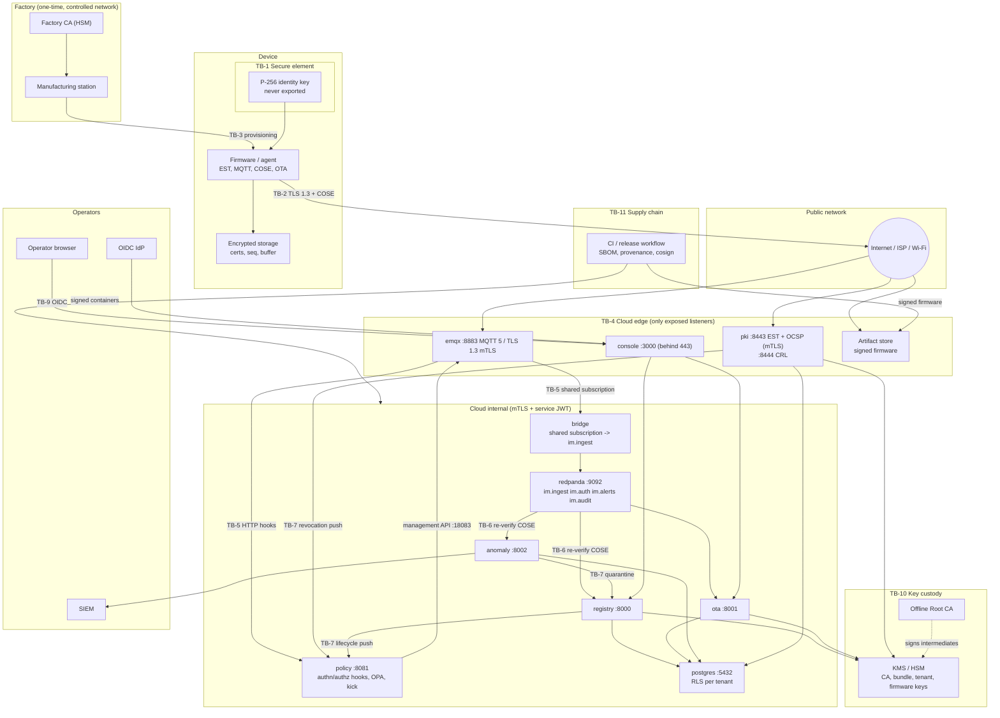

# IronMesh Threat Model

Phase 1 - STRIDE analysis of the IronMesh IoT security framework across device, network and cloud.

This document is subordinate to [`docs/DESIGN_CONTRACT.md`](docs/DESIGN_CONTRACT.md). Where the two
disagree, the contract wins and this document has a bug. Every mitigation below is either a contract
requirement or an implementation decision that satisfies one.

## 1. Scope and method

### 1.1 In scope

| Domain       | Elements                                                                                                                                    |
|--------------|---------------------------------------------------------------------------------------------------------------------------------------------|
| Device       | ESP32 firmware (`device/esp32/`), Linux agent (`device/agent-rs/`), secure elements (ATECC608, TPM 2.0, OP-TEE), software-key fallback       |
| Factory      | Manufacturing station, Factory CA, bootstrap certificate issuance, eFuse hardening                                                            |
| Network      | EST over mTLS (`/.well-known/est`), MQTT 5 over TLS 1.3 (8883), CRL/OCSP distribution, firmware artifact download                              |
| Cloud        | `emqx`, `pki`, `policy`, `bridge`, `registry`, `ota`, `anomaly`, `console`, `redpanda`, `postgres`, `otel-collector`, KMS/HSM                |
| Operators    | Console users (OIDC), tenant administrators, IronMesh platform operators                                                                      |
| Supply chain | Firmware and container build pipelines, dependency ecosystems (Cargo, Go modules, PyPI, npm, ESP-IDF components), signing infrastructure      |

Out of scope for Phase 1: physical security of the data centre, the back-office systems of tenants
that consume IronMesh APIs, and the internal correctness of third-party identity providers beyond the
OIDC contract.

### 1.2 Method

* STRIDE-per-element. Every trust boundary in section 3 is examined for Spoofing, Tampering,
  Repudiation, Information disclosure, Denial of service and Elevation of privilege.
* Each threat is rated for likelihood and impact (section 1.3) and mapped to the control that
  mitigates it and to the code location that implements the control.
* Threats that are deliberately not mitigated are recorded as **NOT MITIGATED** rows with the
  residual risk and compensating controls, so the decision is visible rather than implicit.

### 1.3 Rating scale

| Rating | Likelihood                                                                      | Impact                                                                                     |
|--------|---------------------------------------------------------------------------------|--------------------------------------------------------------------------------------------|
| H      | Expected to be attempted routinely against an Internet-exposed fleet             | Fleet-wide or tenant-wide compromise; CA or signing key loss; safety-relevant device misuse |
| M      | Requires a foothold, a specific vulnerability, or a motivated targeted attacker  | One tenant degraded, many devices affected, or sensitive data of one tenant exposed         |
| L      | Requires physical access, lab equipment, or an insider                           | Single device affected, or a nuisance that is detected and recovered automatically          |

### 1.4 Reference convention

The **Reference** column cites the implementing code as `path::symbol` in backticks, where `path` is
relative to the repository root and `symbol` is a function, type, Rego rule, config key or heading in
that file. `scripts/resolve_threat_refs.py` scans this file, checks that each path exists and that the
symbol is present, and in `--rewrite` mode replaces the reference with `path:line (symbol)` so a
reviewer can jump to the exact line. CI runs it in the default `--check` mode; `--strict` fails the
build on dangling references. References to `docs/DESIGN_CONTRACT.md` use a heading or bold term from
the contract as the symbol.

## 2. Assets

| ID   | Asset                                                                        | Where it lives                                                                                | Goal    | Why it matters                                                                                            |
|------|------------------------------------------------------------------------------|-----------------------------------------------------------------------------------------------|---------|-----------------------------------------------------------------------------------------------------------|
| A-01 | Device identity private keys (bootstrap and operational, ECDSA P-256)         | ATECC608 slot, TPM 2.0 object, OP-TEE secure storage; encrypted NVS or OS keyring for `software` | C, I    | The device is its key. Every authorization decision derives from the certificate that wraps it            |
| A-02 | Bootstrap certificate (10 y, Factory CA)                                      | Device non-volatile storage                                                                   | I       | Long-lived re-entry credential; its binding to one physical device is what makes zero-touch safe          |
| A-03 | Operational certificate (14 d, Device CA)                                     | Device storage; `pki` database                                                                | I       | Carries device id and tenant id for MQTT authn/authz                                                      |
| A-04 | CA private keys: Root (offline), Factory, Device, Services                    | Offline HSM; factory HSM; cloud KMS (`awskms`) or SoftHSM                                     | C, I    | Loss of any online CA key allows minting arbitrary device or service identities                           |
| A-05 | PKI bundle signing key and the bundle public key baked into firmware          | KMS; firmware image                                                                           | C, I    | The bundle tells devices which broker, CA pins, tenant key and firmware keys to trust                     |
| A-06 | Tenant command signing keys (`tenant-cmd-<tenant>`, Ed25519)                  | KMS, one per tenant                                                                           | C, I    | Signs every command, desired shadow and OTA notification a device will act on                            |
| A-07 | Firmware signing keys (Ed25519 mandatory, ML-DSA-65 optional)                 | KMS                                                                                           | C, I    | Gate on all code that runs on devices                                                                     |
| A-08 | Firmware images, manifests and delta patches                                  | Artifact store (S3 or MinIO), `ota` database                                                  | I, A    | Integrity is enforced by signature; availability gates security patching                                  |
| A-09 | Telemetry, events, shadow reported state                                      | MQTT in flight, Redpanda `im.ingest`, `registry` and `anomaly` databases                       | I, C, A | Operational truth for the fleet; feeds anomaly detection and compliance evidence                          |
| A-10 | Commands, desired shadow, OTA notifications                                   | MQTT (retained for shadow/ota/config), `registry` and `ota` databases                          | I       | Actuation path to physical devices                                                                        |
| A-11 | Device configuration payloads (may embed Wi-Fi credentials, tenant API tokens) | HPKE-wrapped on the broker; plaintext only in `registry` memory and on the device              | C, I    | The only payload with confidentiality requirements beyond TLS                                             |
| A-12 | Tenant data partitions                                                        | Postgres databases `registry`, `ota`, `anomaly` under RLS                                      | C, I    | Multi-tenant platform; a cross-tenant read is a breach even without device impact                         |
| A-13 | Device lifecycle and revocation state                                         | `registry` (lifecycle), `pki` (revocations), `policy` in-memory caches                         | I, A    | Inputs to every CONNECT decision; stale or forged state grants or denies access                           |
| A-14 | Audit log                                                                     | `registry` append-only `audit` table, Redpanda `im.audit`, SIEM                                | I, A    | Non-repudiation for operator and lifecycle actions                                                        |
| A-15 | Anomaly rules, Isolation Forest models, quarantine decisions                   | `anomaly` database and process memory                                                          | I       | Poisoned models silence detection or weaponise quarantine                                                 |
| A-16 | Service identities: Services CA certificates, `svc-bridge`, service JWT keys   | Kubernetes secrets or SPIFFE-style mounts; KMS                                                 | C, I    | `svc-bridge` can read every tenant's traffic; service JWTs authorise internal APIs                        |
| A-17 | Operator sessions and OIDC tokens                                             | Browser (httpOnly cookies via console BFF), console server memory                              | C, I    | Operators can revoke, quarantine, decommission and launch OTA campaigns                                   |
| A-18 | Replay state: per-device `seq`, EST nonces, command idempotency keys           | Postgres (`registry`, `pki`), device NVS or keyring                                            | I, A    | Replay protection is only as good as the persistence of the counters                                      |
| A-19 | Platform availability: broker, EST, ingest pipeline                            | Cloud                                                                                         | A       | Devices buffer offline but cannot be patched, commanded or quarantined while the platform is down         |
| A-20 | Build pipeline, SBOMs, provenance, release signing workflow                   | `.github/workflows/`, `sbom/`, KMS                                                             | I       | Single point from which every device and service inherits code                                            |

Goal column: C = confidentiality, I = integrity, A = availability.

## 3. Trust boundaries

| ID    | Boundary                                      | What crosses it                                                                                   | Primary control                                                                                                   |
|-------|-----------------------------------------------|---------------------------------------------------------------------------------------------------|-------------------------------------------------------------------------------------------------------------------|
| TB-1  | Secure element <-> firmware/application        | Signature requests and results only; the private key never crosses                               | Key generated inside the SE; non-exportable slot or object policy; software fallback marked `assurance:software`   |
| TB-2  | Device <-> Internet                            | EST (HTTPS mTLS), MQTT 5 over TLS 1.3, firmware downloads                                         | TLS 1.3 only, Services CA SPKI pinning, SAN host match, COSE_Sign1 on every payload, HPKE for config              |
| TB-3  | Factory station <-> device                     | Key generation command, CSR, bootstrap cert, bundle public key, pins, EST URL; eFuse programming  | Physically controlled factory network; one-time provisioning mode closed by eFuses; registry reconciliation       |
| TB-4  | Internet <-> cloud edge                        | Only 8883 (EMQX), 8443/8444 (PKI), 443 (console and APIs), artifact store                         | mTLS on 8883/8443, no other listeners exposed, provider DDoS protection                                            |
| TB-5  | EMQX <-> policy and bridge                     | Authn/authz hook requests; shared-subscription stream of every tenant's publishes                 | mTLS with Services CA, `svc-bridge` subscribe-only, deny-by-default OPA, fail-closed hooks                         |
| TB-6  | Redpanda <-> consumers                         | Raw COSE envelopes with broker metadata                                                           | Consumers re-verify signatures and replay state; broker metadata is never trusted for identity                     |
| TB-7  | Service <-> service                            | Revocation and lifecycle pushes, quarantine calls, certificate lookups, signing requests          | mTLS + ES256 service JWT (`aud`, 5 min), per-service DB roles                                                      |
| TB-8  | Tenant <-> tenant inside shared services       | Rows in shared tables; MQTT topics under `im/v1/<tenant>/`                                        | Postgres RLS keyed on `ironmesh.tenant_id`; OPA binds topics to certificate OU                                     |
| TB-9  | Operator <-> console and APIs                  | OIDC tokens, REST calls, campaign approvals                                                       | OIDC code flow with PKCE, BFF session cookies, RBAC enforced server-side, audit, step-up for destructive actions   |
| TB-10 | Services <-> KMS/HSM                           | Sign requests; keys never leave                                                                   | IAM-scoped KMS grants, CloudTrail or HSM audit, `file` KMS refused in prod profile                                 |
| TB-11 | Source control and CI <-> deployed artifacts   | Firmware, containers, Helm charts, SBOMs                                                          | Reproducible builds, SLSA provenance, cosign, admission verification, dependency audits                            |

## 4. Attacker profiles

| ID   | Profile                                  | Access and resources                                                                              | Typical goals                                                                                        |
|------|------------------------------------------|---------------------------------------------------------------------------------------------------|------------------------------------------------------------------------------------------------------|
| AP-1 | Remote unauthenticated attacker           | Internet reachability to 8883/8443/443; scanners, protocol fuzzers, credential-stuffing kits       | Connect without a certificate, exhaust the broker or EST, find an input-validation bug                |
| AP-2 | On-path network attacker                  | Control of a Wi-Fi AP, ISP segment, DNS or BGP; can present forged certificates                    | Impersonate the broker or EST server, downgrade TLS, replay or reorder traffic                        |
| AP-3 | Physical possessor of a device            | Stolen or purchased unit; from a UART adapter to a side-channel lab                                | Extract the identity key or firmware, clone the device, reuse the bootstrap credential                |
| AP-4 | Compromised device                        | Legitimate certificate; attacker code runs on the device (exploit or malicious firmware)           | Spoof telemetry, probe topics, flood ingest, attempt lateral movement to other tenants or services    |
| AP-5 | Malicious tenant or tenant administrator  | Valid OIDC identity for one tenant; API access; can enrol their own devices                        | Read or write another tenant's data, escape topic ACLs, abuse shared services                         |
| AP-6 | Compromised operator or platform insider  | Stolen console session, or legitimate IronMesh operations access                                  | Revoke or quarantine at scale, push a rogue OTA campaign, read tenant data, erase audit trails        |
| AP-7 | Factory or contract-manufacturer insider  | Access to the manufacturing station and possibly the Factory CA                                   | Mint bootstrap certificates for rogue devices, exfiltrate keys before hardening                       |
| AP-8 | Supply-chain attacker                     | Compromised upstream dependency, CI runner, container registry or developer workstation           | Insert a backdoor into firmware or a service image that is then signed legitimately                   |
| AP-9 | Well-resourced adversary                  | Zero-days, side-channel and fault-injection equipment, patient targeting                          | Recover secure-element keys, compromise online CAs, or defeat secure boot on a target device          |

## 5. Threat register

Legend: S = Spoofing, T = Tampering, R = Repudiation, I = Information disclosure, D = Denial of
service, E = Elevation of privilege. L/I = likelihood / impact after considering the deployment
profile but before the listed mitigation. Attacker profiles (AP-n) and assets (A-nn) refer to
sections 2 and 4. Rows marked **NOT MITIGATED** are discussed again in section 6.

### 5.1 Device: hardware, firmware and local storage

| ID   | STRIDE | Threat | Affected component | L/I | Mitigation | Reference |
|------|--------|--------|--------------------|-----|------------|-----------|
| T-01 | S, I | Stolen device: attacker tries to extract the P-256 identity key from a hardware-rooted device (AP-3) | Secure element, agent identity module | M / H | The key is generated inside the ATECC608 slot, TPM object or OP-TEE storage with a non-exportable policy; firmware only ever receives signatures. A theft report moves the device to `decommissioned` (terminal), which revokes the active certificate (broker kick in < 10 s) and makes EST refuse re-enrollment, so even a later key recovery yields nothing. | `device/agent-rs/src/identity/tpm.rs::TpmIdentity::generate_key` `device/esp32/main/identity_atecc.c::atecc_genkey_slot` `services/registry/app/domain/lifecycle.py::decommission` `services/pki/internal/est/handler.go::GetDevice` |
| T-02 | S, I | **NOT MITIGATED** - lab-grade side-channel (power or EM analysis) or fault-injection attack on the ATECC608 or TPM to recover the P-256 private key (AP-9) | Secure element | L / M | Not mitigated by IronMesh; depends on the secure-element vendor's countermeasures. Residual risk: one device identity per attacked unit, requiring physical possession and lab time. Compensating controls: operational certificates expire in 14 d and re-enrollment requires the current key, so a recovered key is useful only until the legitimate device rotates; one active serial per device plus the `impossible_travel` and `auth_burst` rules flag a cloned identity; the device can be decommissioned. | `docs/DESIGN_CONTRACT.md::Assurance levels` `services/anomaly/app/rules/impossible_travel.py::evaluate` `services/policy/internal/hooks/authn.go::IsRevokedSerial` |
| T-03 | S | Software-key device: malware or an attacker with filesystem access copies the key from encrypted NVS or the OS keyring (AP-3, AP-4) | `identity/software.rs`, `identity_nvs.c` | M / M | Software keys are a tenant opt-in (`allow_software_keys`, off in the prod profile). The certificate carries OU `assurance:software`, the registry records `assurance_level=software`, the console shows a warning badge and `hardware_only` groups exclude the device. Linux stores the key 0600 in the OS keyring or in a file encrypted with an at-rest key; ESP32 uses NVS encryption under Flash Encryption. | `services/pki/internal/attest/verify.go::AllowSoftwareKeys` `services/registry/app/domain/lifecycle.py::set_assurance_level` `device/agent-rs/src/identity/software.rs::SoftwareIdentity::load` `device/esp32/main/identity_nvs.c::nvs_identity_open_encrypted` |
| T-04 | I, T | Flash readout or firmware extraction from a captured ESP32 (dump flash over SPI, read certificates and configuration, reverse engineer the image) (AP-3) | ESP32 flash, bootloader | M / M | The production `sdkconfig` enables Flash Encryption in release mode and Secure Boot v2 and disables ROM download mode; the NVS partition holding certificates and `seq` is encrypted with keys in eFuse. Linux gateways rely on the integrator's disk encryption (see `COMPLIANCE_MATRIX.md` 5.4-1). | `device/esp32/sdkconfig.defaults.prod::CONFIG_SECURE_FLASH_ENC_ENABLED` `device/esp32/sdkconfig.defaults.prod::CONFIG_SECURE_DISABLE_ROM_DL_MODE` `device/esp32/partitions.csv::nvs_keys` |
| T-05 | E | Debug interface abuse: JTAG or the UART console is used to halt the CPU, dump RAM or run code (AP-3) | ESP32 hardening, Linux agent host | M / H | Secure Boot v2 permanently disables JTAG via eFuse because `CONFIG_SECURE_BOOT_ALLOW_JTAG` is not set; the UART console is compiled out (`CONFIG_ESP_CONSOLE_NONE`); `hardening.c` verifies at boot that the expected eFuses are burned and refuses to enrol otherwise. On Linux the agent runs as an unprivileged user with no debug sockets; physical ports are the integrator's responsibility. | `device/esp32/main/hardening.c::hardening_verify_efuses` `device/esp32/sdkconfig.defaults.prod::CONFIG_ESP_CONSOLE_NONE` `device/esp32/sdkconfig.defaults.prod::CONFIG_SECURE_BOOT_V2_ENABLED` |
| T-06 | T | Modified or malicious firmware booted on the device (flash rewrite, evil-maid) (AP-3, AP-8) | Boot chain | M / H | ESP32: Secure Boot v2 verifies bootloader and application signatures and the anti-rollback eFuse `secure_version` blocks older images. Linux: TPM measured boot; PCRs 0, 2, 4 and 7 are quoted with the EST nonce and compared with the tenant's PCR policy at every enrollment and rotation, so a modified boot chain cannot obtain an operational certificate. Telemetry carries `fw_hash` and the `fw_hash_mismatch` rule flags images not in the OTA catalogue. | `device/esp32/sdkconfig.defaults.prod::CONFIG_SECURE_BOOT_V2_ENABLED` `services/pki/internal/attest/verify.go::verifyTPM` `services/anomaly/app/rules/fw_hash_mismatch.py::evaluate` |
| T-07 | S, T | Compromised device with a legitimate certificate publishes forged telemetry or events (AP-4) | Ingest, anomaly | M / M | Signatures cannot help: the message is genuinely from the device key, so detection is the control. `fw_hash` in every telemetry record is compared with the campaign catalogue; TPM-backed devices are re-attested every 14 d at rotation; the `beaconing`, `topic_violation` and `auth_burst` rules and the per-tenant Isolation Forest raise alerts; auto-quarantine denies the device at CONNECT and kicks it. Telemetry bodies are schema-validated (types, ranges, string lengths) before storage. | `services/anomaly/app/rules/fw_hash_mismatch.py::evaluate` `services/anomaly/app/quarantine.py::quarantine_device` `services/registry/app/ingest/verify.py::validate_telemetry_body` |
| T-08 | T, D | Sequence counter loss or reset (NVS corruption, flash rollback, A/B slot revert, power loss mid-write) makes a device reuse a `seq`, so legitimate messages are dropped as replays or an old message becomes replayable (AP-3) | `wire/replay.rs`, NVS | M / L | `seq` is persisted before each send (contract). The counter is `(boot_epoch << 32) \| counter`, where `boot_epoch` is a persisted monotonic value incremented on every boot and on any detected storage inconsistency, so a reset can only move `seq` forward. The seq store lives in the shared data partition, not in the A/B application slots, so a slot revert does not roll it back. Server-side rejects are counted in `ironmesh_replay_rejected_total` and a sustained rate for one device raises an alert instead of silently discarding. | `device/agent-rs/src/wire/replay.rs::SeqCounter::next` `device/esp32/main/wire_cose.c::wire_seq_next` `services/registry/app/ingest/verify.py::check_replay` |
| T-09 | T | Offline buffer tampering: an attacker with storage access edits or reorders buffered telemetry before it is replayed on reconnect (AP-3) | `buffer.rs`, ESP32 ring buffer | L / L | Messages are COSE-signed at creation and stored as finished envelopes, so modification breaks the signature server-side; `seq` ordering is enforced by the receiver; the buffer lives in encrypted storage. | `device/agent-rs/src/buffer.rs::RingBuffer::push_signed` `services/registry/app/ingest/verify.py::verify_envelope` |
| T-10 | T | Device clock manipulation (NTP spoofing, RTC drift) to push `ts` outside the window, accept expired commands, or defeat certificate validity checks (AP-2) | Agent time source, EST client | M / L | Devices take authenticated time from the EST server's `Date` header over mTLS at boot and at every rotation and use it to sanity-check NTP (steps more than 300 s away from the authenticated reference are rejected). The `ts` window is +/-300 s on both sides, so a skewed device fails closed and telemetry is retried after resync. Certificate validity is checked by the server, which has trusted time. | `device/agent-rs/src/est.rs::sync_time_from_response` `device/esp32/main/est_client.c::est_apply_server_time` `services/registry/app/ingest/verify.py::check_timestamp_window` |
| T-11 | D | Rollback loop: a malicious or buggy image never calls `ota_mark_healthy()`, so the device reboots between slots indefinitely (AP-8) | `ota/ab.rs`, `ota_ab.c`, bootloader | L / M | After the 120 s health deadline the bootloader reverts once to the previous slot and marks the new slot `invalid`; the agent reports `OtaStatus.state=6` (rolled_back) and the rollout engine counts it toward the halt threshold. An invalid slot is never booted again without a new signed image, so the loop terminates after one revert. | `device/agent-rs/src/ota/ab.rs::mark_slot_invalid` `device/esp32/main/ota_ab.c::ota_on_health_timeout` `services/ota/app/rollout.py::halt_if_failures_exceed` |
| T-12 | T, E | Memory-safety or parser bug in CBOR/COSE decoding triggered by a crafted retained message (device-side code execution) (AP-6 with broker access, AP-2) | `wire/cbor.rs`, `wire_cose.c` | M / H | The Rust wire crate is `#![forbid(unsafe_code)]`, bounds CBOR nesting (depth <= 8) and envelope size (<= 16 KiB) and is fuzzed continuously. The ESP32 C parser is cross-tested against `device/common/vectors/` (including negative vectors) and compiled with stack protector and heap poisoning. The signature is verified before the payload is decoded, so unauthenticated bytes never reach the body parser. | `device/agent-rs/fuzz/fuzz_targets/cose_decode.rs::fuzz_target` `device/agent-rs/src/wire/cbor.rs::MAX_DEPTH` `device/esp32/main/wire_cose.c::wire_cose_verify_then_decode` `device/common/vectors/README.md::Files` |

### 5.2 Identity, PKI and enrollment

| ID   | STRIDE | Threat | Affected component | L/I | Mitigation | Reference |
|------|--------|--------|--------------------|-----|------------|-----------|
| T-13 | S | Cloned identity: attacker copies a bootstrap or operational credential (software-key device or extracted key) and runs a second device under the same id (AP-3, AP-4) | PKI, policy, anomaly | M / H | Hardware keys cannot be copied (T-01). For any device only one operational certificate is active at a time: issuing a new one supersedes and revokes the previous serial, so a clone and the original fight over the identity and every rotation evicts one of them. The policy authn hook rejects a CONNECT whose certificate serial is not the device's current serial, EMQX reports the clientid takeover to `im.auth`, and the `auth_burst` and `impossible_travel` rules alert on the resulting pattern. | `services/pki/internal/est/handler.go::supersedePrevious` `services/policy/internal/hooks/authn.go::IsRevokedSerial` `services/anomaly/app/rules/auth_burst.py::evaluate` |
| T-14 | S | EST nonce reuse or attestation replay: a captured attestation COSE is replayed to enrol a second key (AP-2, AP-4) | `est/handlers.go`, nonce store | M / H | The nonce is 32 random bytes with a 120 s TTL, bound to the TLS client certificate serial that requested it, and consumed atomically (`DELETE ... RETURNING`) in Postgres so concurrent reuse loses. The attestation also binds `sha256(csr_der)`, so a replay cannot carry a different CSR. | `services/pki/internal/est/handler.go::nonce` `services/pki/internal/store/postgres/postgres.go::ConsumeNonce` `services/pki/internal/attest/statement.go::VerifyBinding` `services/pki/internal/attest/statement.go::VerifySignature` |
| T-15 | S, R | Attestation forgery: a software device claims `se_type=atecc608` or `tpm2`, or presents a quote from another TPM (AP-4, AP-5) | `attest/attest.go` | M / H | `tpm2`: the quote signature is verified with the AK certificate, which must chain to a TPM vendor EK/AK CA in the trust store and be bound to this device's manufacture record; `qualifyingData` must equal the nonce; the PCR digest must match the tenant policy. `atecc608` and `optee`: the registry's manufacture record (written by the factory station) states the secure-element type and serial, and a claimed `se_type` that does not match it is rejected and alerted. `software` is accepted only when the tenant allows it and is always marked in the certificate. | `services/pki/internal/attest/verify.go::VerifyEvidence` `services/pki/internal/attest/verify.go::verifyTPM` `services/pki/internal/est/handler.go::checkSeTypeAgainstManufactureRecord` `services/pki/internal/attest/tpm2.go::VerifyQuoteSignature` |
| T-16 | T | CSR substitution or CN tampering in transit during `simpleenroll` (AP-2) | EST | L / H | mTLS prevents on-path modification; independently the server requires CSR CN == TLS certificate CN, CSR OU == certificate tenant, and `sha256(csr_der)` == attestation claim 2, which is signed by the TLS client key. | `services/pki/internal/est/handler.go::enroll` `services/pki/internal/attest/statement.go::VerifyBinding` |
| T-17 | S, E | Re-enrollment by a quarantined or decommissioned device using its still-valid 10 y bootstrap certificate (AP-3) | EST, registry lifecycle | M / H | EST checks the lifecycle state via the registry before issuing: only `manufactured`, `provisioned` and `active` may enrol; `quarantined` is refused until released and `decommissioned` is terminal. The attempt is audited and raises an alert. | `services/pki/internal/est/handler.go::GetDevice` `services/registry/app/domain/lifecycle.py::can_enroll` `services/registry/app/audit.py::record` |
| T-18 | S | Bootstrap credential stolen in logistics: a device is intercepted between factory and installation and enrolled by the attacker (AP-3) | EST, registry | L / M | Partially mitigated. Enrolment from `manufactured` still requires the hardware key, so the attacker needs the physical unit. The registry records the enrolment source and alerts when a `manufactured` device enrols outside an open shipment window or from an unexpected region; the tenant can decommission it. Residual: an attacker who installs the stolen unit before the legitimate owner notices operates a device under the victim tenant until it is decommissioned. | `services/registry/app/domain/lifecycle.py::on_first_enrollment` `services/anomaly/app/rules/impossible_travel.py::evaluate` |
| T-19 | S, E | **NOT MITIGATED** - factory insider with Factory CA access mints bootstrap certificates for rogue hardware (AP-7) | Factory CA, registry | L / H | Not mitigated against an insider who controls both the Factory CA and the registry. Compensating controls: the device id is minted by the registry, which records the bootstrap serial, secure-element serial and `se_type` per unit, and EST rejects a bootstrap certificate whose serial is not in the manufacture record, so a rogue certificate also needs a registry write. Factory CA issuance logs are reconciled daily against production orders and unexplained serials are revoked. The Factory CA key is in an HSM and the CA can be revoked by the Root without affecting the Device CA. Residual: rogue devices could operate until reconciliation. | `services/pki/internal/est/identity.go::checkBootstrapSerialMatchesManufactureRecord` `services/registry/app/api/devices.py::manufacture_batch` `services/pki/internal/ca/reconcile.go::ReconcileIssuanceLog` |
| T-20 | S, E | **NOT MITIGATED** - compromise of the offline Root CA ceremony (key generated or stored incorrectly, witness collusion) (AP-9, AP-7) | Root CA | L / H | Not mitigated by software. Compensating controls: ceremony under dual control with scripted, witnessed steps; key in an offline HSM with M-of-N quorum; the Root only signs intermediates and a yearly CRL; devices pin the Services CA SPKI through the bundle and the bundle key is independent of the Root, so a Root compromise is contained by rotating intermediates and shipping new pins in a signed bundle plus firmware update. Residual: if the ceremony itself is corrupted every chain is suspect and the fleet must be re-rooted via OTA. | `services/pki/internal/ceremony/ceremony.go::InitRoot` `services/pki/internal/shamir/shamir.go::Split` `security/ROOT_CA_CEREMONY.md::Quorum` `services/pki/internal/est/bundle.go::BuildHeader` |
| T-21 | S, E | Online CA or bundle key compromise through the KMS boundary (stolen service credentials, misconfigured IAM) (AP-6) | `kms/awskms/awskms.go`, SoftHSM backend | L / H | Device, Services and bundle keys are non-exportable KMS keys; only the `pki` workload identity may call `Sign` on them; every Sign call is logged (CloudTrail or PKCS#11 audit); issuance rate is compared with the fleet's rotation baseline and alerts on departure. The `file` backend is refused when `IRONMESH_PROFILE=prod`. Response is intermediate rotation from the Root. | `services/pki/internal/kms/kms.go::Signer` `services/pki/internal/kms/awskms/awskms.go::Sign` `services/pki/cmd/pki/main.go::requireProductionKMS` |
| T-22 | T | Rogue or stale bundle: attacker substitutes a bundle to repoint devices at a hostile broker, add CA pins or swap firmware keys (AP-2, AP-6) | `X-IronMesh-Bundle`, device EST client | L / H | The bundle is a COSE_Sign1 by the PKI bundle key; devices verify it with the bundle public key baked into firmware at the factory and accept it only inside an mTLS EST response, never from the broker. Devices refuse a bundle that drops the currently pinned Services CA unless the replacement pin was announced in a previous bundle (two-step pin rotation). | `device/agent-rs/src/est.rs::verify_bundle` `device/esp32/main/est_client.c::est_verify_bundle` `services/pki/internal/est/bundle.go::BuildHeader` |
| T-23 | S | Reused public key at re-enrollment: a CSR is submitted for a key that was already certified, defeating the new-key-per-enrollment rule (AP-4) | EST | L / M | The server rejects a CSR whose SubjectPublicKeyInfo matches any certificate previously issued to that device id. | `services/pki/internal/est/handler.go::rejectReusedKey` `services/pki/internal/store/postgres/postgres.go::ListCertificatesByDevice` |
| T-24 | S | Predictable or colliding certificate serials used to confuse `kid` lookups or forge revocation events (AP-5) | `ca/ca.go` | L / M | Serials are 128-bit values from the OS CSPRNG; the store enforces a unique index on `(issuer, serial)`. | `services/pki/internal/ca/serial.go::NewSerial` `services/pki/internal/store/postgres/postgres.go::PutCertificate` |
| T-25 | D | EST enrolment flood or TLS handshake exhaustion against `pki` (AP-1, AP-4) | `pki` 8443 | M / M | Per-source-IP connection rate limits at the load balancer; per-client-certificate limits after the handshake (one nonce in flight, at most 6 enrol attempts per hour); bounded nonce table with TTL cleanup; KMS signing budget alarms; horizontal autoscaling. Devices back off exponentially (base 60 s, cap 6 h) so a healthy fleet cannot create a thundering herd. | `services/pki/internal/est/handler.go::rateLimit` `services/pki/internal/store/postgres/postgres.go::DeleteExpiredNonces` `device/agent-rs/src/est.rs::renewal_backoff` |
| T-26 | D, E | Revocation or lifecycle push lost between PKI or registry and policy (network partition, policy restart), so a revoked or quarantined device stays connected beyond the 10 s budget (AP-4 benefits) | `revocation/publisher.go`, `revocation/cache.go` | M / M | The publisher writes the event to a durable outbox in the same transaction as the revocation and retries with backoff until policy acknowledges; policy reconciles against the signed CRL and the registry lifecycle snapshot every 60 s on top of the push path, and warms both caches before accepting hook traffic. The EMQX kick is retried until the session is gone. `ironmesh_revocation_latency_seconds` alerts above 10 s. | `services/pki/internal/revocation/publisher.go::Publish` `services/policy/internal/revocation/crlpoll.go::PollOnce` `services/policy/internal/emqx/kick.go::Kick` |
| T-27 | D | Stale revocation data makes the policy service decide incorrectly while the PKI is unreachable (AP-1 causing an outage) | `revocation/cache.go` | L / M | Partially mitigated. Policy keeps serving from its last-known cache so a PKI outage does not disconnect the fleet, but marks itself degraded after 10 min without a successful resync, which pages operators; certificates issued during the gap cannot be validated and are denied until the next sync. Residual: a device revoked during a prolonged PKI-to-policy partition keeps access until the partition heals. | `services/policy/internal/revocation/cache.go::IsRevokedSerial` `services/policy/internal/revocation/crlpoll.go::LastSuccess` |

### 5.3 Transport and broker

| ID   | STRIDE | Threat | Affected component | L/I | Mitigation | Reference |
|------|--------|--------|--------------------|-----|------------|-----------|
| T-28 | S | Rogue broker: DNS hijack, BGP hijack or captive portal presents a forged broker certificate (AP-2) | Device MQTT client | M / H | Devices pin the SHA-256 of the Services CA SPKI distributed in the signed bundle, require the broker certificate SAN to match the configured host, and accept only TLS 1.3 with ALPN `mqtt`. A publicly trusted certificate for the right hostname is therefore not sufficient. Pin rotation is two-step via the bundle (T-22). | `device/agent-rs/src/mqtt.rs::PinnedVerifier::verify_server_cert` `device/esp32/main/mqtt_client.c::mqtt_tls_verify_pin` `docs/DESIGN_CONTRACT.md::Pinning` |
| T-29 | S, I | MITM on the EST path during first enrollment, before any bundle exists (AP-2) | Device EST client | M / H | The factory bakes the Services CA pin and the EST URL into the device alongside the bootstrap certificate, so the first EST connection is already pinned; the server requires the device's bootstrap certificate (mTLS), so an interceptor cannot complete a handshake toward the real server either. | `device/agent-rs/src/est.rs::EstClient::connect_pinned` `device/esp32/main/est_client.c::est_http_tls_cfg` `device/esp32/main/identity_nvs.c::nvs_read_factory_pins` |
| T-30 | T | TLS downgrade to 1.2 or a weak cipher suite (AP-2) | EMQX listener, EST listener, device TLS stacks | L / M | TLS 1.3 only is configured on EMQX and `pki`; rustls in the agent is configured with TLS 1.3 only and has no legacy protocol support; ESP-IDF mbedTLS is built with TLS 1.2 disabled. The conformance suite connects with TLS 1.2 and asserts the handshake fails. | `deploy/docker/emqx/emqx.conf::ssl_options.versions` `device/agent-rs/src/mqtt.rs::TLS13_ONLY` `device/esp32/sdkconfig.defaults.prod::CONFIG_MBEDTLS_SSL_PROTO_TLS1_3` `conformance/tests/test_transport.py::test_tls12_rejected` |
| T-31 | T | Replay of device-to-cloud messages captured on the wire or re-published through a compromised bridge (AP-2, AP-6) | Registry ingest, anomaly | M / M | Every envelope carries a strictly increasing persisted `seq` per (device, direction) and a `ts` within +/-300 s; the receiver stores the last accepted `seq` per device in Postgres and drops anything at or below it, counting the drop in `ironmesh_replay_rejected_total`. The `kid` (certificate serial) must be the device's current or immediately previous serial, so a message signed with a long-revoked key is also rejected. | `services/registry/app/ingest/verify.py::check_replay` `services/registry/app/ingest/verify.py::check_timestamp_window` `services/registry/app/ingest/verify.py::resolve_kid` |
| T-32 | T | Replay of cloud-to-device commands, desired shadow or OTA notifications, retained or captured (AP-2, AP-6) | Device wire layer | M / H | Devices persist the last accepted `seq` per tenant key in NVS or keyring and reject non-increasing values; commands carry a 16-byte `nonce` echoed in the ack, an `idempotency_key` kept in a bounded on-device set, and an `expires_at` enforced device-side. | `device/agent-rs/src/wire/replay.rs::ReplayWindow::accept` `device/esp32/main/wire_cose.c::wire_check_seq` `device/agent-rs/src/mqtt.rs::IdempotencySet::seen` |
| T-33 | S | Telemetry spoofing across devices or tenants: a connected device publishes to another device's topic, or signs with a key the topic does not belong to (AP-4, AP-5) | OPA ACL, ingest verification | M / H | OPA allows a publish only when the topic's `<t>/<d>` segments equal the OU and CN of the connecting certificate, with exact segment matching. Independently, the registry ingest resolves the certificate by `kid`, verifies the signature, and requires the certificate's tenant and device to equal the topic's; broker metadata is never used for identity. | `services/policy/policy/rego/mqtt_acl.rego::owns_topic` `services/registry/app/ingest/verify.py::verify_envelope` `services/registry/app/ingest/verify.py::require_topic_matches_cert` |
| T-34 | E | Broker ACL bypass through wildcards, `$share`, `$SYS`, `+` inside device segments, MQTT 5 topic aliases, Unicode look-alikes, trailing slashes or empty segments (AP-4, AP-5) | OPA policy, EMQX | M / H | Deny-by-default Rego (`default allow := false`): `topic` is defined only when the string parses as `im/v1/<tenant>/<device>/<class>` with the tenant and device segments matching the contract regexes and `<class>` one of the nine contract classes, so wildcards, `$SYS`, extra or missing segments and unknown classes leave `topic` undefined and every allow rule fails. The tenant and device segments must equal the `client_attrs` the authn hook derived from the verified certificate, never anything the client sent; devices get QoS <= 1 and no retain; shared-subscription filters are accepted only for CN `svc-bridge`. EMQX resolves topic aliases before the authz hook runs, so the hook always sees the full topic. The Rego test suite contains the adversarial cases and runs in CI. Tenant owners may customise the policy through `PUT /v1/policy`, but the built-in invariant tests run on every update and a policy that fails one is refused. | `services/policy/policy/rego/mqtt_acl.rego::has_wildcard` `services/policy/policy/rego/mqtt_acl.rego::topic` `services/policy/policy/rego/mqtt_acl_test.rego::test_device_claiming_service_cn_denied` `services/policy/policy/rego/mqtt_acl_test.rego::test_device_publish_wildcard_denied` |
| T-35 | S, D | Client id not equal to certificate CN: a device connects with another device's client id to take over its session or force a kick (AP-4) | Policy authn hook | M / M | The authn hook rejects any CONNECT whose `clientid` differs from the certificate CN (which EMQX also uses as username via `peer_cert_as_username = cn`), so session takeover requires the victim's key. The attempt is published to `im.auth` and feeds `auth_burst`. | `services/policy/internal/hooks/authn.go::clientid_mismatch` `deploy/docker/emqx/emqx.conf::peer_cert_as_username` |
| T-36 | E | Policy hook unavailable or slow and EMQX falls open (AP-1 causing an outage, AP-4 benefiting) | EMQX authn/authz configuration | M / H | EMQX is configured with the HTTP authenticator as the only chain element and no anonymous fallback, `authorization.no_match = deny` and `authorization.deny_action = disconnect`, so a hook timeout or 5xx denies the CONNECT or publish instead of allowing it. The authz result cache is short (60 s) because quarantine and revocation are enforced by kick, not by cache expiry. The policy service runs with at least three replicas and reports ready only after its caches are warm. | `deploy/docker/emqx/emqx.conf::authorization.no_match` `deploy/docker/emqx/emqx.conf::authorization.deny_action` `services/policy/internal/server/server.go::readyz` `deploy/helm/ironmesh/values.yaml::policy.replicaCount` |
| T-37 | I | Bridge credential theft: the `svc-bridge` Services CA certificate and key are exfiltrated and used to subscribe to `$share/bridge/im/v1/#` from outside (AP-6) | Bridge, EMQX, policy | L / H | The key is mounted read-only from a Kubernetes secret or issued at start-up via a CSR to the Services CA, lives 90 d and rotates automatically; OPA allows `svc-bridge` to subscribe only, never publish; the authn hook alerts when `svc-bridge` connects from outside the cluster CIDR or when more sessions exist than bridge replicas; revoking the serial kicks the stolen session in < 10 s. Residual: telemetry is signed, not encrypted, so the holder of a stolen bridge certificate can read tenant telemetry until revoked. | `services/policy/policy/rego/mqtt_acl.rego::bridge_filters` `services/policy/internal/hooks/authn.go::checkServicePrincipalOrigin` `deploy/helm/ironmesh/templates/bridge-cert.yaml::svc-bridge` |
| T-38 | T | Bridge-to-Redpanda poisoning: fabricated records are produced directly into `im.ingest` (AP-6, AP-4 after lateral movement) | Redpanda, consumers | L / M | Redpanda requires TLS and SASL/SCRAM; ACLs give the bridge principal write-only access to `im.ingest` and give the `registry`, `anomaly` and `ota` principals read-only access. Records carry the original COSE bytes and every consumer re-verifies signature and replay state, so a record without a valid device signature is rejected at consumption. | `services/bridge/internal/bridge/consumer.go::produceRecord` `deploy/docker/redpanda/acls.sh::im.ingest` `services/anomaly/app/consumer.py::verify_before_score` |
| T-39 | D | **NOT MITIGATED** - volumetric or protocol-level denial of service against the broker (SYN flood, TLS handshake flood, connection churn from a botnet) (AP-1) | EMQX 8883 edge | M / M | Not mitigated at the application layer. Compensating controls: the cloud provider's network DDoS protection (AWS Shield Standard in front of the load balancers created by the Terraform AWS modules), EMQX per-listener connection rate and maximum connection limits, and device reconnect backoff with full jitter (base 1 s, cap 300 s) that stops the legitimate fleet from amplifying an outage. Devices buffer up to 10 000 messages offline, so telemetry is delayed rather than lost. Residual: a sufficiently large attack delays telemetry, commands and OTA until it is absorbed upstream. | `deploy/terraform/aws/main.tf::alb` `deploy/docker/emqx/emqx.conf::max_connections` `device/agent-rs/src/mqtt.rs::reconnect_backoff` |
| T-40 | D | Telemetry flood from a compromised subset of the fleet exhausts the broker, bridge or Redpanda (AP-4) | EMQX, bridge, Redpanda | M / M | EMQX per-client message and byte rate limits; the bridge applies backpressure (bounded in-flight window, QoS 1 acks only after a successful produce); Redpanda topics have retention and quotas; the `beaconing` rule and a publish-rate rule quarantine devices whose rate exceeds the tenant profile. | `deploy/docker/emqx/emqx.conf::messages_rate` `services/bridge/internal/bridge/consumer.go::inflightLimit` `services/anomaly/app/rules/beaconing.py::evaluate` |
| T-41 | T | Trace context injection: a device sets the MQTT 5 user property `traceparent` to hostile content to pollute traces or exploit the collector (AP-4) | Bridge, otel-collector | L / L | The bridge validates `traceparent` against the W3C grammar (version `00`, 32-hex trace id, 16-hex span id, 2-hex flags) and starts a fresh trace otherwise; the raw value is never logged. | `services/bridge/internal/bridge/consumer.go::extractTraceparent` |

### 5.4 Cloud platform: registry, tenancy, commands, configuration, console

| ID   | STRIDE | Threat | Affected component | L/I | Mitigation | Reference |
|------|--------|--------|--------------------|-----|------------|-----------|
| T-42 | I, E | Tenant isolation breach through the API: a tenant user requests another tenant's device, twin or campaign by id (IDOR) (AP-5) | Registry, OTA, anomaly APIs and databases | M / H | Every tenant table has `tenant_id uuid NOT NULL` and the RLS policy `tenant_id = current_setting('ironmesh.tenant_id')::uuid`; services connect as the non-owner role `registry_app` and set the tenant from the verified OIDC claim at the start of every transaction; the `X-IronMesh-Tenant` override is honoured only for the `platform_admin` role and is audited. A missing setting raises an error rather than returning all rows. Cross-tenant tests in each service assert that reads return nothing and writes fail. | `services/registry/app/db/rls.py::set_tenant` `services/registry/app/db/migrations/0002_rls.sql::ENABLE ROW LEVEL SECURITY` `services/registry/tests/test_rls.py::test_cross_tenant_read_is_empty` `services/ota/tests/test_rls.py::test_cross_tenant_campaign_denied` |
| T-43 | E | RLS bypass: the application role owns tables or has `BYPASSRLS`, the policy is not forced, or a query injects `SET ironmesh.tenant_id` (AP-5 via SQL injection, AP-6) | Postgres roles, migrations | L / H | Migrations run under a separate owner role in CI only; `registry_app` is created `NOBYPASSRLS NOSUPERUSER` and owns nothing; every table has `FORCE ROW LEVEL SECURITY`; the tenant is set with `SET LOCAL` through a parameterised `set_config` call and all queries use bound parameters (SQLAlchemy Core, no string formatting). A CI check lists tables lacking an RLS policy and fails if any exist. | `services/registry/app/db/migrations/0002_rls.sql::FORCE ROW LEVEL SECURITY` `services/registry/app/db/rls.py::require_tenant` `services/registry/tests/test_rls.py::test_app_role_cannot_bypass_rls` |
| T-44 | S, E | Tenant command signing key compromise: whoever can sign as `tenant-cmd-<tenant>` controls every device of that tenant (commands, desired shadow, OTA notify) (AP-6) | KMS, registry commands API, OTA | L / H | Keys are per tenant and non-exportable in KMS; the only callers are the `registry` and `ota` workload identities, through authorised and audited API paths; every command carries `expires_at` (<= 24 h) so a leaked signature has a bounded life; a tenant can rotate its key, after which devices pick up the new key from the bundle at their next rotation (<= 14 d) and old-key messages are rejected. | `services/registry/app/api/commands.py::sign_command` `services/registry/app/audit.py::record` `services/pki/internal/est/bundle.go::BuildHeader` |
| T-45 | T | Duplicate command execution: a command is delivered twice (QoS 1 redelivery, operator retry) and executes twice (AP-2, operator error) | Device command handler, registry | M / M | Operators supply an `Idempotency-Key` on `POST /v1/devices/{id}/commands`; the registry stores it with the command and returns the existing command on a repeat; devices keep a bounded set of recent `idempotency_key` values and answer a repeat with the stored ack instead of re-executing. | `services/registry/app/api/commands.py::dedupe_idempotency_key` `device/agent-rs/src/mqtt.rs::IdempotencySet::seen` |
| T-46 | T | Late execution: a command queued while the device was offline executes after it is no longer appropriate (AP-2 delaying delivery) | Device command handler | M / M | `cmd/req` is never retained; the broker queues for at most the session expiry (7 d), but the device enforces `expires_at` and acks `status=3` (expired) without executing; the registry marks expired commands and shows them in the console. | `device/agent-rs/src/mqtt.rs::reject_expired_command` `services/registry/app/api/commands.py::expire_stale_commands` |
| T-47 | I | Configuration disclosure: anyone with broker access (bridge certificate, EMQX operator, retained-message dump) reads device configuration containing secrets (AP-6) | Config path, EMQX retained store | M / H | Config is `COSE_Encrypt0`: the registry wraps a fresh 256-bit key with HPKE (DHKEM P-256, HKDF-SHA256, AES-128-GCM) to the device's current certificate public key, then AES-256-GCM encrypts the CBOR; only the device holding the private key can open it. Plaintext never leaves registry memory and is never retained on the broker. | `services/registry/app/api/config.py::wrap_config_hpke` `libs/python/ironmesh-wire/src/ironmesh_wire/hpke.py::wrap_config` `device/agent-rs/src/wire/cose.rs::open_encrypt0` |
| T-48 | I | Configuration decryptable with a superseded or compromised device key: an old retained config stays readable after the key that wrapped it leaked (AP-3) | Config path | L / M | The registry re-wraps the retained config to the new public key on every certificate issuance event and replaces the retained message, so the window is bounded by rotation (<= 14 d) and closed immediately on revocation. | `services/registry/app/api/config.py::rewrap_on_cert_rotation` `services/registry/app/api/devices.py::enrolled` |
| T-49 | E | Lifecycle state race: concurrent transitions (quarantine while enrolling, release while decommissioning) leave a device in an inconsistent or privileged state (AP-5 timing) | `domain/lifecycle.py` | L / M | Transitions run in one transaction with `SELECT ... FOR UPDATE` on the device row, validate against the state machine (`decommissioned` terminal), write the audit row in the same transaction and publish the lifecycle event to policy only after commit. | `services/registry/app/domain/lifecycle.py::transition` `services/registry/app/domain/lifecycle.py::ALLOWED_TRANSITIONS` |
| T-50 | S | Service-to-service token forgery or replay: an attacker with network access to internal APIs replays a captured JWT or mints one (AP-6, AP-4 after lateral movement) | Internal APIs | L / H | Internal calls require mTLS with a Services CA certificate plus an ES256 JWT whose `aud` is the target service, `iss` is the caller's service name, lifetime is 5 min and `jti` is cached for that lifetime to block replay; the JWT subject must equal the mTLS certificate CN. Network policies restrict which service may reach which port. | `services/registry/app/auth/service_jwt.py::verify` `services/policy/internal/auth/jwt.go::Verify` `deploy/k8s/networkpolicies/internal.yaml::policy-from-pki` |
| T-51 | S, E | Console session hijack: XSS, token theft from browser storage, CSRF or session fixation lets an attacker act as an operator (AP-1, AP-6) | Console (Next.js), OIDC | M / H | OIDC authorization code flow with PKCE; tokens are held server-side by the console BFF and the browser receives only an httpOnly, Secure, SameSite=Strict session cookie; strict CSP with nonces and no inline scripts; CSRF tokens on state-changing routes; access tokens live 5 min with rotating refresh tokens; revoke, quarantine, decommission and campaign approval require a re-authentication within the last 5 min (step-up). API keys (`imk_` prefix) are stored as SHA-256 hashes, carry a role and scopes, expire, and are shown once at creation; WebSocket sessions use a 60 s single-use ticket from `POST /v1/ws/ticket` instead of placing the bearer token in the URL. | `console/src/auth.ts::authConfig` `console/next.config.ts::Content-Security-Policy` `console/src/lib/auth/step_up.ts::requireRecentAuth` `console/src/app/api/ws/ticket/route.ts::POST` `console/src/lib/rbac.ts::proxyAllows` |
| T-52 | E | Role escalation in the console or APIs: a tenant `operator` or `viewer` performs admin-only actions (upload firmware, roll back a campaign, decommission, change user roles) (AP-5) | Registry, OTA RBAC | M / H | Roles (`owner`, `admin`, `operator`, `viewer`, `factory`) come from OIDC group claims or the API key record and are enforced server-side by a FastAPI dependency on every route with the minimum role from `docs/API_CONTRACT.md`; the console only hides buttons and is never the enforcement point. Platform-admin routes additionally require the IronMesh operator realm. Authorization tests enumerate every route against every role. | `services/registry/app/auth/rbac.py::require_role` `services/ota/app/api/campaigns.py::require_role` `services/registry/tests/test_rbac.py::test_every_route_has_role_guard` |
| T-53 | R | Audit log tampering: an insider edits or deletes audit rows to hide an action (AP-6) | `audit.py`, Postgres | L / H | The `audit` table grants only INSERT and SELECT to the application role; rows are hash-chained (`prev_hash`, `row_hash`) and the chain head is published to Redpanda `im.audit` and forwarded to the SIEM, so an edit or deletion is detectable by re-walking the chain. | `services/registry/app/audit.py::append_hash_chained` `services/registry/app/db/migrations/0005_audit_append_only.sql::REVOKE UPDATE` `services/anomaly/app/siem.py::forward_audit` |
| T-54 | T, R | Log injection: device-controlled strings (`top_procs`, `fw_version`, command `error`) contain newlines, ANSI escapes or fake JSON to forge log lines, mislead SIEM parsing or exploit log viewers (AP-4) | All services' logging, SIEM | M / L | All services emit structured JSON logs in which device-supplied values are JSON-encoded fields, never concatenated into `msg`; the ingest layer caps `tstr` fields (64 bytes, `top_procs` at most 10 entries) and strips C0/C1 control characters; the SIEM sink emits fields, not free text. | `services/registry/app/ingest/verify.py::sanitize_tstr` `services/anomaly/app/siem.py::emit_event` `services/bridge/internal/bridge/consumer.go::logFields` |
| T-55 | D | Metric cardinality explosion: attacker-controlled values become Prometheus labels (device id, firmware version) and exhaust the collector (AP-4) | otel-collector, services | L / M | Device id is never a metric label; `fw_version` is bucketed to catalogue versions plus `other`; tenant id is bounded by the tenant count; the collector enforces a per-metric label cardinality limit. | `services/bridge/internal/bridge/consumer.go::metrics` `observability/prometheus/rules.yaml::cardinality` |

### 5.5 OTA and supply chain

| ID   | STRIDE | Threat | Affected component | L/I | Mitigation | Reference |
|------|--------|--------|--------------------|-----|------------|-----------|
| T-56 | T | OTA image tampering in transit or at rest: a modified `image.bin` on the CDN, or on-path modification during download (AP-2, AP-6, AP-8) | OTA verify path | M / H | The manifest is a COSE_Sign (tag 98) with a mandatory Ed25519 signature and an optional ML-DSA-65 signature; devices verify with keys from the bundle's `fw_signing_pubkeys`, then hash the downloaded bytes and require equality with `image_sha256` and `image_size` before writing the inactive slot. The download is TLS 1.3 with pinning, but integrity does not depend on it. | `device/agent-rs/src/ota/verify.rs::verify_manifest` `device/agent-rs/src/ota/verify.rs::verify_image_hash` `device/esp32/main/ota_ab.c::ota_verify_manifest` `services/ota/app/signing.py::sign_manifest` |
| T-57 | T | Firmware downgrade: an old, validly signed image with a known vulnerability is pushed or replayed (AP-2, AP-6) | OTA verify, bootloader | M / H | `version_code` must be strictly greater than the running image's and `min_version_code` must be satisfied; ESP32 additionally burns the eFuse `secure_version` at mark-healthy so the bootloader refuses older images even if the application check were bypassed; Linux keeps the high-water mark in a TPM NV index or a protected state file. | `device/agent-rs/src/ota/verify.rs::check_anti_rollback` `device/esp32/sdkconfig.defaults.prod::CONFIG_BOOTLOADER_APP_ANTI_ROLLBACK` `services/ota/app/manifest.py::assert_version_code_monotonic` |
| T-58 | T, D | Delta patch applied against the wrong base, or a crafted patch with out-of-range `COPY` indices, corrupts the slot or crashes the applier (AP-6, AP-8) | `ota/delta.rs`, `delta.py` | M / M | The device hashes its active slot and requires equality with `delta.base_sha256` before applying; `COPY` block indices are bounds-checked against the base size and `LITERAL` lengths against `patch_size`; the reconstructed image is hashed and must equal `image_sha256` before the slot is marked pending. The delta applier is a fuzz target. | `device/agent-rs/src/ota/delta.rs::apply` `device/agent-rs/fuzz/fuzz_targets/delta_apply.rs::fuzz_target` `services/ota/app/delta.py::build_delta` |
| T-59 | T | Product mismatch: an image for `gateway-rpi` is notified to an ESP32 node or vice versa (operator error, AP-6) | OTA verify | L / M | `product` in the manifest must equal the device's compiled-in product id; the OTA service refuses to target a campaign at devices whose product differs from the artifact. | `device/agent-rs/src/ota/verify.rs::check_product` `services/ota/app/api/campaigns.py::validate_targets_product` |
| T-60 | S | Download redirection: the `url` in an OtaNotify points to an attacker host, or an HTTP redirect leads there, to serve malware or fingerprint devices (AP-6, AP-2) | Device OTA downloader | L / M | OtaNotify is signed by the tenant key, so only the OTA service can set `url`; the device additionally requires `https`, a host in the bundle-provided artifact host allowlist, and follows no redirects; the device never presents its client certificate to the artifact host. Content integrity does not depend on the source (T-56). | `device/agent-rs/src/ota/verify.rs::check_download_host` `device/esp32/main/ota_ab.c::ota_download_pinned` |
| T-61 | T | Health-check bypass: a faulty or malicious image marks itself healthy without real connectivity, defeating rollback (AP-8) | `ota/health.rs`, `ota_ab.c` | L / M | `ota_mark_healthy()` is reachable only through the agent's health gate, which requires an established mTLS MQTT session and a broker PUBACK for a telemetry publish within the 120 s window; the OTA service also expects an `OtaStatus.state=5` (success) signed by the device and counts a device that stays silent as a failure for the rollout threshold. | `device/agent-rs/src/ota/health.rs::HealthGate::mark_healthy_if` `device/esp32/main/ota_ab.c::ota_mark_healthy` `services/ota/app/rollout.py::count_silent_as_failure` |
| T-62 | D | Rollout blast radius: a bad image bricks or degrades a large part of the fleet before anyone notices (AP-8, operator error) | `rollout.py` | M / H | Campaigns advance 1% -> 10% -> 100%; devices are assigned to stages by a deterministic hash of the device id so canaries are stable; each stage has a dwell time (default 3600 s) and a `max_failure_rate` (default 0.05); a stage passes only when the dwell has elapsed with the failure ratio (failed + rolled_back + rejected over targeted, silent devices counted as failed) below the threshold, otherwise the campaign halts automatically and records `halt_reason`; A/B revert protects individual devices; a halted campaign is rolled back through a child campaign that re-signs the previous image with a higher `version_code`, so anti-rollback is never bypassed. | `services/ota/app/rollout.py::advance_stage` `services/ota/app/rollout.py::halt_if_failures_exceed` `services/ota/app/rollout.py::assign_stage_by_hash` |
| T-63 | T | Supply-chain compromise of the firmware build: a malicious dependency, compromised CI runner or developer machine inserts code that is then signed legitimately (AP-8) | Build pipeline | M / H | Reproducible firmware builds from pinned toolchains; lock files (`Cargo.lock`, `go.sum`, `poetry.lock`, `package-lock.json`, ESP-IDF component manifest) with `cargo audit`, `cargo vet`, `govulncheck`, `pip-audit` and `npm audit` in CI; a CycloneDX SBOM per artifact in `sbom/`; SLSA provenance attestation; release signing runs only in the protected `release` environment, reached through GitHub OIDC federation to KMS, with mandatory two-person review on the release branch. | `.github/workflows/firmware-release.yml::slsa-provenance` `.github/workflows/ci.yml::cargo-audit` `.github/workflows/ci.yml::sbom` `sbom/README.md::Generation` |
| T-64 | S | Firmware signing key compromise (Ed25519 or ML-DSA-65 key in KMS) (AP-6, AP-8) | KMS, `signing.py` | L / H | Keys are non-exportable in KMS and callable only by the `ota` release role from the release workflow; the two signatures use separate keys, so an attacker must compromise both when `IRONMESH_PQ_REQUIRED` is set; `signing_key_id` in the manifest lets the bundle drop a compromised key, after which devices reject images signed with it from their next rotation; the rotation runbook ships a dual-signed transition image. | `services/ota/app/signing.py::sign_manifest` `device/agent-rs/src/ota/verify.rs::verify_signatures` `services/pki/internal/est/bundle.go::BuildHeader` |
| T-65 | E | Rogue OTA campaign from a compromised operator account (AP-6) | OTA campaigns API | M / H | Introducing an image (`POST /v1/firmware`, which triggers KMS signing) requires `admin` while starting a campaign requires `operator`, so a stolen `operator` session cannot ship new code and a stolen `admin` session still has to pass the canary stages; campaign targets are confined to the caller's tenant by RLS; start, halt and rollback require step-up authentication (T-51); every action is audited to `im.audit` and the SIEM, and `campaign.updated` WebSocket events make a running campaign visible to every connected console session immediately. | `services/ota/app/api/campaigns.py::require_role` `services/ota/app/api/firmware.py::upload_firmware` `services/registry/app/audit.py::record` |
| T-66 | T | Artifact store tampering: an object in S3 or MinIO is replaced after upload (AP-6) | Artifact store, OTA service | L / M | The OTA service verifies the manifest signature and image hash at upload, again when a campaign is created, and when each notify is sent; the bucket uses versioning and object lock; devices verify independently (T-56). | `services/ota/app/manifest.py::verify_artifact` `deploy/terraform/aws/modules/s3/main.tf::object_lock_configuration` |
| T-67 | T | Container image tampering or an untrusted base image deployed to the cluster (AP-8) | Kubernetes admission, CI | M / H | Images are built from pinned digests on distroless bases, scanned (Trivy) and signed with cosign in CI; the cluster admission policy rejects unsigned images or images from other registries; Helm charts pin image digests. | `.github/workflows/ci.yml::cosign-sign` `deploy/k8s/policies/verify-images.yaml::verifyImages` `deploy/helm/ironmesh/values-prod.yaml::image.digest` |

### 5.6 Detection and response

| ID   | STRIDE | Threat | Affected component | L/I | Mitigation | Reference |
|------|--------|--------|--------------------|-----|------------|-----------|
| T-68 | T | Anomaly engine poisoning: a compromised device slowly drifts its behaviour so the per-tenant Isolation Forest baseline absorbs the malicious pattern, or crafts features that push legitimate devices into the outlier region (AP-4) | `isolation_forest.py`, rules | M / M | Deterministic rules are independent of the model and cannot be trained away; the model is fitted on a rolling window that excludes quarantined and recently alerted devices, uses robust quantile scaling, and its score distribution is monitored for drift; model-only findings create a `suspect` alert for operator review, and auto-quarantine requires a hard score threshold plus at least one corroborating rule. All features come from signature-verified records (T-38). | `services/anomaly/app/model/isolation_forest.py::fit_window` `services/anomaly/app/model/isolation_forest.py::drift_monitor` `services/anomaly/app/quarantine.py::decide` |
| T-69 | D | Weaponised quarantine: forged inputs (spoofed GPS to trigger `impossible_travel`, bursts of failed connects against victims) cause mass false positives that disconnect healthy devices (AP-4, AP-5) | `quarantine.py`, rules | M / M | Rules use only fields signed by the device they judge, so one device cannot trigger a rule for another; `impossible_travel` requires two consecutive consistent fixes and an implausible speed; `auth_burst` keys on the certificate serial, not the client id; a per-tenant circuit breaker caps automatic quarantines at 5% of the tenant's fleet per hour and escalates to operator approval above that. | `services/anomaly/app/quarantine.py::rate_limiter` `services/anomaly/app/rules/impossible_travel.py::evaluate` `services/anomaly/app/rules/auth_burst.py::evaluate` |
| T-70 | E | Quarantine without disconnect: a quarantined device keeps publishing because only the database state changed (AP-4) | Registry, policy, EMQX | M / H | Quarantine is a registry lifecycle transition with three side effects executed as one saga: PKI `revoke-all` for the device's certificates (which pushes the signed revocation to policy), a policy cache deny keyed on the device id, and an EMQX kick of the live session via the management API; the authn hook denies later CONNECTs (`MayConnect` is true only for `provisioned` and `active`) and EST refuses re-enrollment while quarantined. Release returns the device to `active`, but it must re-enrol with its bootstrap certificate. The conformance suite measures quarantine-to-disconnect latency against the same < 10 s budget as revocation. | `services/anomaly/app/quarantine.py::quarantine_device` `services/policy/internal/registry/client.go::MayConnect` `services/policy/internal/emqx/kick.go::Kick` `conformance/tests/test_quarantine.py::test_quarantine_to_kick_under_10s` |
| T-71 | I | SIEM egress credential leak, or tampering with alerts in transit (AP-6) | `siem.py` | L / M | SIEM credentials live in the secret store and are injected at runtime; the sink uses TLS with certificate verification to an allowlisted egress host; alerts are also durable in `im.alerts`, so a SIEM outage does not lose evidence. | `services/anomaly/app/siem.py::SiemSink` `deploy/k8s/networkpolicies/anomaly-egress.yaml::siem` |
| T-72 | T, R | Consumer-group manipulation: offsets of the anomaly consumer are moved forward to skip incriminating events (AP-6) | Redpanda ACLs | L / M | Consumer-group ACLs allow only the `anomaly` principal to commit offsets for its group; offset commits are logged; a skip detector alerts when the committed offset jumps by more than the consumed count. | `deploy/docker/redpanda/acls.sh::anomaly` `services/anomaly/app/consumer.py::detect_offset_skip` |

### 5.7 Operations and deployment

| ID   | STRIDE | Threat | Affected component | L/I | Mitigation | Reference |
|------|--------|--------|--------------------|-----|------------|-----------|
| T-73 | I | Secrets committed to Helm values, the compose `.env` or Terraform state (AP-8, AP-6) | `deploy/` | M / H | Secrets are referenced, not stored: Kubernetes External Secrets from AWS Secrets Manager, compose reads a git-ignored `.env`, Terraform state lives in an encrypted S3 backend with DynamoDB locking; `gitleaks` runs on every pull request and in a pre-commit hook. | `deploy/terraform/aws/backend.tf::encrypt` `.github/workflows/ci.yml::gitleaks` `.gitignore::/deploy/docker/.env` |
| T-74 | S | Development key backend (`file`, or SoftHSM with a default PIN) used in production (AP-6, configuration error) | `kms/file/file.go`, Helm values | M / H | `IRONMESH_PROFILE=prod` makes the PKI refuse to start with `kms=file`; `values-prod.yaml` pins `kms: awskms`; the conformance suite's prod profile asserts that the `cacerts` chain is not the development chain. | `services/pki/cmd/pki/main.go::requireProductionKMS` `deploy/helm/ironmesh/values-prod.yaml::kms` `services/pki/internal/kms/file/file.go::warn` |
| T-75 | I | Postgres compromise (stolen credentials, exposed port) exposes tenant data and replay state (AP-6, AP-1) | Postgres | L / H | TLS to the database with per-service databases and roles; at-rest encryption (RDS `storage_encrypted`); no long-term secrets in the database (keys live in KMS, certificates are public); network policy restricts 5432 to service pods; credentials rotate through the secret store. | `deploy/terraform/aws/main.tf::rds` `deploy/terraform/aws/modules/rds/main.tf::storage_encrypted` `deploy/k8s/networkpolicies/postgres.yaml::ingress` |
| T-76 | E | EMQX management API (18083) exposed, or its API key leaked, lets an attacker kick, subscribe or reconfigure the broker (AP-1, AP-6) | EMQX, policy | M / H | 18083 is bound to the cluster network only, requires mTLS plus an API key from the secret store, and the network policy admits only policy pods; the dashboard is disabled in production. | `deploy/k8s/networkpolicies/emqx.yaml::management-from-policy` `services/policy/internal/emqx/kick.go::NewClient` `deploy/docker/emqx/emqx.conf::dashboard.listeners` |
| T-77 | T | OPA policy tampering: Rego rules replaced through the policy update API, at runtime, or in the image (AP-5, AP-6, AP-8) | Policy service | L / H | The base policy and its invariant tests are embedded in the policy binary at build time; tenant customisation is possible only through `PUT /v1/policy` by the tenant `owner`, which compiles the Rego, runs the embedded invariant tests (deny by default, wildcard denial, topic-to-certificate binding, `svc-bridge` subscribe-only) and refuses any policy that fails one; every version is hashed, attributed and kept in history; the image is cosign-signed and admission-verified (T-67). | `services/policy/policy/embed.go::FS` `services/policy/internal/mgmt/api.go::putPolicy` `services/policy/policy/rego/mqtt_acl_test.rego::test_missing_attrs_denied` |
| T-78 | R | Repudiation of actions: a device denies having acknowledged a command, or an operator denies issuing one (AP-4, AP-6) | Audit, wire envelopes | L / M | Every device message is a COSE_Sign1 with `kid` and `seq`; command acks echo the command `nonce` and `cmd_id`; operator actions are recorded in the hash-chained audit table with the OIDC subject, and the signed command bytes are stored with the audit row. | `services/registry/app/audit.py::record` `services/registry/app/api/commands.py::store_signed_command` |
| T-79 | D | Platform outage (region loss, bad deploy) leaves devices unable to rotate; certificates expire and devices fall back to bootstrap enrolment en masse when service returns (AP-1 indirectly) | PKI, devices | L / M | Renewal starts at 50% lifetime (7 d early) with backoff up to 6 h, so a multi-day outage is tolerated; after expiry devices re-enrol with bootstrap certificates, which is a supported path; EST rate limits and jittered backoff shape the recovery wave; the PKI runs multi-AZ with a replica KMS key in a second region. | `device/agent-rs/src/est.rs::renewal_schedule` `docs/DESIGN_CONTRACT.md::Renewal` `deploy/terraform/aws/modules/eks/main.tf::aws_eks_cluster` |

## 6. Threats that are explicitly not mitigated

These rows are repeated here so the accepted risks are visible in one place. Each has a named owner
and a review trigger; acceptance is revisited at every release that touches the affected component.

| ID   | Threat                                                        | Why it is not mitigated                                                                                  | Residual risk                                                                                             | Compensating controls                                                                                                          | Review trigger                                                      |
|------|---------------------------------------------------------------|----------------------------------------------------------------------------------------------------------|-----------------------------------------------------------------------------------------------------------|--------------------------------------------------------------------------------------------------------------------------------|---------------------------------------------------------------------|
| T-02 | Side-channel or fault injection against ATECC608 / TPM        | Countermeasures are inside the vendor silicon; IronMesh cannot add them in software                      | One identity per attacked unit; attacker needs possession and lab time; cert lifetime bounds the window     | 14 d certificates, one active serial per device, duplicate-session and impossible-travel detection, decommission path           | Vendor security advisory for the secure element; new SE qualification |
| T-19 | Factory insider with Factory CA access                        | A colluding insider with Factory CA and registry access can forge the manufacture record as well          | Rogue devices operate until daily reconciliation detects unexplained serials                               | Registry-minted ids, bootstrap serial check at EST, daily issuance reconciliation, Factory CA revocable by Root, HSM custody     | Change of contract manufacturer; any reconciliation discrepancy      |
| T-20 | Offline Root CA ceremony compromise                           | Procedural, not technical; software cannot verify the integrity of its own root of trust                 | Total trust collapse requiring fleet-wide re-rooting through OTA and bundle update                           | Dual control, M-of-N HSM quorum, witnessed scripted ceremony, Root used only for intermediates, pins and bundle key independent | Each ceremony; Root rotation (20 y) or intermediate re-issuance       |
| T-39 | Network-layer denial of service against the broker            | Volumetric attacks must be absorbed upstream of the application                                           | Telemetry, commands and OTA delayed for the attack duration; devices buffer, no data integrity impact       | Provider DDoS protection, EMQX connection limits, device backoff with jitter, offline buffering                                | Any availability incident; change of cloud provider or edge design   |

Partially mitigated threats with an accepted residual: T-18 (stolen unit installed before the owner
notices), T-27 (revocation during a prolonged PKI-to-policy partition), T-37 (bridge certificate holder
can read signed-but-not-encrypted telemetry until revoked).

## 7. Residual risk summary

| Area                         | Residual after controls | Dominant residual threats | Comment                                                                                                     |
|------------------------------|-------------------------|---------------------------|-------------------------------------------------------------------------------------------------------------|
| Device identity              | Low                     | T-02, T-03                | Hardware-rooted keys with 14 d rotation; software keys remain the weak point and are off by default in prod |
| Enrollment and PKI           | Low                     | T-19, T-20, T-27          | Online CAs are KMS-backed and revocable; residual sits in procedure (factory, ceremony) and partitions       |
| Transport and broker         | Low-Medium              | T-37, T-39                | Confidentiality of telemetry relies on TLS alone; availability relies on upstream DDoS protection            |
| Multi-tenancy                | Low                     | T-43                      | RLS plus topic binding; residual is implementation slips caught by the cross-tenant test suite               |
| Commands and configuration   | Low                     | T-44                      | Per-tenant KMS keys with bounded-life commands; a tenant key compromise is the single highest-impact event   |
| OTA and supply chain         | Medium                  | T-63, T-64                | Signing is strong; the build pipeline remains the largest attack surface and depends on process discipline  |
| Detection and response       | Medium                  | T-68, T-69                | Model-based detection can be gamed; rules and circuit breakers bound the damage in both directions          |
| Operations                   | Low-Medium              | T-73, T-76                | Configuration errors (exposed management API, dev KMS) are prevented by profile checks and admission policy  |

Ranked residual risks for Phase 1 sign-off:

1. Supply-chain compromise of the firmware build (T-63) - highest likelihood of the high-impact items;
   mitigated by provenance and review, not eliminated.
2. Tenant command key compromise (T-44) - low likelihood, tenant-wide impact; bounded by `expires_at`
   and bundle-driven key rotation.
3. Anomaly engine gaming (T-68, T-69) - detection quality is probabilistic; operators must review
   `suspect` alerts and the quarantine circuit breaker must stay enabled.
4. Software-key devices (T-03) - acceptable only for tenants that opt in; the prod profile keeps it off.
5. Factory and ceremony procedure (T-19, T-20) - accepted with named owners and audit evidence.

## 8. Assumptions

1. Secure elements (ATECC608, TPM 2.0, OP-TEE) behave as their vendor documentation states: keys
   generated inside are not exportable, and TPM EK/AK certificates chain to a vendor CA that IronMesh
   can trust-store.
2. The factory network is physically controlled, the manufacturing station is managed by IronMesh or a
   contracted manufacturer under audit, and eFuses are burned before a unit leaves the factory.
3. The cloud provider's isolation primitives (VPC, IAM, KMS, managed Kubernetes) work as documented,
   and provider staff are out of scope.
4. The OIDC identity provider enforces multi-factor authentication for every operator account and
   exposes group claims that map to IronMesh roles.
5. Cloud services have trusted time (provider NTP); devices are within +/-300 s of true time after the
   authenticated time sync in T-10.
6. Integrators deploying the Linux agent provide disk encryption, an unprivileged service account,
   systemd sandboxing, and physical protection of ports; IronMesh provides the hardening guide and the
   reference unit file but cannot enforce it.
7. ECDSA P-256, Ed25519, AES-GCM, SHA-256, HKDF and TLS 1.3 are not broken at the protocol level for
   the lifetime of the operational certificates. Harvest-now-decrypt-later against TLS-protected
   telemetry is accepted for Phase 1; firmware signing is already post-quantum capable through
   ML-DSA-65, and HPKE for configuration is the first candidate for a hybrid KEM in Phase 2.
8. Tenants are mutually distrusting but each tenant is trusted with its own devices: a tenant can
   always command its own fleet, and IronMesh does not protect a tenant from its own administrators
   beyond RBAC, audit and step-up authentication.
9. The design contract (`docs/DESIGN_CONTRACT.md`) is implemented as written; where this document
   assumes a behaviour that the contract does not state (for example the `boot_epoch` structure of
   `seq`, the two-step pin rotation, the quarantine circuit breaker), that behaviour is an
   implementation decision owned by the component named in the Reference column.

## 9. STRIDE coverage by trust boundary

| Boundary | S                         | T                              | R          | I                    | D                        | E                         |
|----------|---------------------------|--------------------------------|------------|----------------------|--------------------------|---------------------------|
| TB-1     | T-01, T-02, T-03, T-13    | T-06, T-08, T-09               | -          | T-01, T-02, T-04     | T-08, T-11               | T-05                      |
| TB-2     | T-28, T-29, T-33          | T-10, T-12, T-30, T-31, T-32   | T-78       | T-29, T-47, T-48     | T-10                     | T-12                      |
| TB-3     | T-18, T-19                | T-04                           | -          | T-04                 | -                        | T-05, T-19                |
| TB-4     | T-25                      | -                              | -          | -                    | T-25, T-39, T-40, T-79   | T-76                      |
| TB-5     | T-35, T-37                | T-41                           | -          | T-37                 | T-36                     | T-34, T-36, T-70          |
| TB-6     | -                         | T-38, T-54, T-72               | T-54, T-72 | -                    | T-55                     | -                         |
| TB-7     | T-50                      | T-26                           | -          | T-71                 | T-26, T-27               | T-26, T-49, T-50          |
| TB-8     | T-33                      | T-42                           | -          | T-42, T-75           | -                        | T-34, T-42, T-43          |
| TB-9     | T-51                      | T-45, T-46                     | T-53, T-78 | -                    | T-62, T-69               | T-52, T-65                |
| TB-10    | T-21, T-24, T-44, T-64    | T-22, T-77                     | -          | T-73                 | -                        | T-21, T-44, T-74          |
| TB-11    | T-74                      | T-56, T-57, T-58, T-59, T-63, T-66, T-67 | -  | T-73                 | T-62                     | T-67                      |
| Detection| T-15                      | T-68                           | T-15       | -                    | T-69                     | T-70                      |

Threats whose primary element is the OTA verifier (T-56 to T-61) sit on TB-11 because the attacker's
entry point is the artifact, even though the control executes on the device.

## 10. Maintaining this document

* Add a threat when a new component, boundary, message type or deployment target is introduced, or
  when an incident or penetration test finds a path not listed. Use the next free `T-nn`, cite the
  attacker profile and keep the Reference column populated before merge.
* Run `python3 scripts/resolve_threat_refs.py --check` locally and in CI. Once the referenced code
  exists, run with `--rewrite` to pin references to `path:line (symbol)`; re-run after refactors.
* When a NOT MITIGATED row becomes mitigated, move it out of section 6 and record the change in
  `CHANGELOG.md`; when a mitigation is removed, add the row back before the change ships.
* Keep `COMPLIANCE_MATRIX.md` in step: every control cited there must map to at least one threat here.
