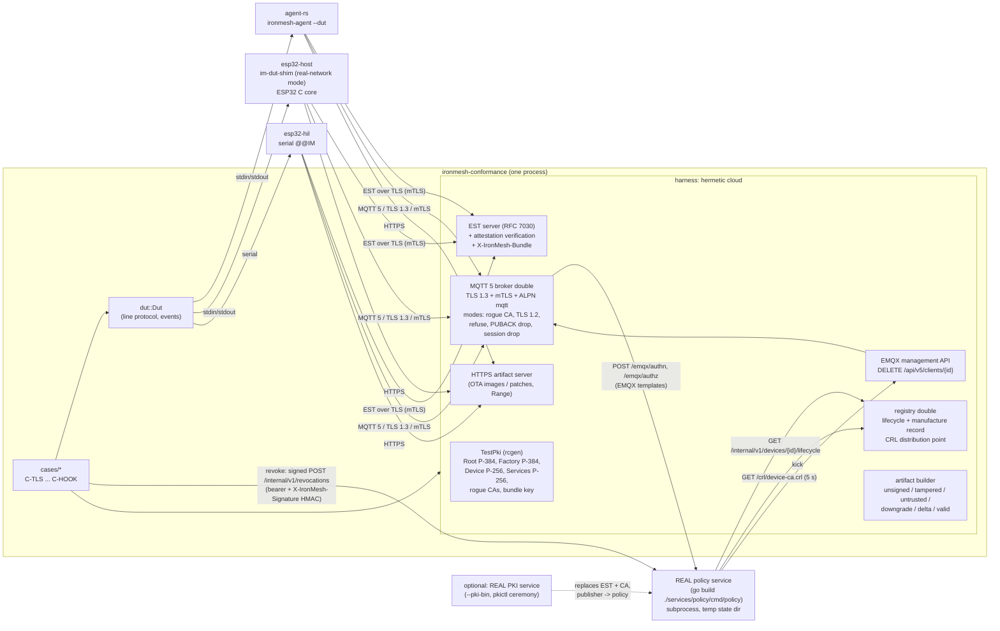

# IronMesh device conformance suite

One suite, run unchanged against every firmware target through the DUT control protocol
([`DUT_PROTOCOL.md`](DUT_PROTOCOL.md)). It implements every case of the protocol's case table
(C-TLS-1..5, C-ENR-1..2, C-ROT-1..2, C-REV-1, C-ACL-1..3, C-OTA-1..7, C-RPL-1..4, C-OFF-1,
C-CFG-1, C-HOOK-1) and writes JUnit XML, a Markdown report with the measured values and a
machine-readable `results.json` per target, plus a cross-target [`results/SUMMARY.md`](results/SUMMARY.md).

Binding specifications: [`docs/DESIGN_CONTRACT.md`](../docs/DESIGN_CONTRACT.md),
[`device/common/WIRE_FORMAT.md`](../device/common/WIRE_FORMAT.md),
[`docs/API_CONTRACT.md`](../docs/API_CONTRACT.md) §4 and the DUT protocol.

```sh
cd conformance
cargo run --release -- run --target agent-rs              # results/agent-rs/{junit.xml,report.md,results.json}
cargo run --release -- run --target esp32-host            # results/esp32-host/...
cargo run --release -- run --target agent-rs --cases 'C-OTA-*,C-REV-1' --junit out.xml --report out.md
cargo run --release -- summary                            # regenerate results/SUMMARY.md
cargo run --release -- list                               # the case table
```

Missing binaries are built on first use (disable with `--no-build`): the policy service with
`go build ./services/policy/cmd/policy`, `ironmesh-agent` with `--features dut-control` (DUT) and in
`--release` without it (C-HOOK-1), and `im-dut-shim`. Everything is built into
`conformance/target/`, never into the device or service trees; `ironmesh-conformance build` builds
all of them, including the real PKI binaries for `--pki-bin`. Requirements: Rust stable, Go (on
Windows `C:\Program Files\Go\bin\go.exe` is used when `go` is not on `PATH`), MSVC for the ESP32 C
core. No Docker, no EMQX, no Postgres.

## Architecture



| Path | What |
|------|------|
| `src/harness/pki.rs` | Contract §2 hierarchy with rcgen, certificate profiles mirroring `services/pki/internal/ca` (CN/OU/O, SAN URI, KU/EKU, CRL DP, AIA OCSP, 128-bit serials, `assurance:software` OU, bootstrap OU), rogue CAs, CRL, persistence for HIL |
| `src/harness/est.rs` | EST: `cacerts`, `csrattrs`, `ironmesh/nonce`, `simpleenroll`, `simplereenroll` with the checks of `services/pki/internal/est/handler.go`; records every request |
| `src/harness/broker.rs` | MQTT 5 broker double; every decision delegated to the real policy service; EMQX management API |
| `src/harness/policy.rs` | Policy subprocess, EMQX hook client, PKI revocation publisher (HMAC-SHA256 + bearer), `/metrics` reader |
| `src/harness/registry.rs` | Registry internal endpoints (lifecycle, manufacture record, assurance, enrolled) and the CRL distribution point |
| `src/harness/ota.rs`, `downlink.rs`, `keys.rs` | Manifests / signatures / IMDELTA1 patches, tenant-signed downlinks, HPKE Config wrap, uplink verification, test-vector keys |
| `src/harness/realpki.rs` | `--pki-bin`: real `pkictl` ceremony + real `pki` service as the enrollment authority |
| `src/harness/stack.rs` | `--stack`: the same cases against a real deployment |
| `src/dut/` | `Dut` handle, line-protocol transport (`link.rs`, stdio and `@@IM ` serial framing), launchers per target |
| `src/cases/` | One module per case family |
| `src/report/` | JUnit, Markdown report, SUMMARY |

### Design decisions

* **Real policy service, faithful broker double.** The broker double renders the EMQX HTTP
  authn/authz request bodies exactly like `services/policy/deploy/emqx/emqx.conf` (strings for
  `qos`/`retain`, nested and flat `client_attrs`, `X-IronMesh-Hook-Token`, `cert_pem` as on EMQX
  >= 5.8, username = certificate CN) and implements `deny_action = disconnect`, `max_qos_allowed = 1`,
  retained messages, `clean_start=false` sessions and `DELETE /api/v5/clients/{clientid}` with HTTP
  basic auth. Every CONNECT, PUBLISH and SUBSCRIBE in every case is therefore decided by the real
  Rego policy and the real revocation cache. Downlinks are published as `svc-registry` and are
  authorized by the policy too (retained Config only works because the policy allows it).
* **C-REV-1 traverses the production code.** Revoke = CRL regenerated + the PKI publisher's request
  (`POST /internal/v1/revocations`, JSON event in the Go field order, `Authorization: Bearer`,
  `X-IronMesh-Signature: sha256=<hex HMAC-SHA256(body)>`, `X-IronMesh-Event-ID`) to the real policy
  service, which updates its cache and calls the EMQX management API on the broker double, which
  drops the session; the DUT's reconnect is refused by the real authn hook. The suite measures
  revoke -> policy 202, -> kick call, -> broker disconnect, -> DUT `disconnected`, -> first
  denied CONNECT, over 20 iterations (fresh device each), p50/p95/max, and asserts < 10 s.
* **Why the default EST server is in-process, and what `--pki-bin` adds.** The real PKI *can* run
  with the in-memory store and the file KMS (`pkictl` ceremony in a temp dir works, see
  `realpki.rs`), but not for the whole suite: (1) the in-memory store has no way to set a tenant
  policy, so its bundles carry an empty `tenant_cmd_pubkey` and no `fw_signing_pubkeys` - every
  downlink and OTA case would be impossible; (2) `PKI_OPERATIONAL_CERT_TTL` is bounded to
  168h-720h, so C-ROT-2 cannot use short-lived certificates. The in-process EST server mirrors the
  PKI's checks instead, and `--pki-bin` runs the same suite with the real PKI as the enrollment
  authority (downlink/OTA cases then report `not_applicable` with that reason). That interop run
  is what found the attestation-format mismatch reported in `results/SUMMARY.md`.
* **The wire code of the Rust agent is reused** (`ironmesh-agent` as a path dependency, default
  features off) for CBOR/COSE/envelopes/manifests/deltas/HPKE/MQTT codec. To make sure a bug there
  cannot hide, the harness unit tests reproduce the published deterministic vectors
  (`manifest_signed.json`, `envelope_command_ack.json`) byte for byte with the harness builders and
  keys, and every uplink the cases rely on is verified with the certificate key the broker saw.
* **Keys.** Tenant command key and firmware keys are the public test-vector keys of
  `libs/python/ironmesh-wire/tests/keys/` (so artifacts can be re-checked with the Python
  reference). C-RPL-3 forges with a random non-tenant key.
* **Fresh device per case** (and per C-REV-1 iteration): the policy's revocation deny list is
  persistent and keyed by device id, so cases never influence each other.
* **Health-failing update (C-OTA-6).** The image is valid; the broker refuses every CONNECT of the
  new boot (CONNACK 0x88), so the contract health check (MQTT connected + telemetry acked within
  the deadline) cannot pass and the device must roll back by itself. agent-rs is configured with
  `ota.health_timeout_s = 15`; the ESP32 core has a fixed 120 s (`IM_OTA_HEALTH_TIMEOUT_MS`), so
  the case takes about 2 minutes there.
* **Clock scaling (C-TLS-5).** agent-rs runs with `mqtt.backoff_scale = 0.02` (base 20 ms, cap
  6 s), which lets the suite verify the cap; the ESP32 core has no scaling, so the bound, the
  growth and the jitter are verified over real-time attempts and the report states that the cap
  was not reached.
* **Resumption semantics (C-TLS-4).** agent-rs must report `resumed=true` and the broker must see a
  resumed handshake; for ESP32 targets the criterion is "ticket offered": the broker-side resumed
  handshake decides, the DUT flag is informational.

## How each case works

| Case | Procedure (fresh device, enroll + connect unless noted) | Cross-checks on the wire |
|------|------|------|
| C-TLS-1 | `connect` | broker: TLS 1.3, ALPN `mqtt`, operational cert presented, CONNECT client id = CN, policy authn allow; session parameters vs contract §4 (warnings) |
| C-TLS-2 | broker serves a rogue-CA certificate; `connect`; repeated with a rogue CA that impersonates the Services CA name | no CONNECT reached the broker; handshake failure logged |
| C-TLS-3 | broker offers TLS 1.2 only | no CONNECT |
| C-TLS-4 | `disconnect`, `connect` | broker-side resumed handshake; `session_present` |
| C-TLS-5 | broker refuses CONNECT (0x88) and drops the session; collect `connect_failed.at_ms` | gap_k <= min(300, 2^k) x scale (+ tolerance), growth, full jitter, cap (scaled targets) |
| C-ENR-1 | `enroll` | EST: bootstrap client cert, attestation kid = bootstrap serial, signature by the bootstrap key, nonce single use, CSR CN/OU, fresh key, se_type, issued serial / notAfter = event |
| C-ENR-2 | registry lifecycle `quarantined`, `enroll` | EST answered 403, nothing issued |
| C-ROT-1 | `renew` | `simplereenroll` with the operational cert, new serial, new SPKI, same CN; broker session with the new cert; telemetry kid = new serial and verifies with the new key |
| C-ROT-2 | 40 s certificates, wait | renewal at 50-60 % of the lifetime (EST timestamp), reconnect |
| C-REV-1 | revoke (real policy path above), 20 iterations | kick, broker disconnect, denied CONNECT, no re-admission; policy `/metrics` and log |
| C-ACL-1 | `publish_raw` to another device / tenant / own downlink topic | policy authz denied, session dropped (`deny_action = disconnect`), nothing routed; own telemetry accepted |
| C-ACL-2 | `subscribe_raw` to foreign / wildcard / `$SYS` / shared / own uplink filters | every filter denied by the policy; own `cmd/req` granted |
| C-ACL-3 | retained `publish_raw` on own telemetry (and events) | denied, nothing retained |
| C-OTA-1..4 | OtaNotify with unsigned / tampered / untrusted-key / downgrade artifact | final `ota_state`, error code, slots unchanged, no reboot, signed OtaStatus uplinks |
| C-OTA-5 | valid update | `rebooted{ota_apply}`, `success`, new version code, active slot hash = image hash, signed OtaStatus success with fw_hash |
| C-OTA-6 | valid update, broker refuses the new boot | `rebooted{rollback}`, previous slot and version active, `rolled_back` |
| C-OTA-7 | IMDELTA1 patch from the running (factory) image | applied slot hash = full image hash; patch size |
| C-RPL-1 | command, then the same bytes again | `ENV_REPLAY`, executed once, one CommandAck echoing cmd_id + nonce |
| C-RPL-2 | command with ts = now - 400 s (and + 400 s) | `ENV_TS_SKEW`, not executed |
| C-RPL-3 | command signed by a non-tenant key, then the genuine command with the same seq | `COSE_SIGNATURE`; the genuine one is executed (store not advanced by the forgery) |
| C-RPL-4 | telemetry, `status`, `reboot`, `status`, telemetry | `seq_out` after > before; first seq after reboot > last before; wire seqs strictly increasing |
| C-OFF-1 | `net_down`, 25 telemetry, `net_up`; then a broker-side session drop | nothing leaves while down, `buffer_flushed` range, all seqs verified, in order, no gaps |
| C-CFG-1 | Config (tenant-signed, HPKE to the cert key) published retained | no rejection; the same ciphertext again -> `ENV_REPLAY` (proves it was applied); retained copy is a COSE_Encrypt0 without plaintext; a config for another key -> `HPKE_OPEN` |
| C-HOOK-1 | run the release `ironmesh-agent --dut` | exit status != 0, no protocol answer (n/a for ESP32 targets, with the reason) |

Verdicts: `pass`, `FAIL` (the DUT did not meet the criterion; the reason names what was
observed), `n/a` (not applicable to the target or mode - always with a written reason), `ERROR`
(harness problem). Deviations from the contract that are outside a case's pass criterion are
reported as **warnings**, never as failures. Every DUT protocol violation (unparsable lines, events
without `at_ms`, answers slower than 5 s) is reported as a warning of the case.

## Running in CI

* **Hermetic job** (Linux or Windows runner, no services): `cargo run --release -- run --target
  agent-rs` and `--target esp32-host`; publish `results/*/junit.xml`. Exit status is 1 when any case
  failed or errored.
* **Real PKI interop job**: `ironmesh-conformance build` then `run --target <t> --pki-bin
  conformance/target/bin/pki --results-dir conformance/results/real-pki`.
* **Stack job** (docker-compose / Helm with EMQX): `run --target agent-rs --stack https://<host>
  --stack-config stack.toml`. The config gives the registry URL and API key, the PKI port, the
  devices' factory anchors (`anchors_pem`), the bundle public key, `pkictl` + `pki_ca_dir` (factory
  issuance; passphrase in `PKI_FILE_KMS_PASSPHRASE`), a Services CA client certificate for the PKI
  management API and for `svc-registry` MQTT publishes, and optionally the stack's test tenant /
  firmware key seeds and an artifact directory + base URL. Secrets can come from
  `IRONMESH_STACK_*` variables (see `src/harness/stack.rs`). Cases that need broker-side fault
  injection or observation (C-TLS-2/3/5, C-REV-1 timing, C-ACL, C-OFF-1, C-OTA-6) report `n/a` in
  this mode; this mode is compiled and its configuration unit-tested here but was not run against
  EMQX (not available on the development host).
* **HIL job**: a board built with the `hil` profile, provisioned from a persistent harness PKI:
  1. `ironmesh-conformance export-pki --out hil-pki` (CAs, keys, `anchors.pem`, `est-pin.hex`,
     `bundle.pub.hex`); bake anchors, pin, bundle key and the EST host/port into the HIL firmware
     and issue its bootstrap certificate from `hil-pki/factory-ca.*`.
  2. `hil.toml`: `port`, `bootstrap_cert`, `pki_dir = "hil-pki"`, `advertise_host` (the runner's
     LAN address), `est_port`, optional `se_type` (default `atecc608`), `baud`.
  3. `run --target esp32-hil --hil-config hil.toml` (binds `0.0.0.0`).
  One physical board keeps its device id across cases, so run C-REV-1 last with
  `--rev-iterations 1` (the policy deny list is per device). The serial framing and the transport
  are unit-tested with a fake serial pair (`src/dut/esp32_hil.rs`); the board itself only runs in
  the HIL job.

## Adding a target

1. Implement the DUT protocol in the firmware (test builds only).
2. Add a launcher in `src/dut/` that provisions a fresh device (factory identity, bootstrap
   certificate from `Cloud::issue_bootstrap`, manufacture record via `Cloud::register_device`),
   starts it against `Cloud::endpoints()` and returns `Dut::attach(...)`.
3. Describe it with a `TargetProfile` (product, clock control, resumption semantics, backoff clock
   scale, OTA health deadline, a side-effect-free command, the factory image if the harness knows
   it, a release binary for C-HOOK-1).
4. Add it to `Target`, `Launcher` and the CLI. No case changes: cases branch only on the profile.

## Quality

```sh
cargo fmt --check
cargo clippy --all-targets -- -D warnings
cargo test        # harness unit tests: broker topic filters, policy hook/revocation signer (RFC 4231 HMAC vectors,
                  # PKI publisher request shape), PKI profiles + persistence, artifact builder variants, manifest and
                  # command vectors reproduced byte for byte, HPKE config round trip, line framing (stdio and @@IM serial
                  # over a fake serial pair), backoff analysis, JUnit rendering, stack config
```
