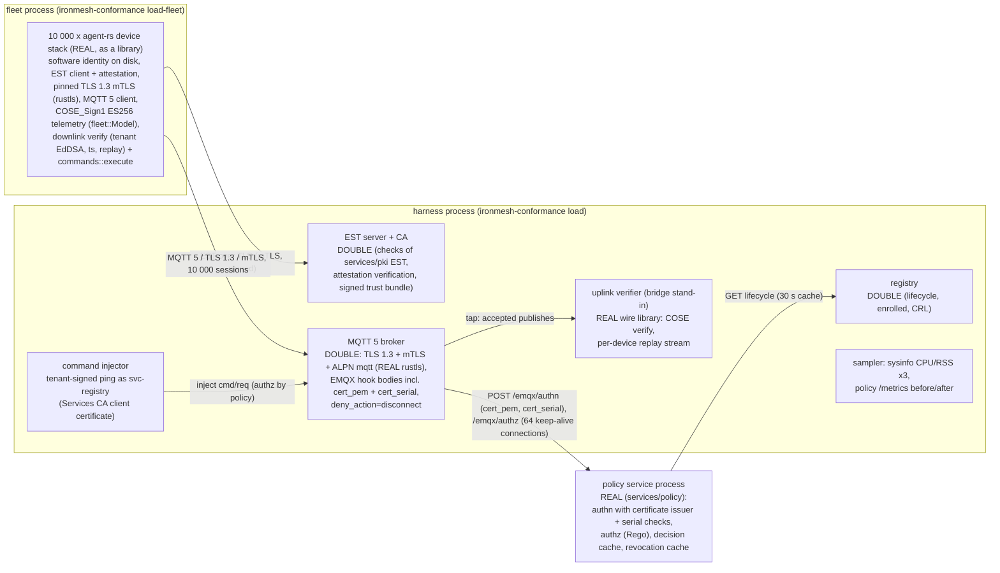

# IronMesh load test report: 10 000 devices on one machine

**Headline (run [`20261109-231000-full-10000`](results/20261109-231000-full-10000/report.md), commit
`12c456ca9357`).** 10 000 simulated devices enrolled through EST with attestation, connected over
TLS 1.3 + mTLS with pinning, and published COSE_Sign1 telemetry every 10 s for a 10-minute
sustained window. Every CONNECT, PUBLISH and SUBSCRIBE was decided by the real policy service,
which now runs hardened: every CONNECT carries the presented client certificate (`cert_pem`) and
its serial (`cert_serial`) and is checked for issuer (Device CA / Services CA files) and revoked
serial (`POLICY_REQUIRE_CERT_SERIAL=true`), and its management API accepts only single-use
service JWTs (`POLICY_JWT_SINGLE_USE=true`). Results:

* 10 000 of 10 000 devices connected; 0 never connected; 0 device-side errors; 0 CONNECTs
  refused, 0 authn/authz denials.
* 1 000.1 telemetry messages/s accepted during the sustained window (600 291 messages in
  600 s; the offered rate was 1 000/s).
* Device-side publish -> PUBACK latency in the sustained window: p50 **0.55 ms**, p95 1.16 ms,
  p99 **1.96 ms**, max 45.7 ms (n = 600 291).
* 500 of 500 downlink commands were acked with a verified CommandAck. Round trip p50 1.8 ms,
  p99 3.8 ms.
* Each of the 10 000 devices' last acknowledged `seq` matched the last `seq` the cloud-side
  verifier accepted. Replay rejections: 0. Uplinks verified: 650 903.
* Peak combined RSS was 1 243 MiB (per-process maxima: fleet 648 MiB, broker/EST/verifier harness 520 MiB, policy
  service 126 MiB).
* The certificate checks add about **0.11 ms per CONNECT** inside the policy service (isolated
  measurement below). No change in sustained publish or authz latency is attributable to them.
  The authn round trip during the ramp was longer than in the previous run, but that run's ramp
  was slower (115.5 vs 183.3 first connects/s); the difference is queueing for the 64 hook
  connections, not the checks (see [Effect of the new checks](#effect-of-the-new-checks-on-latency)).

All 10 000 devices completed the run, so this machine's ceiling was not reached. These results
cover the device stack, TLS/mTLS, COSE and the policy service. They do not cover EMQX, Kafka or the
bridge (see [Not measured here](#not-measured-here)).

Raw data for every run is in `results/<run>/{summary.json,timeseries.csv,report.md}`. How to run the
test is in [`README.md`](README.md). The test itself is `conformance/src/load/` (`ironmesh-conformance load`).

## Runs

| Run | Devices | Sustain | Outcome | Purpose |
|---|---|---|---|---|
| [`20261109-231000-full-10000`](results/20261109-231000-full-10000/report.md) | 10 000 | 600 s | **PASS** | **current: the full run on the hardened policy service** |
| [`20261109-230638-smoke-1000`](results/20261109-230638-smoke-1000/report.md) | 1 000 | 120 s | PASS | current: smoke with the same binaries as the full run |
| [`20261109-212130-full-10000`](results/20261109-212130-full-10000/report.md) | 10 000 | 600 s | PASS | superseded: full run before the hardening (no `cert_pem` / `cert_serial` checks) |
| [`20261109-213653-smoke-1000`](results/20261109-213653-smoke-1000/report.md) | 1 000 | 120 s | PASS | superseded: smoke with the binary of the previous full run |
| [`20261109-211048-smoke-1000`](results/20261109-211048-smoke-1000/report.md) | 1 000 | 120 s | PASS | superseded: first smoke, used for tuning |
| [`20261109-214027-ramp-fleet-threads-64`](results/20261109-214027-ramp-fleet-threads-64/report.md) | 10 000 | (60 s) | aborted by the memory guard at 5 000 connected | superseded: ramp bottleneck experiment, see [Bottlenecks](#bottlenecks-observed) |

The superseded runs were made at `d99b00c` / `23b7dfd` with uncommitted changes in the tree, on a
policy service that did not yet check the client certificate at CONNECT. They are kept as history
and as the baseline for the comparison below.

## Environment

| | |
|---|---|
| CPU | 12th Gen Intel Core i7-12700H, 14 cores / 20 logical CPUs |
| RAM | 16 088 MiB; 4 270 MiB available when the full run started (lowest during the run 2 179 MiB; the machine was also running browsers and IDE tooling) |
| OS | Windows 11 Home (10.0.26200) |
| Rust | rustc 1.99.1 (58cf8f9c3 2026-10-13), release build |
| Go | go1.27.3 windows/amd64 (policy service built with `go build ./services/policy/cmd/policy`) |
| Git | `12c456ca9357771a67989557787bdab201342b2a`; `services/` and `device/` clean at that commit |
| TCP ephemeral ports | 1024-65535 (64 511 ports), `TcpTimedWaitDelay` 30 s |

Build provenance: `ironmesh-conformance build` rebuilt the policy, PKI and pkictl binaries
(`conformance/target/bin/`, `policy.exe` sha256 prefix `6408a8a7a0cc94c2`) and the DUT binaries
from that commit; `git status` showed no changes under `services/` or `device/`. The load-test
binary (sha256 prefix `233dc6a859376247`) was built from the same commit plus the uncommitted
conformance-harness update that makes the broker double send `cert_pem` and `cert_serial` in
every authn call, starts the policy service with `POLICY_DEVICE_CA_FILE` /
`POLICY_SERVICES_CA_FILE` / `POLICY_JWT_PUBLIC_KEY_PEM`, and authenticates the `svc-registry`
command publisher with a Services CA client certificate (hence `summary.json` records
"working tree modified"; only `conformance/` differed). It was copied to
`conformance/target/load-bin/` before the runs so that concurrent edits could not change it, and
both current runs used that copy.

### Exact commands

```sh
cd conformance
cargo run --release -- build
cargo build --release
cp target/release/ironmesh-conformance.exe target/load-bin/
./target/load-bin/ironmesh-conformance.exe load --devices 1000 --sustain-s 120 --label smoke-1000
./target/load-bin/ironmesh-conformance.exe load --devices 10000 --label full-10000
cargo test --release -- --ignored authn_certificate_check_cost --nocapture   # isolated authn cost
```

Defaults used: start rate 200 devices/s in stages of 25/50/75/100 % with 15 s holds, telemetry
every 10 s, 5 % of devices receive one `ping` command, 64 broker -> policy hook connections,
30 s publish timeout, contract reconnect backoff (scale 1.0), sampling every 5 s, abort if the
combined RSS exceeds 70 % of RAM (11 262 MiB) or host available memory drops below 768 MiB (both
guards on; neither triggered).

## Topology: what was real and what was a double



| Path element | Real or double |
|---|---|
| Device identity, EST enrollment, attestation, CSR, key rotation into the operational slot | **real** (agent-rs library code; keys on disk, encrypted at rest, one directory per device) |
| TLS 1.3, mTLS, SPKI pinning, ALPN | **real** on both sides (rustls in the device stack and in the broker double) |
| COSE_Sign1 signing (ES256 uplink, EdDSA downlink), CBOR envelopes, replay checks | **real** (agent-rs wire library on device and verifier side) |
| Authentication (client certificate parsed, issuer = Device CA / Services CA, serial not revoked, lifecycle) and authorization of every CONNECT, PUBLISH and SUBSCRIBE, including the `svc-registry` command publisher | **real** policy service binary |
| MQTT broker | double (in-process; mirrors the EMQX configuration of `services/policy/deploy/emqx/emqx.conf`, including the `cert_pem` / `cert_serial` authn body) |
| EST / CA, registry | doubles |

## Results

| Metric | 1 000 devices (smoke) | 10 000 devices (full run) | 10 000 devices, previous run (superseded) |
|---|---|---|---|
| Enrolled / connected / never connected | 1 000 / 1 000 / 0 | 10 000 / 10 000 / 0 | 10 000 / 10 000 / 0 |
| Device-side errors (all classes) | 0 | 0 | 0 |
| Broker: TLS handshake failures, CONNECT refused, PUBLISH denied, SUBSCRIBE denied | 0, 0, 0, 0 | 0, 0, 0, 0 | 0, 0, 0, 0 |
| Broker -> policy hook transport errors | 0 | 0 | 0 |
| Policy authn decisions allow / deny | 1 001 / 0 | 10 001 / 0 | 10 000 / 0 |
| EST attempts | 1 000 x HTTP 200 | 10 000 x HTTP 200 | 10 000 x HTTP 200 |
| Ramp (incl. 3 x 15 s holds) | 55 s | 100 s | 135 s |
| Achieved first-connect rate (target 200/s, holds excluded) | 196.0/s | **183.3/s** | 115.5/s |
| Sustained window | 120 s | 600 s | 600 s |
| Telemetry accepted by the broker, sustained | 12 000 (100.0/s) | 600 291 (**1 000.1/s**) | 600 534 (1 000.6/s) |
| Telemetry accepted, whole run = PUBACKs received by devices | 14 978 = 14 978 | 650 403 = 650 403 | 671 924 = 671 924 |
| Commands sent / acked (verified) / unacked | 50 / 50 / 0 | 500 / 500 / 0 | 500 / 500 / 0 |
| Uplinks verified / replay rejections | 15 028 / 0 | 650 903 / 0 | 672 424 / 0 |
| Devices whose last PUBACKed `seq` = last verified `seq` | 1 000 / 1 000 | 10 000 / 10 000 | 10 000 / 10 000 |

The extra authn decision in the current runs is the `svc-registry` command publisher, whose
CONNECT is now authenticated with its Services CA client certificate.

### Latency (ms, exact nearest-rank percentiles over every sample)

| Path | Run | n | p50 | p95 | p99 | max |
|---|---|---|---|---|---|---|
| Telemetry publish -> PUBACK, sustained (device side) | 10 000 | 600 291 | 0.55 | 1.16 | 1.96 | 45.7 |
| | 10 000, previous | 600 534 | 0.73 | 7.2 | 128.6 | 781.8 |
| | 1 000 | 12 000 | 0.59 | 1.37 | 2.1 | 14.0 |
| Telemetry publish -> PUBACK, during the ramp | 10 000 | 50 032 | 50.0 | 1 251.1 | 2 379.9 | 2 886.9 |
| | 10 000, previous | 71 161 | 192.1 | 1 671.1 | 2 477.0 | 7 448.1 |
| Connect: TCP + TLS 1.3 mTLS + CONNACK | 10 000 | 10 000 | 635.7 | 2 110.5 | 2 641.3 | 3 935.8 |
| | 10 000, previous | 10 000 | 1 202.1 | 3 374.0 | 4 885.1 | 8 776.2 |
| | 1 000 | 1 000 | 34.1 | 332.4 | 478.9 | 592.0 |
| | 1 000, previous | 1 000 | 13.3 | 220.0 | 334.2 | 387.5 |
| EST enrollment with attestation (nonce, keygen, CSR, attestation, simpleenroll, cacerts) | 10 000 | 10 000 | 464.6 | 3 507.4 | 4 717.8 | 7 174.3 |
| | 10 000, previous | 10 000 | 3 511.1 | 8 586.7 | 10 747.7 | 15 222.9 |
| Command round trip (inject -> verified CommandAck at the broker) | 10 000 | 500 | 1.8 | 3.1 | 3.8 | 6.1 |
| Policy authn hook round trip (broker side) | 10 000 | 10 000 | 254.1 | 1 692.5 | 2 455.1 | 3 093.9 |
| | 10 000, previous | 10 000 | 84.9 | 967.3 | 1 452.5 | 2 165.5 |
| | 1 000 | 1 000 | 20.5 | 318.3 | 457.0 | 588.1 |
| | 1 000, previous | 1 000 | 5.4 | 209.7 | 325.1 | 380.6 |
| Policy authz hook round trip (broker side) | 10 000 | 660 903 | 0.36 | 5.5 | 761.2 | 2 792.2 |
| | 10 000, previous | 682 424 | 0.51 | 75.5 | 569.4 | 2 184.4 |
| ... of which waiting for a free hook connection | 10 000 | 671 404 | 0.0 | 0.0 | 837.7 | 2 610.9 |

The authz p99 over the whole run comes from the ramp bursts (in the sustained window the authz p99
per 5 s interval stayed below 21 ms, see the time series). The policy service exports decision
counters but no authn/authz latency histogram; hook latency is the HTTP round trip measured in the
broker, which is what EMQX would see.

### Effect of the new checks on latency

The policy service now parses the presented certificate from `cert_pem` on every CONNECT, checks
CN, expiry and issuer (name and ECDSA signature against `POLICY_DEVICE_CA_FILE` /
`POLICY_SERVICES_CA_FILE`), compares `cert_serial`, and looks the serial up in the revocation
cache. To separate that cost from load effects, the same authn request was sent sequentially
5 000 times (after 200 warm-up calls) over one keep-alive connection to a fresh policy process,
once with `cert_pem` + `cert_serial` and the hardened defaults and once without them and with
`POLICY_REQUIRE_CERT_SERIAL=false` (the old behaviour), two rounds each
(`conformance/src/harness/policy.rs`, test `authn_certificate_check_cost`):

| authn round trip (ms) | mean | p50 | p95 | p99 |
|---|---|---|---|---|
| without certificate checks (round 1 / 2) | 0.078 / 0.082 | 0.069 / 0.066 | 0.123 / 0.196 | 0.169 / 0.253 |
| with `cert_pem` + `cert_serial` checks (round 1 / 2) | 0.187 / 0.200 | 0.172 / 0.183 | 0.291 / 0.328 | 0.416 / 0.455 |

**Attributable cost: about +0.11 ms per CONNECT** (p50 0.07 -> 0.18 ms), including the larger
request body (about 0.8 KB of PEM). For 10 000 CONNECTs that is about 1.1 s of policy time in a
run whose policy process used 282 s of CPU. Over the whole run the policy service used 0.42 ms CPU
per decision, against 0.52 ms in the previous run.

What the load runs show beyond that:

* **Sustained window: no measurable effect.** Authz and publish do not touch the authn path.
  Publish p99 improved from 128.6 ms to 1.96 ms; the previous run's tail came from host memory
  pressure (lowest available 1 147 MiB then, 2 179 MiB now) and hook-pool waits, not policy work.
* **Authn round trip during the ramp: higher, but not because of the checks.** The authn p50 rose
  from 85 ms to 254 ms at 10 000 devices and from 5.4 ms to 20.5 ms at 1 000. At 10 000 devices
  the ramp was 59 % faster this time (183.3 vs 115.5 first connects/s, because enrollment in the
  fleet was faster: EST p50 0.46 s vs 3.5 s), so more CONNECTs and telemetry publishes competed for
  the 64 hook connections at once; the authn round trip is dominated by that queueing, which is
  more than 1 000 times the 0.11 ms of the checks. The 1 000-device smokes ran at the same rate
  (196 vs 199/s); their authn difference (+15 ms p50) is also far above the isolated cost and
  within the run-to-run spread seen before (the two earlier smokes differed by more than 500 ms
  at publish p99). Connect latency (TCP + TLS + CONNACK) at 10 000 devices fell from p50 1.2 s to
  0.64 s.
* **Conclusion:** the certificate-serial checks cost about 0.1 ms per CONNECT and nothing
  measurable on the message path. Single-use JWTs apply to the management APIs only (not to the
  device path) and are not part of this load profile.

### Policy service (`/metrics` delta, full run)

| Counter | Delta |
|---|---|
| `ironmesh_authn_decisions_total{result="allow"}` | 10 001 (deny 0: no `no_cert_serial`, `untrusted_issuer`, `cert_serial_mismatch` or `revoked_serial` denials) |
| `ironmesh_authz_decisions_total{result="allow"}` | 661 403 (deny 0) |
| `ironmesh_authz_cache_total` hit / miss | 255 127 / 406 276 (38.6 % hit rate) |
| `ironmesh_registry_lookups_total` | 10 000 |
| `process_cpu_seconds_total` | 282.5 s over the ~13 min run (about 0.42 ms CPU per decision) |

### Resources (sysinfo every 5 s; CPU in % of one logical CPU, the machine has 20)

| Process | Sustained CPU mean / max | Whole-run CPU max | Sustained RSS mean / max (MiB) | Previous run: sustained CPU mean, RSS max |
|---|---|---|---|---|
| fleet (10 000 device stacks) | 58 / 75 % | 680 % | 631 / 648 | 58 %, 687 MiB |
| harness (broker + EST + registry doubles, verifier) | 65 / 78 % | 266 % | 488 / 520 | 67 %, 506 MiB |
| policy service | 38 / 51 % | 142 % | 72 / 86 (126 peak in the ramp) | 46 %, 117 MiB |

Memory per device at the end of the sustained window, from the measured working sets: 66 KiB
per device in the fleet process and 53 KiB per broker session in the harness (Windows reports the
working set as RSS and trims it under memory pressure; the previous run's lower figures were
taken after the OS trimmed the fleet at t ≈ 630 s).

Connected devices, throughput and tail latency, full run (every 25 s in the ramp, every 50 s in the sustained window; all 140 samples are in
`timeseries.csv`; ASCII CPU/RSS charts are in the run's `report.md`):

| t (s) | phase | connected | telemetry/s | pub p99 (ms) | authz p99 (ms) | host available (MiB) | RSS fleet / harness / policy (MiB) | CPU fleet / harness / policy (%) |
|---|---|---|---|---|---|---|---|---|
| 5 | ramp | 815 | 37 | 802.9 | 569.1 | 3 474 | 88 / 91 / 60 | 563 / 215 / 51 |
| 30 | ramp | 2 818 | 221 | 1 024.1 | 936.7 | 3 229 | 213 / 171 / 75 | 308 / 111 / 36 |
| 55 | ramp | 5 000 | 506 | 2.0 | 1.6 | 2 952 | 342 / 255 / 55 | 35 / 36 / 22 |
| 80 | ramp | 7 500 | 757 | 1.7 | 1.4 | 2 610 | 497 / 353 / 68 | 46 / 54 / 28 |
| 105 | sustain | 10 000 | 969 | 1.5 | 1.1 | 2 830 | 609 / 416 / 66 | 46 / 63 / 37 |
| 155 | sustain | 10 000 | 968 | 1.9 | 1.3 | 2 711 | 610 / 451 / 72 | 46 / 59 / 36 |
| 205 | sustain | 10 000 | 968 | 1.7 | 1.2 | 2 682 | 612 / 455 / 72 | 54 / 68 / 32 |
| 255 | sustain | 10 000 | 968 | 1.7 | 1.2 | 2 901 | 613 / 455 / 72 | 52 / 63 / 37 |
| 305 | sustain | 10 000 | 968 | 21.3 | 20.8 | 2 891 | 614 / 456 / 85 | 61 / 64 / 44 |
| 355 | sustain | 10 000 | 968 | 1.8 | 1.4 | 2 885 | 628 / 477 / 70 | 61 / 67 / 39 |
| 405 | sustain | 10 000 | 968 | 1.6 | 1.0 | 2 846 | 640 / 498 / 71 | 54 / 69 / 39 |
| 455 | sustain | 10 000 | 968 | 1.5 | 1.2 | 2 722 | 645 / 511 / 72 | 49 / 58 / 37 |
| 505 | sustain | 10 000 | 968 | 1.8 | 1.3 | 2 908 | 646 / 517 / 75 | 60 / 63 / 40 |
| 555 | sustain | 10 000 | 968 | 3.6 | 3.4 | 2 893 | 646 / 518 / 78 | 60 / 59 / 25 |
| 605 | sustain | 10 000 | 968 | 1.7 | 1.3 | 2 920 | 647 / 519 / 72 | 56 / 61 / 35 |
| 655 | sustain | 10 000 | 968 | 1.7 | 1.3 | 2 882 | 648 / 519 / 71 | 50 / 69 / 33 |

(Telemetry/s alternates between about 968 and 1 032 per 5 s interval because the 10 s telemetry
period beats against the 5 s sampling; the sustained mean is 1 000.1/s.) None of the 120
sustained intervals had a publish p99 above 50 ms (previous run: 18 of 120); the worst was 22 ms.

## Bottlenecks observed

1. **Ramp: the fleet process still limits it, less than before.** The achieved first-connect rate
   was 183.3/s against the 200/s target (previous run 115.5/s; the 1 000-device smoke reached
   196/s). EST enrollment p50 was 0.46 s (previous 3.5 s) and the factory provisioning of 10 000
   identities took 54 s (previous 132 s). The fleet code did not change; the difference is the
   host (more available memory, 4.3 vs 3.5 GiB at start, and less concurrent disk activity).
   During the stage bursts publish -> PUBACK for already connected devices rose to 0.8-1 s (p99)
   for the first 30 s, as before. The per-device persistence with `fsync` on the async worker
   threads (see the superseded experiment run `ramp-fleet-threads-64`) remains the likely limit;
   moving it to `spawn_blocking` in the fleet would remove it. This is a simulator artifact: a
   real device has its own flash.
2. **Authn under connection bursts.** The authn hook p50 was 254 ms and p99 2.46 s (previously
   85 ms / 1.45 s): the faster ramp put all 64 hook connections in use at once (the pool opened
   158 connections over the run, at most 64 at a time), and the policy service does one registry
   lookup per new device (`ironmesh_registry_lookups_total` + 10 000; its registry client keeps only
   2 idle connections per host). The certificate checks themselves cost about 0.1 ms (see above).
   Connect latency (p50 0.64 s) is mostly authn queueing plus ramp contention.
3. **Sustained tail latency: no longer visible.** In the previous run the sustained publish p99
   exceeded 50 ms in 18 of 120 intervals because of authz-hook pool waits during host memory
   pressure. This time no interval exceeded 22 ms; the lowest host available memory was 2.2 GiB.
   The cause inside the policy service of the earlier spikes (Go GC, paging, Rego evaluation of
   cache misses) was not isolated.
4. **The authz decision cache rarely helps telemetry at a 10 s interval.** `POLICY_AUTHZ_CACHE_TTL`
   is 10 s, the same as the telemetry interval, so 61.4 % of decisions were cache misses that ran
   the Rego query. EMQX's own authorization cache was not modelled by the broker double (it calls
   the hook for every PUBLISH), so these hook-call numbers are a worst case.
5. **Things that did not limit this run.** Ephemeral ports (10 000 long-lived sessions, about
   30 000 EST connections and pooled hook connections fit in the 64 511-port range), broker
   per-connection tasks (two tokio tasks per session, 53 KiB per session), memory (1 243 MiB peak,
   far below the 11.3 GiB cap and the 768 MiB available-memory floor).

**Highest stable count on this machine:** 10 000, the largest count tested. It sustained the full
offered load (1 000.1/s accepted for 1 000/s offered) with zero errors and complete verification,
with the hardened policy checks on. The run was not limited by a resource. Measured memory scales
at about 120 KiB per device across fleet and harness plus about 0.1 GiB fixed. Extrapolated from
that, not measured: about 25 000-30 000 devices fit in the roughly 4 GiB that was available here.

## Not measured here

These components need the docker-compose stack and are covered by the nightly CI job
`load-smoke` ("load smoke (1000 devices, 5 min)") in
[`.github/workflows/nightly.yml`](../.github/workflows/nightly.yml). That job brings up the stack
with `scripts/demo/quickstart.sh`, enrolls 1 000 `ironmesh-fleet` devices, holds the load for 5
minutes, and asserts no container restarts and zero `ironmesh_bridge_forward_errors_total`.

* **EMQX broker throughput, its connection handling, its authorization cache, and whether the
  deployed EMQX renders `${cert_pem}` in the authn body.** The broker here is an in-process double
  that sends `cert_pem` and `cert_serial` as `emqx.conf` specifies; rendering by the real EMQX
  release is marked VERIFY in `services/policy/README.md`.
* **Kafka and the bridge.** No uplink leaves the harness. The verifier only stands in for the
  bridge's signature and replay checks.
* **Registry ingest and the real PKI/EST service** (Postgres, KMS). Doubles are used here. The real PKI
  is exercised by the conformance suite's `--pki-bin` interop run, not under load.
* **Network effects.** Everything ran on loopback, with no RTT, packet loss or NAT. Absolute latencies
  are lower than over a real network.
* **Certificate renewal, revocation and OTA under load.** Operational certificates live 14 days,
  so no renewal happened. Revocation (including the serial-scoped denials of conformance case
  C-REV-2) and OTA are not part of this load profile.
* **Policy service internals.** It has no hook latency histogram, and there was no pprof run; the
  cost of the certificate checks was measured separately (above), not profiled.

## Reproducing and limits of this report

* Each run's `summary.json` holds the exact configuration, environment, every counter and the
  policy `/metrics` deltas. The raw before/after `/metrics`, `policy.log` and `fleet.log` are in
  `conformance/target/load/<run>/` (not committed).
* The host was a shared development laptop running other work at the same time. Host memory
  varied between 2.2 and 4.5 GiB available during the current runs (0.6 to 4.5 GiB during the
  superseded ones). Tail latencies (p99/max) and the ramp rate are sensitive to this, as the
  comparison with the previous runs shows. Sustained-window medians, throughput, counts and
  verification results were stable across all runs.
* The experiment run (`ramp-fleet-threads-64`) is kept as evidence that the abort guard works.
  Its results are partial by design.
