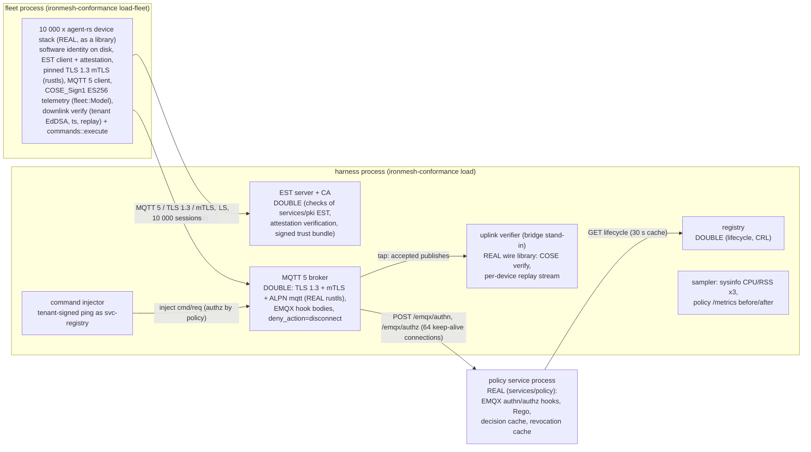

# IronMesh load test report: 10 000 devices on one machine

**Headline.** 10 000 simulated devices enrolled through EST with attestation, connected over
TLS 1.3 + mTLS with pinning, and published COSE_Sign1 telemetry every 10 s for a 10-minute
sustained window. Every CONNECT, PUBLISH and SUBSCRIBE was decided by the real policy service.
Results:

* 10 000 of 10 000 devices connected; 0 never connected; 0 device-side errors.
* 1 000.6 telemetry messages/s accepted during the sustained window (600 534 messages in
  600 s; the offered rate was 1 000/s).
* Device-side publish -> PUBACK latency in the sustained window: p50 **0.7 ms**, p95 7.2 ms,
  p99 128.6 ms, max 782 ms (n = 600 534).
* 500 of 500 downlink commands were acked with a verified CommandAck. Round trip p50 2.0 ms,
  p99 30.3 ms.
* Each of the 10 000 devices' last acknowledged `seq` matched the last `seq` the cloud-side
  verifier accepted. Replay rejections: 0. Uplinks verified: 672 424.
* Peak combined RSS was 1.27 GiB (fleet 687 MiB, broker/EST/verifier harness 506 MiB, policy
  service 117 MiB).

All 10 000 devices completed the run, so this machine's ceiling was not reached. These results
cover the device stack, TLS/mTLS, COSE and the policy service. They do not cover EMQX, Kafka or the
bridge (see [Not measured here](#not-measured-here)).

Raw data for every run is in `results/<run>/{summary.json,timeseries.csv,report.md}`. How to run the
test is in [`README.md`](README.md). The test itself is `conformance/src/load/` (`ironmesh-conformance load`).

## Runs

| Run | Devices | Sustain | Outcome | Purpose |
|---|---|---|---|---|
| [`20261109-211048-smoke-1000`](results/20261109-211048-smoke-1000/report.md) | 1 000 | 120 s | PASS | first smoke, used for tuning |
| [`20261109-212130-full-10000`](results/20261109-212130-full-10000/report.md) | 10 000 | 600 s | **PASS** | the full run |
| [`20261109-213653-smoke-1000`](results/20261109-213653-smoke-1000/report.md) | 1 000 | 120 s | PASS | smoke with the same binary as the full run |
| [`20261109-214027-ramp-fleet-threads-64`](results/20261109-214027-ramp-fleet-threads-64/report.md) | 10 000 | (60 s) | aborted by the memory guard at 5 000 connected | ramp bottleneck experiment, see [Bottlenecks](#bottlenecks-observed) |

## Environment

| | |
|---|---|
| CPU | 12th Gen Intel Core i7-12700H, 14 cores / 20 logical CPUs |
| RAM | 16 088 MiB; 3 542 MiB available when the full run started (the machine was also running browsers, IDE tooling and other build jobs) |
| OS | Windows 11 Home (10.0.26200) |
| Rust | rustc 1.99.1 (58cf8f9c3 2026-10-13), release build |
| Go | go1.27.3 windows/amd64 (policy service built with `go build ./services/policy/cmd/policy`) |
| Git | full run and first smoke at `d99b00c`, second smoke at `23b7dfd`, both with uncommitted changes (see below) |
| TCP ephemeral ports | 1024-65535 (64 511 ports), `TcpTimedWaitDelay` 30 s |

Build provenance: the full run, the second smoke and the experiment used one release binary.
It was copied aside before the full run so that concurrent edits to the tree could not change it
mid-run. It was built from the working tree on top of `d99b00c`. That tree contained this
load-test code (uncommitted at the time) and in-progress, uncommitted changes to
`device/agent-rs` from parallel work (`src/atrest.rs` and the OTA slot store). The
code paths this test exercises (enrollment, TLS, MQTT, COSE envelopes, commands) were not part of
those changes. Re-run on a clean commit to get a fully pinned result.

### Exact commands

```sh
cd conformance
cargo build --release
./target/release/ironmesh-conformance load --devices 1000 --sustain-s 120 --label smoke-1000
./target/release/ironmesh-conformance load --devices 10000 --label full-10000
./target/release/ironmesh-conformance load --devices 10000 --sustain-s 60 --fleet-threads 64 --label ramp-fleet-threads-64
```

Defaults used: start rate 200 devices/s in stages of 25/50/75/100 % with 15 s holds, telemetry
every 10 s, 5 % of devices receive one `ping` command, 64 broker -> policy hook connections,
30 s publish timeout, contract reconnect backoff (scale 1.0), sampling every 5 s, abort if the
combined RSS exceeds 70 % of RAM (11 262 MiB) or host available memory drops below 768 MiB.

## Topology: what was real and what was a double



| Path element | Real or double |
|---|---|
| Device identity, EST enrollment, attestation, CSR, key rotation into the operational slot | **real** (agent-rs library code; keys on disk, encrypted at rest, one directory per device) |
| TLS 1.3, mTLS, SPKI pinning, ALPN | **real** on both sides (rustls in the device stack and in the broker double) |
| COSE_Sign1 signing (ES256 uplink, EdDSA downlink), CBOR envelopes, replay checks | **real** (agent-rs wire library on device and verifier side) |
| Authentication and authorization of every CONNECT, PUBLISH and SUBSCRIBE (including the `svc-registry` command publishes) | **real** policy service binary |
| MQTT broker | double (in-process; mirrors the EMQX configuration of `services/policy/deploy/emqx/emqx.conf`) |
| EST / CA, registry | doubles |

## Results

| Metric | 1 000 devices (second smoke) | 10 000 devices (full run) |
|---|---|---|
| Enrolled / connected / never connected | 1 000 / 1 000 / 0 | 10 000 / 10 000 / 0 |
| Device-side errors (all classes) | 0 | 0 |
| Broker: TLS handshake failures, CONNECT refused, PUBLISH denied, SUBSCRIBE denied | 0, 0, 0, 0 | 0, 0, 0, 0 |
| Broker -> policy hook transport errors | 0 | 0 |
| EST attempts | 1 000 x HTTP 200 | 10 000 x HTTP 200 |
| Ramp (incl. 3 x 15 s holds) | 55 s | 135 s |
| Achieved first-connect rate (target 200/s, holds excluded) | 198.8/s | **115.5/s** |
| Sustained window | 120 s | 600 s |
| Telemetry accepted by the broker, sustained | 12 026 (100.0/s) | 600 534 (**1 000.6/s**) |
| Telemetry accepted, whole run = PUBACKs received by devices | 15 015 = 15 015 | 671 924 = 671 924 |
| Commands sent / acked (verified) / unacked | 50 / 50 / 0 | 500 / 500 / 0 |
| Uplinks verified / replay rejections | 15 065 / 0 | 672 424 / 0 |
| Devices whose last PUBACKed `seq` = last verified `seq` | 1 000 / 1 000 | 10 000 / 10 000 |

### Latency (ms, exact nearest-rank percentiles over every sample)

| Path | Run | n | p50 | p95 | p99 | max |
|---|---|---|---|---|---|---|
| Telemetry publish -> PUBACK, sustained (device side) | 10 000 | 600 534 | 0.7 | 7.2 | 128.6 | 781.8 |
| | 1 000 (2nd) | 12 028 | 0.8 | 7.9 | 945.9 | 2 581.5 |
| | 1 000 (1st) | 12 027 | 0.6 | 1.3 | 1.7 | 4.7 |
| Telemetry publish -> PUBACK, during the ramp | 10 000 | 71 161 | 192.1 | 1 671.1 | 2 477.0 | 7 448.1 |
| Connect: TCP + TLS 1.3 mTLS + CONNACK | 10 000 | 10 000 | 1 202.1 | 3 374.0 | 4 885.1 | 8 776.2 |
| | 1 000 (2nd) | 1 000 | 13.3 | 220.0 | 334.2 | 387.5 |
| EST enrollment with attestation (nonce, keygen, CSR, attestation, simpleenroll, cacerts) | 10 000 | 10 000 | 3 511.1 | 8 586.7 | 10 747.7 | 15 222.9 |
| | 1 000 (2nd) | 1 000 | 42.4 | 76.0 | 90.1 | 124.6 |
| Command round trip (inject -> verified CommandAck at the broker) | 10 000 | 500 | 2.0 | 7.7 | 30.3 | 680.1 |
| Policy authn hook round trip (broker side) | 10 000 | 10 000 | 84.9 | 967.3 | 1 452.5 | 2 165.5 |
| Policy authz hook round trip (broker side) | 10 000 | 682 424 | 0.5 | 75.5 | 569.4 | 2 184.4 |
| ... of which waiting for a free hook connection | 10 000 | 692 924 | 0.0 | 45.3 | 555.2 | 2 060.8 |

The policy service exports decision counters but no authn/authz latency histogram. Hook latency is
therefore the HTTP round trip measured in the broker, which is what EMQX would see.

### Policy service (`/metrics` delta, full run)

| Counter | Delta |
|---|---|
| `ironmesh_authn_decisions_total{result="allow"}` | 10 000 (deny 0) |
| `ironmesh_authz_decisions_total{result="allow"}` | 682 924 (deny 0) |
| `ironmesh_authz_cache_total` hit / miss | 254 555 / 428 369 (37.3 % hit rate) |
| `ironmesh_registry_lookups_total` | 10 000 |
| `process_cpu_seconds_total` | 363.6 s over the ~12.5 min run (computed: about 0.52 ms CPU per decision) |

### Resources (sysinfo every 5 s; CPU in % of one logical CPU, the machine has 20)

| Process | Sustained CPU mean / max | Whole-run CPU max | Sustained RSS mean / max (MiB) |
|---|---|---|---|
| fleet (10 000 device stacks) | 58 / 83 % | 522 % | 637 / 687 |
| harness (broker + EST + registry doubles, verifier) | 67 / 97 % | 183 % | 471 / 506 |
| policy service | 46 / 84 % | 110 % | 76 / 117 |

Memory per device at the end of the sustained window, computed from the measured working sets:
53 KiB per device in the fleet process and 48 KiB per broker session in the harness. Windows
reports the working set as RSS, and the OS trims it under memory pressure. That is why the fleet
dropped from 656 to 520 MiB at t ≈ 630 s while all 10 000 sessions stayed up.

RSS (MiB), full run: fleet | harness | policy (each bar full scale = 700 MiB)

```text
   t(s) phase    fleet                           harness                         policy
     5  ramp    ####..........................   82 ####..........................   85 ###...........................   61
    30  ramp    #########.....................  216 #######.......................  172 ###...........................   78
    55  ramp    ###############...............  354 ###########...................  257 ##............................   52
    80  ramp    #####################.........  481 ##############................  332 ####..........................  102
   105  ramp    #########################.....  579 #################.............  398 ###...........................   62
   130  ramp    ############################..  648 ###################...........  444 ####..........................   96
   155  sustain ############################..  652 ###################...........  455 ####..........................   94
   205  sustain ############################..  653 ###################...........  441 ###...........................   74
   255  sustain ############################..  653 ###################...........  442 ###...........................   70
   305  sustain ############################..  654 ###################...........  443 ###...........................   76
   355  sustain ############################..  664 ####################..........  457 ####..........................   90
   410  sustain #############################.  680 #####################.........  481 ###...........................   68
   460  sustain #############################.  686 #####################.........  498 ####..........................   89
   510  sustain #############################.  687 ######################........  503 ###...........................   74
   560  sustain ############################..  656 ######################........  505 ###...........................   71
   610  sustain ############################..  656 ######################........  506 ###...........................   66
   660  sustain ######################........  520 ####################..........  466 ###...........................   70
   710  sustain ######################........  521 ####################..........  467 ###...........................   69
```

CPU (% of one logical CPU), full run: fleet | harness | policy (full scale = 550 %)

```text
   t(s) phase    fleet                           harness                         policy
     5  ramp    ####################..........  372 ########......................  138 #.............................   24
    30  ramp    ############..................  216 ####..........................   80 #.............................   22
    55  ramp    ###...........................   54 ###...........................   50 ##............................   37
    80  ramp    ######################........  402 #######.......................  130 #####.........................   88
   105  ramp    ####################..........  362 #######.......................  124 ####..........................   80
   130  ramp    ############################..  522 #########.....................  159 ####..........................   71
   155  sustain ####..........................   70 #####.........................   86 ##............................   42
   205  sustain ##............................   44 ###...........................   62 ###...........................   48
   255  sustain ####..........................   67 ####..........................   79 ##............................   45
   305  sustain ###...........................   50 ###...........................   56 ##............................   38
   355  sustain ###...........................   56 ####..........................   66 ##............................   42
   410  sustain ####..........................   69 ####..........................   81 ##............................   41
   460  sustain ###...........................   52 ###...........................   63 ###...........................   61
   510  sustain ###...........................   54 ###...........................   61 ##............................   45
   560  sustain ##............................   45 ###...........................   61 ##............................   37
   610  sustain ##............................   45 ###...........................   57 ##............................   28
   660  sustain ##............................   45 ####..........................   65 ##............................   37
   710  sustain ###...........................   56 ####..........................   73 ##............................   44
```

Connected devices, throughput and tail latency, full run (every 25 s; all 150 samples are in `timeseries.csv`):

| t (s) | phase | connected | telemetry/s | pub p99 (ms) | authz p99 (ms) | host available (MiB) |
|---|---|---|---|---|---|---|
| 5 | ramp | 269 | 8 | 1593.2 | 1748.6 | 3963 |
| 30 | ramp | 2549 | 192 | 1152.5 | 1029.1 | 3948 |
| 55 | ramp | 5000 | 493 | 326.5 | 23.2 | 3171 |
| 80 | ramp | 6905 | 635 | 1313.4 | 209.3 | 1675 |
| 105 | ramp | 8555 | 795 | 978.0 | 242.9 | 2805 |
| 130 | ramp | 9655 | 947 | 710.3 | 106.7 | 2925 |
| 155 | sustain | 10000 | 996 | 34.2 | 29.4 | 1502 |
| 205 | sustain | 10000 | 968 | 2.3 | 2.0 | 4400 |
| 255 | sustain | 10000 | 972 | 21.6 | 21.3 | 3290 |
| 305 | sustain | 10000 | 971 | 3.7 | 3.2 | 3682 |
| 355 | sustain | 10000 | 972 | 13.2 | 11.4 | 2926 |
| 410 | sustain | 10000 | 1028 | 11.1 | 8.9 | 2430 |
| 460 | sustain | 10000 | 1025 | 28.2 | 22.7 | 2624 |
| 510 | sustain | 10000 | 1030 | 5.5 | 4.3 | 2842 |
| 535 | sustain | 10000 | 973 | 643.4 | 635.5 | 2416 |
| 560 | sustain | 10000 | 1033 | 1.9 | 1.6 | 2609 |
| 610 | sustain | 10000 | 1026 | 3.1 | 2.6 | 3115 |
| 660 | sustain | 10000 | 1033 | 2.4 | 1.9 | 2769 |
| 710 | sustain | 10000 | 1032 | 5.7 | 5.1 | 2649 |

## Bottlenecks observed

1. **Ramp: the fleet process limited it, not the cloud side.** With 10 000 devices the achieved
   first-connect rate was 115.5/s against a 200/s target. The 1 000-device smoke reached
   198.8/s. During the stage bursts, EST enrollment p50 rose from 42 ms (1 000 devices) to 3.5 s,
   and publish -> PUBACK p50 for devices that were already connected rose to 100-1 000 ms. That is
   a purely in-memory path for those devices. CPU was not saturated: the fleet process peaked at
   522 % of the 2 000 % available, the harness at 183 % and the policy service at 110 %. The
   per-device enrollment persists keys, certificates and the bundle with `write_atomic`
   (`fsync`) on the async worker threads. 10 000 simulated devices share one disk, and Windows
   Defender scans every new file. Experiment: with `--fleet-threads 64` the first 2 500-device stage
   started on schedule at 200/s (all connected by t = 15 s, against t = 25 s with the default 20
   workers), and fleet CPU rose to 735 %. Both observations fit worker threads blocked in synchronous
   I/O. That run was aborted at 5 000 devices by the available-memory guard (an external process on
   the machine; our processes held 656 MiB), so the later stages were not measured. This is a
   simulator artifact: a real device has its own flash. Moving the blocking persistence to
   `spawn_blocking` in the fleet would remove it.
2. **Authn under connection bursts.** The authn hook p50 was 85 ms and p99 1.45 s at 10 000
   devices, compared with 5 ms / 325 ms at 1 000. The burst puts all 64 hook connections in
   use at once. The policy service also does one registry lookup per new device
   (`ironmesh_registry_lookups_total` + 10 000; its registry client uses Go's default transport,
   which keeps only 2 idle connections per host). Connect latency (p50 1.2 s) is mostly authn plus
   ramp contention. The policy service has no latency histogram and was not profiled, so the split
   inside it is not measured.
3. **Sustained tail latency comes from the authz hook.** In the sustained window, publish p99 per
   5 s interval stayed under 30 ms most of the time. 18 of 120 intervals exceeded 50 ms (worst
   643 ms). In 16 of those 18 intervals the authz hook p99 matched the publish p99 within a few ms. Most of the authz tail
   was spent waiting for one of the 64 pooled connections (wait p99 555 ms of the authz p99
   569 ms). So the policy service had 64 requests outstanding for short periods, while its average
   CPU was 0.46 cores. The spikes were more frequent when host available memory was below
   2.5 GiB because of other processes on the same machine (median per-interval p99 13.8 ms vs 4.7 ms
   above 2.5 GiB). In the second 1 000-device smoke, a drop of host memory to 884 MiB caused the
   2.6 s maximum: authz p50 jumped to 217 ms while our three processes used under 0.5 cores
   together. The first smoke, on a quieter host, had a p99 of 1.7 ms. The cause inside the policy
   service (Go GC, paging, Rego evaluation of cache misses) was not isolated.
4. **The authz decision cache rarely helps telemetry at a 10 s interval.** `POLICY_AUTHZ_CACHE_TTL`
   is 10 s, the same as the telemetry interval. As a result, 62.7 % of decisions were cache misses
   that ran the Rego query. EMQX's own authorization cache was not modelled by the broker double
   (it calls the hook for every PUBLISH), so these hook-call numbers are a worst case.
5. **Things that did not limit this run.** Ephemeral ports: 10 000 long-lived sessions,
   about 30 000 EST connections and pooled hook connections fit in the 64 511-port range. Without
   the keep-alive hook pool, about 1 000 new hook connections per second would have exhausted it
   in TIME_WAIT. Broker per-connection tasks: two tokio tasks per session, 48 KiB per session.
   Memory: the 1.27 GiB peak was far below the 11.3 GiB cap.

**Highest stable count on this machine:** 10 000, the largest count tested. It sustained the full
offered load (1 000.6/s accepted for 1 000/s offered) with zero errors and complete
verification. The run was not limited by a resource. The tightest constraint was host available
memory, shared with other workloads (lowest 1 147 MiB during the full run, above the 768 MiB
abort floor). Measured memory scales at about 100 KiB per device across fleet and harness plus
about 0.1 GiB fixed. Extrapolated from that, not measured: about 20 000 devices fit in the
roughly 3.5 GiB that was available here.

## Not measured here

These components need the docker-compose stack and are covered by the nightly CI job
`load-smoke` ("load smoke (1000 devices, 5 min)") in
[`.github/workflows/nightly.yml`](../.github/workflows/nightly.yml). That job brings up the stack
with `scripts/demo/quickstart.sh`, enrolls 1 000 `ironmesh-fleet` devices, holds the load for 5
minutes, and asserts no container restarts and zero `ironmesh_bridge_forward_errors_total`.

* **EMQX broker throughput, its connection handling and its authorization cache.** The broker
  here is an in-process double. Its per-message cost and memory say nothing about EMQX.
* **Kafka and the bridge.** No uplink leaves the harness. The verifier only stands in for the
  bridge's signature and replay checks.
* **Registry ingest and the real PKI/EST service** (Postgres, KMS). Doubles are used here. The real PKI
  is exercised by the conformance suite's `--pki-bin` interop run, not under load.
* **Network effects.** Everything ran on loopback, with no RTT, packet loss or NAT. Absolute latencies
  are lower than over a real network.
* **Certificate renewal, revocation and OTA under load.** Operational certificates live 14 days,
  so no renewal happened. Revocation and OTA are not part of this load profile.
* **Policy service internals.** It has no hook latency histogram, and there was no pprof run, so
  where its time goes during bursts is not verified.

## Reproducing and limits of this report

* Each run's `summary.json` holds the exact configuration, environment, every counter and the
  policy `/metrics` deltas. The raw before/after `/metrics`, `policy.log` and `fleet.log` are in
  `conformance/target/load/<run>/` (not committed).
* The host was a shared development laptop running other work at the same time (browsers, other
  build jobs). Host memory varied between 0.6 and 4.5 GiB available during the runs. Tail latencies
  (p99/max) are sensitive to this, as the two 1 000-device smokes show (p99 1.7 ms vs 946 ms with
  identical medians). Medians, throughput, counts and verification results were stable across
  runs.
* The experiment run (`ramp-fleet-threads-64`) is kept as evidence that the abort guard works.
  Its results are partial by design.
